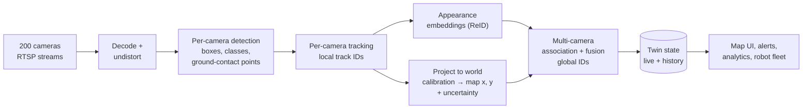
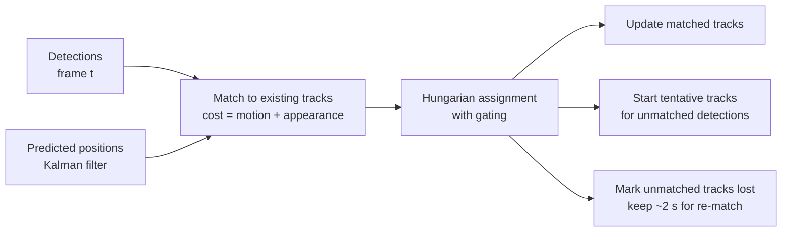
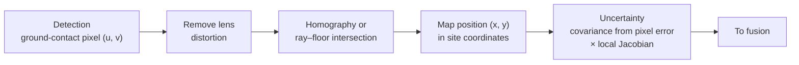
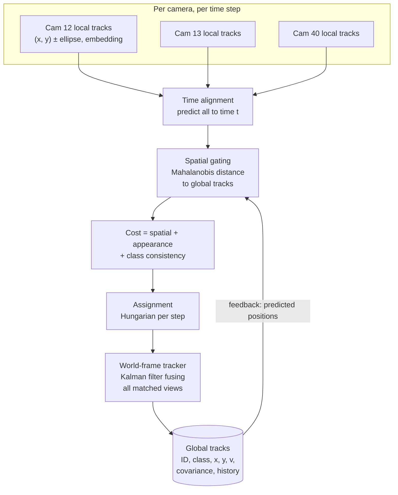
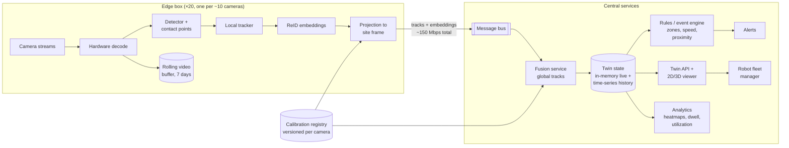

# Digital Twin from Multi-Camera Data

> **Problem:** Build a live digital twin of a large indoor site, for example a warehouse or factory floor, from its fixed security and operations cameras. The twin shows where every person, forklift, mobile robot and pallet is **right now** on a single site map, keeps a history, and drives monitoring and automation: safety alerts, congestion and utilization analytics, and input to robot fleet planning.

The core problems are geometric as much as ML: detect and track objects in each camera, **calibrate** the cameras so pixels map to the world, **project** everything onto one map, and **associate** observations of the same object across cameras into a single global track. Start in 2D (a floor-plan map), then extend to a 3D world.

---

## Table of Contents

1. [Clarifying Requirements](#1-clarifying-requirements)
2. [Framing as an ML Problem](#2-framing-as-an-ml-problem)
3. [Data Preparation](#3-data-preparation)
4. [Model Development](#4-model-development)
   - [Per-camera detection](#41-per-camera-detection)
   - [Single-camera tracking](#42-single-camera-tracking)
   - [Camera calibration: simple to complex](#43-camera-calibration-simple-to-complex)
   - [Projecting to a single 2D map](#44-projecting-to-a-single-2d-map)
   - [Multi-camera association and fusion](#45-multi-camera-association-and-fusion)
   - [From 2D map to 3D digital world](#46-from-2d-map-to-3d-digital-world)
5. [Evaluation](#5-evaluation)
6. [Serving and System Architecture](#6-serving-and-system-architecture)
7. [Monitoring and Iteration](#7-monitoring-and-iteration)
8. [Interview Talking Points](#8-interview-talking-points)

---

## 1. Clarifying Requirements

| Question | Assumed answer |
|----------|----------------|
| Site? | One indoor warehouse, ~50,000 m², mostly flat floor, plus a mezzanine and two loading ramps |
| Cameras? | ~200 fixed cameras, 1080p at 15 fps; mixed lenses (standard and fisheye); many fields of view overlap, some areas covered by one camera only |
| Objects? | People, forklifts, autonomous mobile robots (AMRs), pallets, carts |
| Outputs? | Live positions and IDs on the site map; trajectories; events (zone entry, speeding, person–forklift proximity); history for analytics |
| Accuracy? | Position error **< 0.5 m** (2D, p90); stable IDs across cameras for the whole time an object is on site |
| Latency? | Camera frame → twin update **< 500 ms** for safety alerts; analytics can be minutes behind |
| Automation? | The twin's state feeds the robot fleet manager (where people and forklifts are) and triggers alerts; it does **not** directly control safety-rated stopping, which stays with certified on-vehicle sensors |
| Privacy? | Track people **anonymously**: no face recognition, no identity; raw video stays on site; faces blurred in any stored clips |

### Back-of-the-envelope

```
Frames to process      = 200 cameras × 15 fps                     = 3,000 frames/s
Raw video bandwidth    ≈ 200 × ~4 Mbps (H.264 1080p)              ≈ 800 Mbps → keep video at the edge
Detections upstream    ≈ 3,000 frames/s × ~20 objects × ~320 B    ≈ 19 MB/s ≈ 150 Mbps (boxes + appearance vectors)
GPU need               ≈ 3,000 frames/s ÷ ~300 frames/s per edge GPU (640 px input, batched) ≈ 10 GPUs
                         → ~20 edge boxes of 10 cameras each, with headroom
```

**How accurate can a camera be on the floor?** A camera mounted 6 m high, looking at a point 20 m away, 90° horizontal field of view:

```
Sideways footprint of one pixel ≈ (2 × 20 m × tan 45°) / 1,920 px ≈ 2 cm
Viewing angle down to the floor = atan(6 / 20) ≈ 16.7°
Footprint along the viewing direction ≈ 2 cm / sin 16.7° ≈ 7 cm per pixel
Foot-point error of ~5 px          → ~35 cm of position error, mostly along the line of sight
```

So a single camera's position estimate gets worse with distance and is **elongated along its viewing direction**. Fusing cameras that look from different angles shrinks it, which is why the fusion step carries uncertainty explicitly.

---

## 2. Framing as an ML Problem

### Pipeline



### ML vs geometry

| Component | Type |
|-----------|------|
| Object detection | ML: supervised detector |
| Appearance embedding (re-identification) | ML: metric learning |
| Single-camera tracking | Mostly classical: motion model + assignment, with learned appearance cues |
| Calibration and projection | **Geometry**: no learning needed, but accuracy limits everything downstream |
| Multi-camera association | Geometry + ML: spatial gating plus appearance similarity, solved as an assignment problem |
| 3D reconstruction | Geometry (structure from motion) and neural methods |

### Two architectural options for multi-camera

| Option | How | Pros | Cons |
|--------|-----|------|------|
| **Late fusion** ✅ (tracking-by-detection per camera, fuse in world coordinates) | Detect and track in each camera, project tracks to the map, merge | Modular; works with any camera layout and non-overlapping views; easy to debug per camera; edge-friendly | Errors from each camera compound; occlusions handled per view |
| **Early fusion** (multi-view detection) | Project image features from all overlapping cameras onto a shared ground-plane grid and detect there directly | Handles heavy occlusion well; one consistent detection per object | Needs dense overlap, fixed camera layout, labelled multi-view data; retrain when cameras change |

Start with **late fusion**. Add early fusion for crowded zones with heavy overlap (packing stations, docks) if occlusion is the main error source.

---

## 3. Data Preparation

### Detection and tracking data

| Data | Notes |
|------|-------|
| **Frames from the site's own cameras** | High, oblique and fisheye views look nothing like typical public datasets. Sample across cameras, shifts, lighting (night, skylights, dock doors open). |
| **Labels** | Boxes for people, forklifts, AMRs, pallets, carts; a **ground-contact point** per object (feet for people, the floor footprint for vehicles); orientation for vehicles; occlusion flags |
| **Track labels** | Short clips with consistent IDs within a camera, for tracking evaluation |
| **Cross-camera ID labels** | The same object across cameras. Expensive by hand; use geometry to propose matches in overlapping views and have annotators confirm. |
| **Synthetic data** | Once a 3D model of the site exists (section 4.6), render it with simulated people and vehicles from each real camera's viewpoint for rare cases (falls, near-misses) |
| **Active learning** | Mine frames where detectors disagree across overlapping cameras, or where tracks break, and send them for labelling |

### Calibration data

| Data | Used for |
|------|----------|
| **Floor plan or CAD drawing** of the site | The map coordinate system; landmark coordinates (column corners, lane markings, dock doors) |
| **Surveyed points** | A handful of floor points measured with a laser distance tool or total station, for accuracy |
| **Checkerboard or fiducial-marker images** | Lens intrinsics and distortion per camera model |
| **Fiducial markers** (printed square markers with known size and ID) on the floor | Extrinsics, and multi-camera joint calibration |
| **Time sync** | All cameras on a common clock (PTP or NTP) so frames from different cameras can be compared at the same moment |

### Privacy

Strip identity from training data: blur faces in stored frames, keep annotation crops below the face where possible, and set retention limits. Appearance embeddings are trained for **short-term** matching (clothing, vehicle shape) and stored with time limits, not as a long-term identity database.

---

## 4. Model Development

### 4.1 Per-camera detection

- **Model:** a single-stage detector, fine-tuned on site frames, exported to an optimized edge runtime. One model for all cameras, with **per-camera confidence thresholds** tuned on validation data, since some views are much harder than others.
- **Extra outputs that matter for the twin:**
  - **Ground-contact point:** the bottom-center of a person's box is a poor foot estimate when legs are occluded. Predict the contact point directly as a keypoint, or predict body keypoints (ankles) and use them.
  - **Orientation and footprint** for forklifts and AMRs (an oriented box or four floor-corner keypoints). Forklift forks extend the danger area; the footprint matters for proximity alerts.
  - **Attributes** used later: vehicle type, carrying a load, person wearing high-visibility vest (for zone rules).
- **Fisheye cameras:** either undistort first (wastes pixels at the edges) or train on raw fisheye frames with rotated boxes, since people appear tilted toward the image center.

### 4.2 Single-camera tracking

Tracking-by-detection: link detections frame to frame into **local tracks** per camera.



| Choice | Detail |
|--------|--------|
| Motion model | Kalman filter with constant velocity in image space, or better, **in world coordinates** after projection (motion is more regular there) |
| Association cost | IoU or distance to the predicted position, plus cosine distance between appearance embeddings |
| Low-confidence detections | Use them in a second matching pass to keep tracks alive through partial occlusion, instead of discarding them |
| Track lifecycle | Confirm after N hits; keep lost tracks for a short window; delete after that |

Typical failures: **ID switches** when two people cross, and **fragmentation** when someone is hidden behind a rack. Cross-camera fusion repairs many of these, because another camera often sees the occluded object.

### 4.3 Camera calibration: simple to complex

Calibration answers: **which point on the floor (or in 3D space) does this pixel correspond to?** It splits into **intrinsics** (the lens: focal length, optical center, distortion) and **extrinsics** (where the camera is and where it points).

| Level | Method | What you get | Effort | Accuracy | Use when |
|-------|--------|--------------|--------|----------|----------|
| **0** | **Manual zones per camera** (draw polygons in the image: "dock 3", "aisle 12") | Zone membership only, no coordinates | Minutes per camera | Zone level | Counting and zone alerts; a first version |
| **1** | **Ground-plane homography** from ≥ 4 floor points matched between image and floor plan | Pixel → floor (x, y) for points on the floor | ~15 min per camera | ~0.2–0.5 m if lens distortion is small | Flat floors, standard lenses: the main 2D workhorse |
| **2** | **Full pinhole model**: intrinsics + distortion from a checkerboard; extrinsics from known 3D points (perspective-n-point solve) | Pixel ↔ 3D ray; projection of any 3D point | ~30–60 min per camera; intrinsics once per camera model | ~0.1–0.3 m | Fisheye or wide lenses, ramps and mezzanines, any 3D use |
| **3** | **Joint multi-camera calibration** (bundle adjustment): fiducial markers or shared scene features seen by several cameras; optimize all cameras together, anchored to surveyed points | All cameras consistent in one world frame | A site-wide calibration session | Best: few centimetres to ~0.1 m | Large overlapping networks; precise cross-camera fusion; 3D twin |
| **4** | **Automatic and continuous calibration**: structure from motion on the cameras' own images; using tracked people as moving calibration targets (known height, ground contact); vanishing points from aisle lines | Calibration without manual surveying; detection of drift | Engineering effort up front, then none | Depends on scene texture and traffic | Hundreds of cameras; cameras that get bumped, refocused or replaced |

#### Level 1: homography

For points on a flat floor, an image pixel `(u, v)` and the floor position `(x, y)` are related by a 3×3 matrix `H`:

```
[x, y, 1]ᵀ  ∝  H · [u, v, 1]ᵀ
```

- `H` has 8 degrees of freedom, so 4 point correspondences determine it; use 8–12 spread across the view and solve with least squares plus RANSAC (random sample consensus) to reject bad clicks.
- **Check it:** reproject held-out landmarks and measure the error in metres. Re-pick points if it's above ~0.3 m.
- **Limits:** only valid for points **on that plane**. A person's head, a raised pallet, the mezzanine, or a ramp all map wrongly. Strong lens distortion breaks it unless the image is undistorted first.

#### Level 2: full camera model

```
s · [u, v, 1]ᵀ = K · [R | t] · [X, Y, Z, 1]ᵀ        (after removing lens distortion)

K       intrinsics: focal lengths, optical center
R, t    extrinsics: camera rotation and position in the world
```

- **Intrinsics:** wave a checkerboard in front of the camera (Zhang's method); estimate distortion coefficients, with a fisheye model for wide lenses. Usually done once per camera model and lens setting, in the lab.
- **Extrinsics:** with `K` known, solve perspective-n-point from ≥ 4 known 3D points (surveyed landmarks or floor fiducials).
- **Pixel to floor:** back-project the pixel into a 3D ray and intersect it with the floor plane `Z = 0`, or with the mezzanine plane, or with a ramp's tilted plane. For a flat floor this gives the same result as the homography, with distortion handled properly.

#### Level 3: joint calibration

Calibrating cameras one by one leaves each with its own small error, so two cameras disagree about where the same person is (e.g. 0.4 m apart). Joint calibration fixes this:

1. Place fiducial markers on the floor where camera views overlap.
2. Detect their corners in every camera that sees them.
3. Optimize all cameras' poses (and optionally intrinsics) together to minimize reprojection error across all observations (**bundle adjustment**), anchored by a few surveyed points.

#### Level 4: automatic, continuous calibration

Cameras get bumped, re-aimed or replaced. Detect and fix drift without a site visit:

- Store **reference keypoints** (static features: rack corners, floor markings) per camera at calibration time.
- Periodically match the live image to the reference. If the features shifted by more than a few pixels, flag the camera and re-estimate its pose from the matches.
- Use people as calibration targets: their ground-contact points from overlapping cameras should land at the same map position; persistent disagreement reveals which camera drifted.

### 4.4 Projecting to a single 2D map



1. **Pick the right point:** the ground-contact point, not the box center. Projecting the box center of a 1.7 m person puts them metres behind where they stand.
2. **Undistort** that point with the lens model.
3. **Map it** with the homography (level 1) or ray–floor intersection (level 2+). Use the plane the object is on: the floor, the mezzanine (from the camera's zone mask), or a ramp.
4. **Attach uncertainty:** propagate a few pixels of foot-point error through the mapping. The result is an ellipse, long along the camera's line of sight and growing with distance (see the back-of-the-envelope section).
5. **Occluded feet:** if the bottom of the person is hidden (behind a pallet), estimate the ground point from the head: project the head point, then use a **height prior** (~1.7 m) along the vertical, and widen the uncertainty.
6. **Mask what can't be mapped:** regions above the floor (rack shelves) and areas outside the camera's calibrated floor region.

**Map coordinate system:** one site frame in metres, aligned with the floor plan (origin at a building corner, x along the main aisle). The map is a 2D raster plus vector layers: walls, racks, lanes, zones, docks, charging stations.

### 4.5 Multi-camera association and fusion

Each camera produces local tracks in map coordinates. The fusion service turns them into **one global track per real object**.



**Overlapping views:**

- **Time alignment:** cameras capture at slightly different moments; predict every observation to a common timestamp with its track's velocity. A 66 ms offset at walking speed is ~10 cm; at forklift speed it's ~30 cm.
- **Spatial gating:** a local track can only match a global track whose position is within its uncertainty ellipse (Mahalanobis distance). This cuts candidate pairs from thousands to a few.
- **Appearance:** embeddings from a re-identification (ReID) model, trained with metric learning so the same person or vehicle seen from different cameras is close. Same-class constraint: a person never matches a forklift.
- **Fusion:** a Kalman filter in world coordinates per global track, updated with every camera that sees it, each weighted by its own covariance. Two cameras at 90° to each other combine into a small, round uncertainty.

**Non-overlapping views (gaps between cameras):**

- **Camera topology graph:** which camera an object can appear in next, and the typical travel time (learned from data: exits from camera 12 appear in camera 15 after 4–8 s).
- Match by appearance + plausible travel time + plausible path through the floor plan. Keep the global track "in transit" with growing uncertainty until it reappears.
- Ambiguous cases keep **multiple hypotheses** briefly, or are left unmatched rather than forced; a wrong merge is worse than a short gap for most analytics.

**Track lifecycle:** global tracks are born at **entry zones** (doors, docks) or when a camera sees a confirmed new object; they die after leaving through an exit zone or after a timeout. A person who appears in the middle of the floor with no history is either a missed hand-off or a detection error, a useful health signal.

**Known objects:** AMRs report their own positions to the fleet manager. Fuse those reports as a high-confidence sensor; this also gives free ground truth for evaluating camera tracking.

### 4.6 From 2D map to 3D digital world

The 2D twin answers "where is everything on the floor". A 3D twin adds height (mezzanines, racks, pallet levels), realistic visualization, line-of-sight and clearance checks, and simulation.

| Layer | 2D twin | 3D twin |
|-------|---------|---------|
| Static scene | Floor plan raster + vector layers | 3D model: building information model (BIM) or CAD if available; otherwise reconstructed mesh, point cloud or Gaussian splats |
| Calibration | Homography per camera (level 1) | Full camera models, jointly calibrated (levels 2–3) |
| Object position | (x, y) on the floor | (x, y, z) + orientation; 3D boxes (length, width, height, yaw) |
| Ground surface | One plane | Multiple planes or a height map / mesh: ramps, mezzanines, stairs |
| People | A point | Optionally a 3D skeleton (pose) |
| Uses | Live map, zones, heatmaps, alerts | Clearance and line-of-sight checks, pallet heights on racks, simulation, robot planning, synthetic training data |

**Building the static 3D scene:**

1. **Use existing models** (BIM or CAD) when they're accurate; check them against reality, since racks get moved.
2. **Reconstruct:** structure from motion (SfM) plus multi-view stereo from a walkthrough video or a handheld lidar scan gives a metric point cloud and mesh. Register it to the site frame with surveyed points.
3. **Photorealistic layer (optional):** neural scene representations such as 3D Gaussian splatting give realistic rendering for operators and for synthetic camera views.
4. Keep the static layer **versioned**: when racks or zones move, re-scan that area.

**Dynamic objects in 3D:**

| Approach | How | Notes |
|----------|-----|-------|
| **Ground plane + size priors** (simplest) | Take the 2D map position, place a 3D box using class-typical size and the detected orientation | Good enough for people and standard vehicles on flat floors |
| **Multi-view triangulation** | Detect 2D keypoints (box corners, body joints) in each overlapping camera; intersect the rays to get 3D points | Needs joint calibration and time sync; gives true heights (lifted forks, pallet on a high shelf) |
| **Monocular 3D detection** | A network predicts 3D boxes directly from one image, using known camera intrinsics and the floor plane | Covers single-camera areas; less accurate in depth |
| **Multi-view 3D / occupancy networks** (early fusion) | Lift features from all cameras into a 3D voxel grid or bird's-eye-view grid; predict boxes or occupancy | Best under occlusion; most data and compute; the 3D extension of multi-view detection |

**Ground surface in 3D:** replace the single homography with **ray–surface intersection** against the reconstructed floor mesh: a person on a ramp or the mezzanine lands at the right (x, y, z). The camera's zone mask (or the mesh itself) decides which surface each pixel region belongs to.

**Twin representation:** a scene graph:

```
Site
├── Static layer (versioned): building mesh, racks, zones, docks, lanes
├── Sensors: cameras (K, distortion, R, t, health), AMR position feeds
└── Dynamic entities (live): global ID, class, pose (x, y, z, yaw), 3D box,
    velocity, covariance, attributes (carrying load, vest), state history
```

A 3D engine renders it for operators; the same state feeds rules, analytics and simulation.

---

## 5. Evaluation

### Component metrics

| Component | Metric |
|-----------|--------|
| Detection | mAP per class, **per camera** (averages hide the worst views); recall at the operating threshold |
| Ground-contact point | Pixel error vs labelled contact points |
| Calibration | Reprojection error on held-out landmarks (pixels) **and** floor error (metres) |
| Single-camera tracking | HOTA, IDF1, ID switches, fragmentation |
| ReID embeddings | Rank-1 accuracy and mAP for cross-camera matching |
| Multi-camera tracking | **Global IDF1** across cameras ⭐, ID switches at camera hand-offs, false merges vs missed merges |
| Localization | **Position error in metres** (p50, p90) vs ground truth: AMR self-reported positions, ultra-wideband tags carried by test walkers, surveyed marks |
| 3D | 3D box IoU, height error for forks and pallets |

### System metrics

| Metric | Why |
|--------|-----|
| Coverage | Fraction of the floor seen by ≥ 1 and ≥ 2 cameras; gaps break tracks |
| Event precision and recall | Zone violations and near-misses vs human-reviewed video. False alarms train operators to ignore alerts. |
| Track completeness | Share of an object's time on site covered by one global ID |
| End-to-end latency | Frame captured → twin updated, p99 |

### Online

- Operator-confirmed alert rate, false alarms per shift.
- Agreement between twin-reported positions and AMR positions, continuously.
- For automation: robot route replans triggered by twin data, fewer near-misses, throughput of the zones being optimized.

### Test set

Record **scripted sessions**: walkers carrying ultra-wideband (UWB) or similar tags follow routes through overlaps, gaps, crowds and occlusions; forklifts with known positions. This gives position ground truth that no hand labelling can.

---

## 6. Serving and System Architecture

### Edge + central



- **Edge:** decoding, detection, local tracking, embeddings and projection run close to the cameras, so raw video never crosses the network. Video stays in a rolling buffer for incident review (with faces blurred on export).
- **Central:** fusion needs all cameras, so it runs centrally. Partition it by **floor region** with overlapping borders if one process can't keep up; hand global tracks off between partitions like cameras.
- **Calibration registry:** versioned per camera. Every observation carries the calibration version it was projected with, so a re-calibration doesn't silently mix old and new geometry.

### Latency budget (p99)

| Step | Time |
|------|------|
| Capture + encode + network to edge | ~100 ms |
| Decode + detection + tracking + projection | ~80 ms |
| Edge → central | ~20 ms |
| Fusion (wait for slower cameras, assign, update) | ~100 ms |
| Rules engine → alert | ~20 ms |
| **Total** | **~320 ms**, inside 500 ms |

Fusion has a trade-off: waiting longer for late cameras improves association, but adds latency. Use a short fixed window (~100 ms) and let late observations update tracks after the fact.

### Rules and automation

- **Geofences:** person in a forklift-only aisle, vehicle in a pedestrian walkway.
- **Proximity:** person within the predicted path of a moving forklift in the next 2 s, computed from both tracks' velocities and uncertainties.
- **Speed:** vehicles over the zone limit.
- **Automation:** the fleet manager subscribes to live positions of people and forklifts, and slows or reroutes AMRs around them. The twin is an **advisory** layer; certified on-vehicle safety sensors still handle emergency stops.

### Time sync

All cameras and edge boxes sync to one clock (PTP where supported, NTP otherwise), and every frame is timestamped at capture. Without this, cross-camera fusion places the same moving forklift in two places.

---

## 7. Monitoring and Iteration

| What | Why |
|------|-----|
| **Camera health** | Offline streams, frozen frames, blur, glare, dirty or blocked lenses, tampering |
| **Calibration drift** | Reference keypoints moved, or cross-camera position disagreement rising for one camera |
| Detection confidence and count per camera | Lighting changes, new object types, seasonal clothing |
| Track fragmentation and births in mid-floor | Coverage gaps or hand-off failures |
| Position residuals vs AMR self-reports | Continuous localization accuracy |
| Fusion latency and late-observation rate | Network or edge overload |
| Alert volume and dismissal rate | Rules too sensitive; alert fatigue |

**Failure modes:**

| Failure | Mitigation |
|---------|------------|
| Camera bumped → objects appear in walls | Drift detection; auto re-estimate pose; mark camera degraded until fixed |
| Crowds at docks → merged tracks | Higher camera density; multi-view early fusion in that zone |
| Look-alike people (same uniform) → ID swaps at hand-offs | Rely more on motion and geometry; accept short-term IDs; don't force uncertain merges |
| Layout change (racks moved) → stale map and wrong masks | Versioned static layer; re-scan; re-validate affected cameras |
| Reflective floors, glass → phantom detections | Per-camera masks; mine false positives for retraining |

**Iteration:** active learning on cameras with low agreement; synthetic data from the 3D twin for rare events; move crowded zones to early fusion; add 3D layers zone by zone.

---

## 8. Interview Talking Points

### Key trade-offs

| Trade-off | Discussion |
|-----------|------------|
| Late vs early multi-camera fusion | Late fusion is modular and works with any layout; early fusion handles occlusion but needs dense overlap and retraining when cameras change |
| Calibration level | Homography is fast and good for flat 2D; full and joint calibration is needed for 3D, wide lenses and precise cross-camera fusion |
| Edge vs central | Edge saves bandwidth and keeps video private; fusion must be central (or regional) because it needs all views |
| Fusion latency vs accuracy | Waiting for late cameras improves matching but delays alerts |
| Wrong merge vs missed merge | For safety, a missed merge (two IDs for one person) is less harmful than merging two people; tune thresholds accordingly |
| 2D vs 3D | 2D covers most monitoring; 3D adds heights, clearance and simulation at much higher calibration and compute cost |

### Likely follow-up questions

1. **Why project the foot point and not the box center?** The homography is only valid on the floor plane; the box center is ~1 m above it.
2. **How do you handle a ramp or a mezzanine?** Full camera model and ray intersection with the right surface (plane per region, or a mesh), not a single homography.
3. **How do you know the calibration is still right?** Reference-keypoint drift checks, cross-camera position disagreement, and residuals against AMR positions.
4. **How do you match a person across non-overlapping cameras?** Appearance embeddings plus a camera topology graph with travel-time priors; keep the track in transit with growing uncertainty.
5. **How do you get position ground truth?** Scripted sessions with tagged walkers (UWB), AMR self-reported positions, surveyed marks.
6. **What about privacy?** Anonymous IDs, no face recognition, video kept on site, faces blurred on export, short retention for embeddings.

### Common pitfalls to avoid

- ❌ Projecting box centers instead of ground-contact points
- ❌ One homography for a site with ramps and mezzanines
- ❌ Ignoring time sync between cameras
- ❌ Treating all projected positions as equally accurate (no uncertainty)
- ❌ Calibrating once and never checking for drift
- ❌ Using the twin as the safety-rated stop mechanism for vehicles

---

## References

- [A Flexible New Technique for Camera Calibration, Zhang 2000](https://doi.org/10.1109/34.888718)
- [Random Sample Consensus: A Paradigm for Model Fitting with Applications to Image Analysis and Automated Cartography, Fischler & Bolles 1981](https://doi.org/10.1145/358669.358692)
- [AprilTag 2: Efficient and Robust Fiducial Detection, Wang & Olson 2016](https://doi.org/10.1109/IROS.2016.7759617)
- [Structure-from-Motion Revisited, Schönberger & Frahm 2016](https://doi.org/10.1109/CVPR.2016.445)
- [Simple Online and Realtime Tracking, Bewley et al. 2016](https://arxiv.org/abs/1602.00763)
- [Simple Online and Realtime Tracking with a Deep Association Metric, Wojke et al. 2017](https://arxiv.org/abs/1703.07402)
- [ByteTrack: Multi-Object Tracking by Associating Every Detection Box, Zhang et al. 2021](https://arxiv.org/abs/2110.06864)
- [Performance Measures and a Data Set for Multi-Target, Multi-Camera Tracking, Ristani et al. 2016](https://arxiv.org/abs/1609.01775)
- [HOTA: A Higher Order Metric for Evaluating Multi-Object Tracking, Luiten et al. 2020](https://arxiv.org/abs/2009.07736)
- [Multiview Detection with Feature Perspective Transformation, Hou et al. 2020](https://arxiv.org/abs/2007.07247)
- [3D Gaussian Splatting for Real-Time Radiance Field Rendering, Kerbl et al. 2023](https://arxiv.org/abs/2308.04079)
