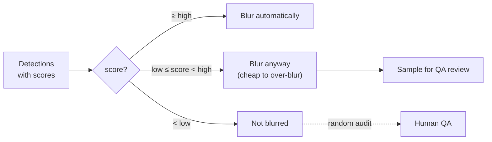
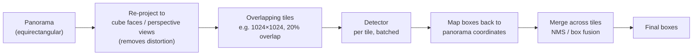
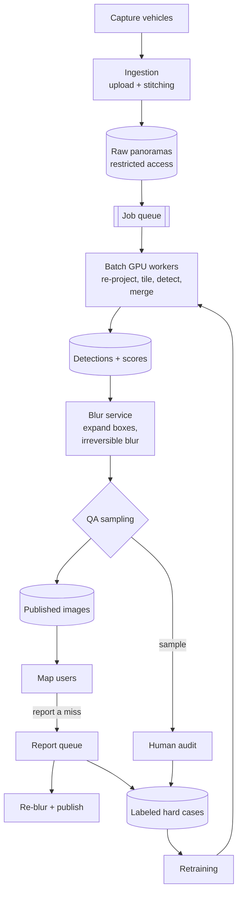

# Face and License Plate Blurring for Street-Level Imagery

> **Problem:** A mapping product captures billions of street-level panoramic images with camera-equipped vehicles. Before any image is published, every **face** and **license plate** must be detected and blurred to protect privacy. Design the ML system.

This is a classic **object detection** design, with one twist: **missing an object is a privacy failure**, so the system is designed around very high recall rather than balanced accuracy.

---

## Table of Contents

1. [Clarifying Requirements](#1-clarifying-requirements)
2. [Framing as an ML Problem](#2-framing-as-an-ml-problem)
3. [Data Preparation](#3-data-preparation)
4. [Model Development](#4-model-development)
5. [Evaluation](#5-evaluation)
6. [Serving and System Architecture](#6-serving-and-system-architecture)
7. [Monitoring and Iteration](#7-monitoring-and-iteration)
8. [Interview Talking Points](#8-interview-talking-points)

---

## 1. Clarifying Requirements

| Question | Assumed answer |
|----------|----------------|
| Objects to blur? | Faces and license plates. (Extensible: house numbers on request, people's whole bodies in sensitive locations.) |
| Image type? | 360° panoramas stitched from several cameras, ~50 megapixels each |
| Volume? | ~10M new panoramas/day; historical backlog of billions |
| Real time? | **No.** Batch processing; images are published days after capture. Throughput and cost matter, not latency. |
| Accuracy priority? | **Recall first.** A missed face is a privacy and legal problem. Over-blurring (a blurred sign) is a minor quality issue. |
| Human review? | Yes, limited capacity. Users can report missed blurs after publishing. |
| Regions? | Worldwide: many plate formats, scripts and sizes |

### What makes it hard

- **Tiny objects:** a face 50 m away is a few pixels in a 50 MP image.
- **Distortion:** panoramas are equirectangular, so objects near the top and bottom are stretched.
- **Variety:** plates differ by country (shapes, colors, scripts); faces appear at every angle, partially hidden, in reflections, on posters and billboards.
- **Scale:** billions of high-resolution images → GPU cost dominates.

---

## 2. Framing as an ML Problem

### Formulation

**Object detection:** given an image, output bounding boxes (or masks) with class ∈ {face, license plate} and a confidence score.

Then a **deterministic blurring step** applies a strong, irreversible blur to every box above a threshold.

### Threshold choice: recall-oriented

Because a false positive (blurring a sign) costs little and a false negative (an unblurred face) costs a lot, the **operating threshold is set low**, for example to reach ≥ 99.5% recall, accepting more false positives.

### Detection vs segmentation

| Option | Pros | Cons |
|--------|------|------|
| **Bounding boxes** ✅ | Cheap labels, fast models, a box blur fully covers the object | Blurs some background |
| Instance segmentation | Tighter, prettier blur | Expensive labels; a mask edge error leaves part of a face visible |

Boxes are the safer choice for privacy: slightly expand them before blurring.

---

## 3. Data Preparation

### Labels

- **Annotation:** humans draw boxes around every face and plate, including tiny, partly hidden and reflected ones. Clear guidelines: what counts (posters? statues? faces on screens?), minimum size, how to box partly visible plates.
- **Quality control:** double annotation on a subset; measure agreement; adjudicate disagreements. **Missed labels** are the main annotation error, and they directly teach the model to miss objects.
- **Geographic coverage:** sample images from every country and city type, so all plate formats and conditions are represented.

### Data balancing and hard cases

| Hard case | How to get more |
|-----------|-----------------|
| Tiny, distant faces | Oversample crowded scenes; label at full resolution |
| Rare plate formats | Sample by country; synthetic plates (rendered text on plate templates) |
| Night, rain, glare, motion blur | Sample by capture metadata (time, weather) |
| Reflections, posters, screens | Mine from model false negatives reported by users |
| Distorted regions (top and bottom of the panorama) | Train on the projection used in production, or re-project (see 4.2) |

### Active learning loop

Prioritize labeling budget on images where the model is **uncertain** (scores near threshold), on **user-reported misses**, and on regions or conditions where audits found misses.

### Augmentation

Scale jitter (critical for small objects), crops, brightness and contrast, blur, noise, JPEG artifacts, horizontal flips (careful: flipped plate text is unrealistic, but fine for detection).

---

## 4. Model Development

### 4.1 Detector choice

| Family | Examples | Pros | Cons |
|--------|----------|------|------|
| **Two-stage** | Faster R-CNN + FPN | Very accurate, strong on small objects | Slower |
| **One-stage** | RetinaNet, YOLO family | Fast, simpler | Historically weaker on tiny objects (FPN and focal loss fixed much of this) |
| **Transformer-based** | DETR variants | No anchors or NMS, strong global context | Training cost; small-object performance varies |

**Recommendation:** a one-stage detector with a **feature pyramid network (FPN)** and **focal loss**, trained on high-resolution tiles. Batch processing means throughput matters more than latency, and recall on small objects is the deciding metric. Benchmark a two-stage model as a recall reference.

- **FPN:** detects at several scales from feature maps at different resolutions. Essential for tiny faces.
- **Focal loss:** down-weights easy background examples so the many easy negatives don't swamp training.

### 4.2 Handling high-resolution panoramas

A 50 MP image can't be fed in at full resolution, and downscaling loses tiny faces.

- **Re-projection:** converting to perspective views removes the stretching near the top and bottom, so objects look like they do in normal training images.
- **Overlapping tiles:** objects cut by a tile edge are still fully visible in a neighbouring tile.
- **Merge:** non-maximum suppression (NMS) or weighted box fusion removes duplicates across tiles.
- **Multi-scale inference:** run once at full resolution for tiny objects and once downscaled for very large ones (a face right next to the car).

### 4.3 Recall boosters

- **Test-time augmentation:** flipped and rescaled passes, results combined. Costs more compute; worth it for privacy.
- **Ensemble:** two different detectors; blur the **union** of their detections.
- **Temporal / multi-view consistency:** the same face appears in consecutive panoramas captured meters apart. A detection in one frame can be projected into neighbouring frames to recover misses.
- **Person detector as a backup:** if a person is detected but no face box exists inside it at a plausible position, blur the head region anyway.

### 4.4 Training details

- Loss: focal loss (classification) + smooth L1 or GIoU (box regression).
- **Anchor sizes / assignment** tuned for tiny objects.
- Train at high resolution on tiles; validate on full panoramas through the real tiling pipeline.
- Per-region fine-tuning or a region-conditioned head if plate formats differ strongly.

---

## 5. Evaluation

### Offline

| Metric | Why |
|--------|-----|
| **Recall at the operating threshold** ⭐ | The privacy metric. Report it per class, per object-size bucket, per country, per condition (night, rain). |
| **Recall at a low IoU threshold** (e.g. 0.3) | For blurring, a box that roughly covers a face is fine. Standard mAP@0.5 penalizes loosely placed boxes that still protect privacy. |
| **Coverage** | Fraction of each ground-truth box's area covered by the blurred area. Partial coverage can leave a face identifiable. |
| Precision / false positives per image | Image quality cost of over-blurring |
| mAP | Overall detector quality, useful for comparing models |

> **The question that matters:** "What fraction of real faces and plates leave the pipeline unblurred?" Measure recall on a **separately labeled, exhaustive test set**, and break it down by object size; most misses are tiny objects.

### Online / production

| Metric | Definition |
|--------|------------|
| **Audit miss rate** ⭐ | Humans exhaustively check a random sample of published panoramas for unblurred faces and plates |
| User reports of missed blurs | Per million images published; time to fix |
| Over-blur complaints | Signs and storefronts blurred incorrectly |
| Throughput and cost | Panoramas per GPU-hour, backlog size |

---

## 6. Serving and System Architecture

**Key serving points:**
- **Raw images are access-controlled:** unblurred originals are stored encrypted with strict access and a retention policy. Only blurred versions are published.
- **Irreversible blur:** strong Gaussian blur or pixelation with expanded boxes. A light blur can sometimes be reversed or recognized.
- **Batch throughput:** GPU workers process tiles in large batches, with mixed precision and an optimized inference runtime. Autoscale workers based on the queue.
- **Reprocessing:** when a better model ships, re-run it on the published backlog (prioritized by views) and blur any **new** detections. Never "unblur" previously blurred regions automatically.
- **Idempotent jobs:** each panorama job is keyed by image ID and model version, so retries don't duplicate work.

---

## 7. Monitoring and Iteration

| Signal | Why |
|--------|-----|
| Audit miss rate by region and condition | The main quality metric |
| Detections per image distribution | A sudden drop may mean a broken model or pipeline |
| User reports trend | Real-world misses |
| New capture conditions (new camera hardware, new countries) | Distribution shift. Evaluate before scaling up. |
| Queue backlog and cost | Operations |

**When a new country or camera is added:** collect and label a sample first, evaluate recall, and fine-tune if needed **before** publishing images from it.

---

## 8. Interview Talking Points

### Key trade-offs

| Trade-off | Discussion |
|-----------|------------|
| Recall vs precision | Asymmetric costs → low threshold. Accept over-blurring. |
| Accuracy vs compute | Tiling, multi-scale inference, test-time augmentation and ensembles all raise recall and cost. Batch processing makes it affordable. |
| Boxes vs masks | Boxes are safer and cheaper for privacy |
| One model vs per-region models | One global model is simpler; region fine-tuning helps rare plate formats |
| mAP vs privacy metrics | mAP@0.5 is the wrong target. Use recall at low IoU and coverage. |

### Likely follow-up questions

1. **How do you detect a face that's only 10 pixels tall?** Full-resolution tiling, FPN, anchor tuning, scale augmentation, and multi-view consistency across neighbouring panoramas.
2. **How do you estimate how many faces you're missing in production?** Exhaustive human audits on random samples, broken down by size, region and condition, with confidence intervals.
3. **What about faces on billboards or posters?** A policy decision. Usually blur them too (cheap), so the annotation guideline must say so.
4. **How do you update the model safely?** Evaluate recall on the exhaustive test set, require no regression in any slice, then reprocess the backlog and only add blurs.
5. **Why not do this in real time on the capture vehicle?** No latency need, limited on-vehicle compute, and the cloud allows bigger models and ensembles.

### Common pitfalls to avoid

- ❌ Optimizing mAP@0.5 instead of recall at the operating point
- ❌ Downscaling the whole panorama (tiny faces disappear)
- ❌ Running detection on the distorted equirectangular image
- ❌ Ignoring missing labels in the training data
- ❌ Weak, reversible blurs

---

## References

- [Focal Loss for Dense Object Detection (RetinaNet), Lin et al. 2017](https://arxiv.org/abs/1708.02002)
- [Feature Pyramid Networks for Object Detection, Lin et al. 2016](https://arxiv.org/abs/1612.03144)
- [Faster R-CNN: Towards Real-Time Object Detection with Region Proposal Networks, Ren et al. 2015](https://arxiv.org/abs/1506.01497)
- [You Only Look Once: Unified, Real-Time Object Detection, Redmon et al. 2015](https://arxiv.org/abs/1506.02640)
- [End-to-End Object Detection with Transformers (DETR), Carion et al. 2020](https://arxiv.org/abs/2005.12872)
- [Large-scale Privacy Protection in Google Street View, Frome et al. 2009](https://research.google/pubs/large-scale-privacy-protection-in-google-street-view/)
- [Finding Tiny Faces, Hu & Ramanan 2016](https://arxiv.org/abs/1612.04402)
