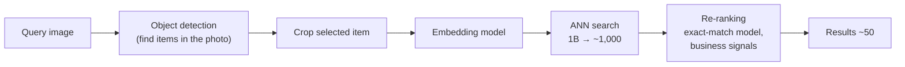
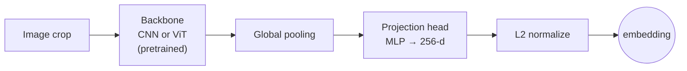
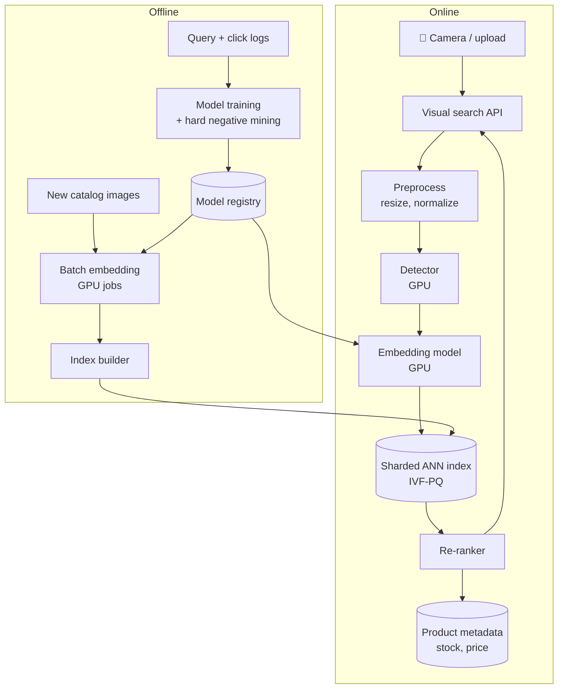

# Visual Search System

> **Problem:** Design a visual search system for a large e-commerce or image-sharing platform. A user takes or uploads a photo (or crops part of an image), and the system returns visually similar products or images from a catalog of billions.

---

## Table of Contents

1. [Clarifying Requirements](#1-clarifying-requirements)
2. [Framing as an ML Problem](#2-framing-as-an-ml-problem)
3. [Data Preparation](#3-data-preparation)
4. [Model Development](#4-model-development)
5. [Evaluation](#5-evaluation)
6. [Serving and System Architecture](#6-serving-and-system-architecture)
7. [Monitoring and Iteration](#7-monitoring-and-iteration)
8. [Interview Talking Points](#8-interview-talking-points)

---

## 1. Clarifying Requirements

| Question | Assumed answer |
|----------|----------------|
| What's the query? | A photo from the user's camera, an uploaded image, or a **crop** of an image already on the platform |
| What's returned? | Visually similar **products** (shoppable) from the catalog, ranked |
| "Similar" means? | Same product if it exists (exact match), otherwise visually similar items (style, color, shape) |
| Catalog size? | ~1B images (products + user-generated images), ~10M new per day |
| Latency? | < 300 ms end to end |
| Text input too? | Optional text refinement ("this but in red"). Mainly image. |
| Personalization? | Light. Mostly content-based. Personalization in re-ranking. |
| Constraints? | Filter out unsafe content; respect availability and region |

### Back-of-the-envelope numbers

```
Catalog                 ≈ 1B images
Embedding               ≈ 256 dims × 4 bytes ≈ 1 KB → ~1 TB raw float32
With product quantization (e.g. 64 bytes/vector) → ~64 GB, shardable in memory
Query QPS               ≈ 5K average, 20K peak
```

---

## 2. Framing as an ML Problem

### Formulation

**Representation learning + nearest-neighbour retrieval:**
1. Learn an embedding function `f(image) → vector` such that **similar images are close** and dissimilar ones are far apart.
2. Embed every catalog image offline and index the vectors.
3. At query time, embed the query and retrieve the nearest catalog vectors with **approximate nearest-neighbour (ANN)** search.
4. Re-rank the top candidates with richer signals.

### Why not classification?

| Approach | Problem |
|----------|---------|
| Classify into categories, return items of the same class | Too coarse: "dress" returns millions of dresses |
| Classify into product IDs | Billions of classes, constantly changing catalog, no examples for new products |
| **Embedding + ANN** ✅ | Works for unseen products, scales to billions, supports similarity, not just identity |

### Pipeline overview



---

## 3. Data Preparation

### Data sources

| Source | Use |
|--------|-----|
| **Catalog images** | Several professional photos per product: front, side, on model |
| **User-generated photos** | Reviews, social posts: real-world conditions (lighting, angles, clutter). Critical for the **query-to-catalog domain gap**. |
| **Engagement logs** | Query image → clicked / purchased result. Weak relevance labels. |
| **Product metadata** | Category, brand, color, attributes. Helpful for filtering and multi-task training. |
| **Human relevance ratings** | Gold evaluation sets: "is this result similar? exact match?" |

### Building training pairs

Metric learning needs **positive pairs** (should be close) and **negatives** (should be far):

| Positive pair source | Notes |
|---------------------|-------|
| Different photos of the **same product** | Clean; teaches viewpoint invariance |
| **User photo ↔ catalog photo** of the same product (from reviews or purchases) | Teaches the street-to-shop gap. The most valuable pairs. |
| Query ↔ clicked or purchased result | Abundant but noisy. Filter by dwell or purchase. |
| **Augmented views** of one image (crop, color jitter, blur) | Self-supervised; no labels needed |

**Negatives:**
- **In-batch negatives:** the other items in a training batch. Cheap.
- **Hard negatives** ⭐: visually close but different products (same style, different brand or pattern). Mine them with the current model's ANN results. They're what teaches fine-grained distinctions.
- Be careful with **false negatives**: two different product IDs may be identical items from different sellers. De-duplicate the catalog first.

### Augmentation

Random crops, scaling, rotation, color jitter, blur, JPEG compression, lighting changes, and backgrounds pasted in, to simulate phone photos.

---

## 4. Model Development

### 4.1 Object detection (for multi-item photos)

A street photo contains a jacket, bag and shoes. Detect the items, suggest the most prominent one, and let the user tap another.
- Detector trained on fashion and home categories (one-stage detector for speed).
- Outputs boxes + category. The category can **filter** the ANN search (only search bags).

### 4.2 Embedding model



| Choice | Options | Recommendation |
|--------|---------|----------------|
| **Backbone** | CNN (ResNet / EfficientNet), ViT | ViT or a modern CNN, **pretrained** on large image or image-text data (CLIP-style), then fine-tuned |
| **Loss** | Contrastive (pairs), **triplet**, InfoNCE / softmax over in-batch negatives, classification-based (ArcFace-style, product ID as class) | InfoNCE with large batches + hard negatives. Classification losses work well when there are many examples per product. |
| **Dimension** | 64–1024 | 256: a balance of accuracy, memory and ANN speed |
| **Multi-task** | Add heads for category and attributes | Improves structure in the embedding space |

**Losses in one line each:**
- **Triplet:** `max(0, d(a, p) − d(a, n) + margin)`. The anchor must be closer to the positive than to the negative, by a margin.
- **InfoNCE:** softmax over 1 positive and many negatives, with temperature τ. Better use of every negative in the batch.

### 4.3 Multimodal queries (image + text)

"This dress but in red" → use a joint image-text embedding space (CLIP-style). Combine `f_img(query) + α · f_text("red")`, or train a composition module on (image, modification text, target image) triplets.

### 4.4 Re-ranking

ANN returns ~1,000 candidates by embedding similarity alone. Re-rank them with:
- **Exact-match model:** a pairwise model (cross-attention over query and candidate images, or local feature matching) scoring "same product?". Too expensive for 1B items, fine for 1,000.
- **Business signals:** in stock, price, rating, seller quality, region availability.
- **Personalization:** user's style, price range, brand affinity.
- **Diversity:** de-duplicate the same product from multiple sellers.

### 4.5 ANN indexing

| Method | How | Trade-off |
|--------|-----|-----------|
| **HNSW** (graph-based) | Navigable small-world graph | High recall and fast, but memory-heavy |
| **IVF** (inverted file) | Cluster vectors with k-means; search only the nearest clusters | Tunable speed/recall via the number of clusters probed |
| **Product quantization (PQ)** | Compress vectors into short codes | ~16–32× memory savings with some accuracy loss |
| **IVF-PQ + re-scoring** ✅ | IVF to narrow, PQ to compress, exact distances on the top candidates | Standard for billion scale |

Shard the index across machines (by vector ID); query every shard in parallel and merge the top-k.

---

## 5. Evaluation

### Offline

| Metric | Why |
|--------|-----|
| **Recall@K** ⭐ | Is the exact product (or a relevant item) in the top K? The primary retrieval metric. |
| **mAP / MRR** | How high relevant results rank |
| **nDCG@K** with graded human labels | Exact match (3) > very similar (2) > somewhat similar (1) |
| **ANN recall vs brute force** | Index quality, separate from model quality |
| **Slices** | By category, by query source (user photo vs catalog image), by lighting and clutter |

Evaluation sets: **user-photo queries** with known purchased products (street-to-shop), plus human-rated relevance. Catalog-photo-to-catalog-photo evaluation is too easy and overestimates quality.

### Online

| Metric | Definition |
|--------|------------|
| Click-through rate on results | Are results relevant? |
| **Add-to-cart / purchase rate** from visual search | The business outcome |
| Zero-click / reformulation rate | User didn't find what they wanted and retook the photo |
| Latency p99 | User experience |

---

## 6. Serving and System Architecture



**Key serving points:**
- **Model and index must match:** a new embedding model changes the vector space. Re-embed the **entire catalog** (backfill ~1B images) and build a new index before switching. Run the old and new versions side by side during the switch.
- **Incremental updates:** new products are embedded within minutes and added to a small "fresh" index that's searched alongside the main one. Merge them periodically.
- **Deletions:** out-of-stock or removed products are filtered at re-ranking time, and removed from the index in the next rebuild.
- **Latency budget:** detection ~40 ms, embedding ~20 ms, ANN ~30 ms, re-ranking ~50 ms, plus network.
- **Backfill cost:** re-embedding 1B images is a large GPU job. That's a reason not to change the embedding model too often. Consider **backward-compatible embeddings** (train the new model so its vectors are compatible with the old index) to avoid backfills.

---

## 7. Monitoring and Iteration

| Signal | Why |
|--------|-----|
| Query embedding distribution drift | New phone cameras, new trends, new categories |
| ANN recall (periodic brute-force sampling) | Index degradation |
| CTR and purchase rate by category | Find weak categories |
| Zero-result and reformulation rate | Search failures |
| Index freshness lag | New products not searchable |

**Improvement loop:** mine failed queries (no clicks, reformulations) → human labeling → new hard negatives and positive pairs → retrain.

---

## 8. Interview Talking Points

### Key trade-offs

| Trade-off | Discussion |
|-----------|------------|
| Embedding dimension | Larger = more accurate, but more memory and slower ANN |
| ANN recall vs latency / memory | IVF probes, PQ code size, HNSW parameters |
| Exact match vs similarity | Separate re-ranking model for exact matches on top of a similarity embedding |
| Frequent model updates vs backfill cost | Backward-compatible embeddings, or scheduled backfills |
| Generic vs category-specific models | One model is simpler; per-category fine-tuning helps fine-grained categories (shoes, furniture) |

### Likely follow-up questions

1. **How do you handle the gap between phone photos and catalog photos?** User-photo ↔ catalog pairs in training, heavy augmentation, and detection + cropping before embedding.
2. **How do you update the model without re-indexing a billion images?** Backward-compatible training, or a staged backfill with dual indexes.
3. **How do you make results distinguish very similar products?** Hard negative mining, plus a re-ranking exact-match model with local features.
4. **How would you add text refinement?** A joint image-text embedding space, or a composition module.
5. **How do you evaluate without lots of labels?** Purchase-based street-to-shop pairs, plus a small human-rated gold set.

### Common pitfalls to avoid

- ❌ Treating it as classification
- ❌ Evaluating only catalog-to-catalog
- ❌ Deploying a new embedding model without re-indexing
- ❌ Random negatives only (the model never learns fine distinctions)
- ❌ Ignoring multi-object query photos

---

## References

- [Learning Transferable Visual Models From Natural Language Supervision (CLIP), Radford et al. 2021](https://arxiv.org/abs/2103.00020)
- [A Simple Framework for Contrastive Learning of Visual Representations (SimCLR), Chen et al. 2020](https://arxiv.org/abs/2002.05709)
- [FaceNet: A Unified Embedding for Face Recognition and Clustering (triplet loss), Schroff et al. 2015](https://arxiv.org/abs/1503.03832)
- [ArcFace: Additive Angular Margin Loss for Deep Face Recognition, Deng et al. 2018](https://arxiv.org/abs/1801.07698)
- [Billion-scale Similarity Search with GPUs, Johnson et al. 2017](https://arxiv.org/abs/1702.08734)
- [Efficient and Robust Approximate Nearest Neighbor Search Using HNSW Graphs, Malkov & Yashunin 2016](https://arxiv.org/abs/1603.09320)
- [Towards Backward-Compatible Representation Learning, Shen et al. 2020](https://arxiv.org/abs/2003.11942)
