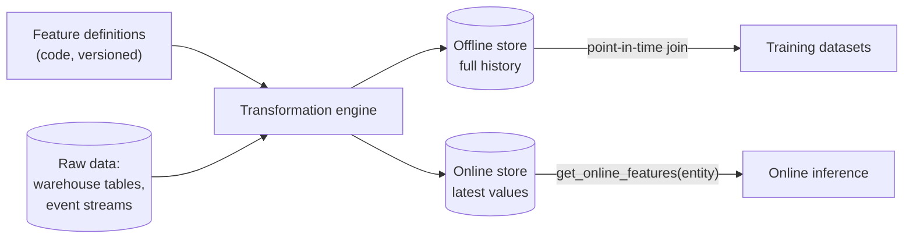
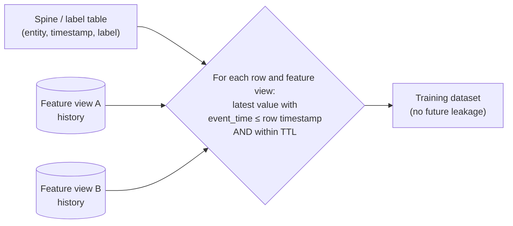
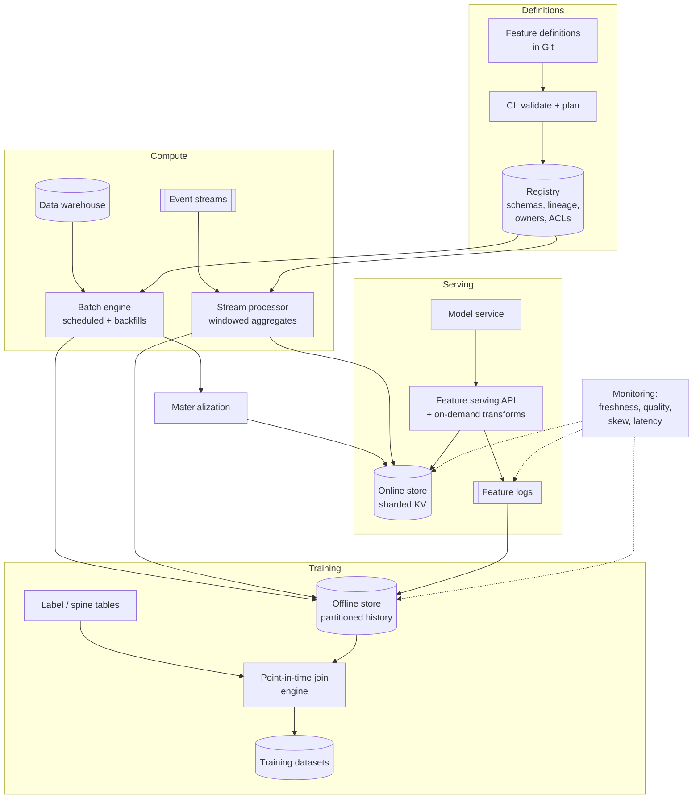

# Feature Store

> **Problem:** Design a company-wide feature store: a platform where ML teams define features once, then use them both to **generate training data** and to **serve features in real time** for online inference, with the same values in both places.

This is an **ML infrastructure** design. There's no single model to train. The interview focuses on **correctness (no leakage, no training-serving skew), latency, freshness, scale, and usability for many teams**. The section layout follows the usual outline, adapted for infrastructure.

Related: almost every other design here depends on one, e.g. [Feed Ranking](../ranking/feed-ranking.md#feature-pipeline), [Ad Click Prediction](../ranking/ad-click-prediction.md) and [Payment Fraud Detection](../trust-and-safety/payment-fraud-detection.md).

---

## Table of Contents

1. [Clarifying Requirements](#1-clarifying-requirements)
2. [Framing: Core Concepts](#2-framing-core-concepts)
3. [Feature Definitions and Data Model](#3-feature-definitions-and-data-model)
4. [Component Design](#4-component-design)
5. [Correctness and Evaluation](#5-correctness-and-evaluation)
6. [System Architecture and Scaling](#6-system-architecture-and-scaling)
7. [Monitoring and Operations](#7-monitoring-and-operations)
8. [Interview Talking Points](#8-interview-talking-points)

---

## 1. Clarifying Requirements

### Why build a feature store?

Without one, every team:
- writes feature logic twice: in SQL or Spark for training, and in service code for serving. The two drift apart, causing **training-serving skew**;
- builds training data with joins that accidentally use **future information** (label leakage);
- rebuilds the same features (user's 7-day click count, and so on) in a slightly different way each time.

### Functional requirements

| Requirement | Detail |
|-------------|--------|
| **Define features as code** | Versioned, reviewed definitions with owners, descriptions and data sources |
| **Batch, streaming and on-demand features** | Daily aggregates, seconds-fresh counters, and request-time computations (e.g. distance between the user's location and a store) |
| **Offline retrieval** | Build training datasets with **point-in-time correct** feature values for millions to billions of (entity, timestamp) rows |
| **Online retrieval** | Low-latency lookups of the **latest** feature values for an entity at inference time |
| **Discovery and reuse** | Search features, see lineage, usage and quality stats |
| **Backfills** | Compute a new feature's history so it can be used for training immediately |

### Non-functional requirements

| Requirement | Target (assumed) |
|-------------|------------------|
| Online read latency | **p99 < 10 ms** for ~100 features of one entity |
| Online throughput | ~1M feature-vector reads/s at peak, across all models |
| Freshness | Streaming features < 1 min; batch features daily or hourly |
| Scale | ~10K features, ~1B entities (users, items), multiple TB online |
| Availability | 99.99% for online reads (models depend on it) |
| Consistency | Online and offline values for the same feature, entity and time must match |

---

## 2. Framing: Core Concepts

| Concept | Meaning | Example |
|---------|---------|---------|
| **Entity** | The thing features describe, with a key | `user_id`, `item_id`, `(user_id, merchant_id)` |
| **Feature** | A named, typed value about an entity | `user_clicks_7d: int` |
| **Feature view / group** | Features computed together from one source with one schedule | `user_engagement_daily` |
| **Event timestamp** | When the value became **true in the world** | Clicks counted up to 2026-05-01 00:00 |
| **Offline store** | Full **history** of feature values, for training | Columnar tables in the data lake |
| **Online store** | Only the **latest** value per entity, for serving | Low-latency key-value store |
| **Materialization** | Copying computed values into the online store | Hourly job or streaming writes |
| **Feature service** | The set of features one model needs | `fraud_model_v3` → 120 features |

### The two paths



The core promise: **one definition → the same values in both paths.**

---

## 3. Feature Definitions and Data Model

### Example definition

```python
user = Entity(name="user", join_key="user_id")

user_engagement = FeatureView(
    name="user_engagement",
    entities=[user],
    source=StreamSource(topic="user_events", timestamp_field="event_time"),
    aggregations=[
        Aggregation("clicks", function="count", window="1h"),
        Aggregation("clicks", function="count", window="7d"),
        Aggregation("dwell_seconds", function="avg", window="24h"),
    ],
    ttl="30d",                 # how long a value stays valid
    owner="feed-ranking-team",
    tags={"pii": "false"},
)
```

### Feature types

| Type | Computed | Freshness | Example |
|------|----------|-----------|---------|
| **Batch** | Scheduled jobs on the warehouse | Hours to a day | User's lifetime purchase count, item embedding |
| **Streaming** | Stream processor over events | Seconds to minutes | Card transactions in the last 10 min |
| **On-demand** | At request time, from request data (+ stored features) | Instant | Distance from user to merchant, query-item text similarity |
| **Embeddings** | Batch model inference | Daily | User and item embeddings from a two-tower model |

### Storage layout

**Offline store:** append-only tables partitioned by date:

```
user_engagement/
  date=2026-05-01/ part-0001.parquet   (user_id, event_time, clicks_1h, clicks_7d, …, created_at)
```

**Online store:** one row per entity per feature view:

```
key:   "user_engagement:" + user_id
value: {clicks_1h: 3, clicks_7d: 41, dwell_avg_24h: 12.5, event_time: …}
```

---

## 4. Component Design

### 4.1 Registry

- Stores definitions, versions, owners, schemas, lineage (source → feature → models using it), and access policies.
- Definitions live in Git and are applied through CI: validation, schema checks, and a **plan** of what will change, like infrastructure as code.
- Powers the **discovery UI**: search, descriptions, freshness, quality stats, which models use the feature.

### 4.2 Transformation engines

| Engine | Used for | Notes |
|--------|----------|-------|
| **Batch** (distributed SQL / Spark-style) | Batch features, backfills | Writes to the offline store, then materializes to online |
| **Streaming** (stream processor with windowed state) | Sliding-window aggregates | Writes to **both** stores; handles late events with watermarks |
| **On-demand** (functions in the serving path) | Request-time features | **The same code** must run offline when building training data |

**Sliding windows at scale:** keeping every event for a 7-day window per user is expensive. Use **tiled / pre-aggregated buckets** (e.g. per-minute and per-hour partial counts) and sum the buckets that cover the window at read time.

### 4.3 Offline retrieval: point-in-time joins ⭐

Training examples are `(entity, timestamp, label)` rows, e.g. "user 42 at 10:05, clicked = 1". For each row, we need feature values **as they were known at 10:05**, never later.

```
Feature history for user 42 (clicks_7d):
  09:00 → 37
  10:00 → 40
  10:30 → 44      ← must NOT be used for an example at 10:05

Training row: (user 42, 10:05, label=1)
Correct value: 40 (latest value with event_time ≤ 10:05, and not older than the TTL)
```



**Implementation:** an "as-of" join, implemented as a sort-merge on (entity, timestamp) in a distributed engine. Partition and pre-sort by entity to avoid huge shuffles.

**Subtlety: when was the value available?** A daily batch feature with `event_time = 00:00` might only land at 06:00. A model serving at 03:00 would still see yesterday's value. To be fully accurate, join on **availability time** (`created_at`), not event time. Otherwise training sees fresher data than serving did.

### 4.4 Online store

| Requirement | Design |
|-------------|--------|
| p99 < 10 ms | In-memory or SSD key-value store; one **multi-get** per request for all feature views of an entity |
| Billions of keys | Shard by entity key (consistent hashing); replicate for availability |
| High write throughput | Streaming jobs upsert continuously; batch materialization uses bulk loads |
| Ordering | Write only if the new value's event_time is newer, so late or replayed writes can't overwrite fresh values |
| Expiry | TTL per feature view, so stale values disappear and the model sees "missing" instead of wrong |

**Sizing example:** 1B users × 100 features × ~8 bytes ≈ 800 GB of raw values, plus overhead and replication → a few TB across a cluster.

### 4.5 Serving API

```
get_online_features(
    feature_service="fraud_model_v3",
    entities={"user_id": 42, "merchant_id": 991},
    request_data={"amount": 120.0, "lat": …, "lon": …}
) → {feature_name: value, …, plus metadata: freshness, missing flags}
```

- Fetches all feature views in **parallel**, runs on-demand transformations, applies defaults for missing values.
- Returns metadata such as **freshness** so the model or caller can react to stale data.
- **Logs the served feature vector** (sampled or full) for skew detection and as training data.

### 4.6 Logged features vs point-in-time joins

Two ways to create training data:

| Approach | How | Pros | Cons |
|----------|-----|------|------|
| **Point-in-time join** | Recompute what the values were, from the offline store | Can build datasets for **new** features over the past (backfill) | Subtle availability-time mismatches |
| **Feature logging** | Record the exact vector served at inference time | Exactly what the model saw; no skew by construction | Only covers features that were already being served |

**Use both:** logging for production retraining, point-in-time joins for experimenting with new features.

---

## 5. Correctness and Evaluation

A feature store is judged by **correctness and reliability**, not model metrics.

| Check | How |
|-------|-----|
| **Online/offline consistency** ⭐ | Sample served vectors from logs; recompute the same (entity, time) offline; compare. Alert if mismatch rate > threshold. |
| **Point-in-time correctness** | Unit tests with synthetic histories (including late events and missing values); assert no value newer than the row timestamp is used |
| **Freshness SLOs** | Lag between event time and online availability, per feature view |
| **Data quality** | Null rates, value ranges, distribution drift vs a baseline, schema changes |
| **Latency and availability SLOs** | p50 / p99 / p999 read latency; error rate |
| **Backfill validation** | Backfilled history must match what streaming computed for overlapping periods |

**Impact on models:** the best end-to-end test is retraining a model with feature-store data and checking that its online performance matches its offline evaluation. A gap usually means skew.

---

## 6. System Architecture and Scaling



### Scaling considerations

| Concern | Approach |
|---------|----------|
| **Hot keys** (a celebrity user or popular item read constantly) | Client-side cache with a short TTL; replicate hot keys |
| **Fan-out reads** (a ranker needs features for 500 items per request) | Batched multi-get; co-locate the serving API with the online store; cache item features, which change less often than user features |
| **Large backfills** | Run on the batch engine with partitioned outputs; throttle bulk loads into the online store |
| **Many teams** | Namespaces, quotas, per-team cost attribution |
| **Multi-region** | Online store replicated per region; streaming writes per region; batch materialization to all regions |

### Build vs buy

Open-source and managed feature stores exist. In an interview, describe the components and trade-offs; the choice depends on existing infrastructure (warehouse, stream processor, KV store), scale and latency needs.

---

## 7. Monitoring and Operations

| Signal | Why |
|--------|-----|
| Freshness lag per feature view | Stale features silently hurt models |
| Online/offline mismatch rate | Training-serving skew |
| Null, default and missing rates in served vectors | Upstream breakages |
| Feature distribution drift | Data changes, bugs, real-world shifts |
| Read latency and error rate per client | SLOs |
| Unused features and cost per feature view | Clean-up: retire features nobody uses |

**Governance:**
- **Ownership:** every feature has an owning team and on-call contact.
- **PII and access control:** tag sensitive features; restrict who can read them; propagate deletion requests (e.g. delete a user's features on account deletion).
- **Change management:** changing a feature's logic creates a **new version**. Models pinned to the old version keep getting the old values until retrained.

---

## 8. Interview Talking Points

### Key trade-offs

| Trade-off | Discussion |
|-----------|------------|
| Freshness vs cost | Streaming features cost much more than daily batch. Use them only where freshness matters (fraud, session features). |
| Point-in-time joins vs logging | Joins enable backfills for new features; logging guarantees no skew. Use both. |
| Online store: memory vs SSD | Memory is faster and more expensive; SSD-backed KV stores are cheaper at large scale with slightly higher latency |
| Centralized platform vs team autonomy | Shared definitions and reuse vs flexibility. Allow custom sources and transformations through clear extension points. |
| Strict vs lenient missing-value handling | Fail the request, or return defaults with a missing flag. Most models prefer defaults + flags. |

### Likely follow-up questions

1. **How do you prevent label leakage?** Point-in-time joins with event time **and** availability time, TTLs, and tests with late-arriving data.
2. **How do you detect training-serving skew?** Log served vectors, recompute offline for the same (entity, time), and compare continuously.
3. **How do you compute a 30-day sliding window count for 1B users efficiently?** Pre-aggregated time buckets (tiles) in the stream processor, summed at read or write time.
4. **What happens when a streaming job falls behind?** Freshness alerts; the API returns freshness metadata; models fall back to batch features or defaults; replay from the stream once it recovers, with event-time ordering so old values can't overwrite new ones.
5. **How do you serve features for 500 candidate items in one ranking request?** Batched multi-get, item-feature caching, and co-location with the ranker.

### Common pitfalls to avoid

- ❌ Writing feature logic separately for training and serving
- ❌ Joining on event time only and ignoring when data actually became available
- ❌ No TTLs (models silently use months-old values)
- ❌ Letting late or replayed writes overwrite newer online values
- ❌ No ownership or deprecation process (thousands of abandoned features)

---

## References

- [Hidden Technical Debt in Machine Learning Systems, Sculley et al. 2015](https://papers.nips.cc/paper/2015/hash/86df7dcfd896fcaf2674f757a2463eba-Abstract.html)
- [Rules of Machine Learning: Best Practices for ML Engineering, Zinkevich](https://developers.google.com/machine-learning/guides/rules-of-ml)
