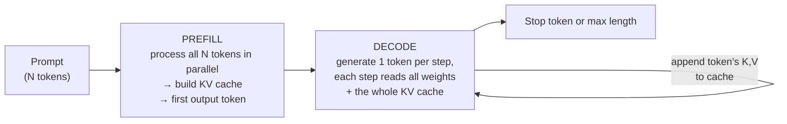
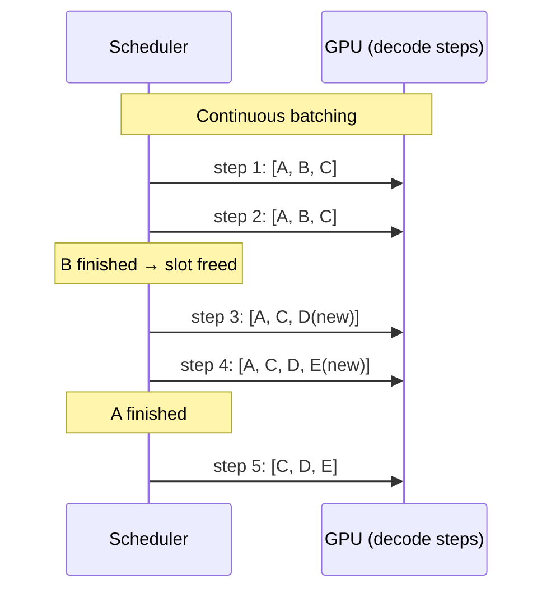
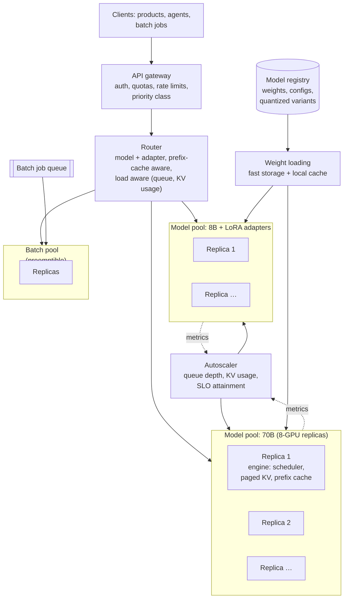

# LLM Inference Serving Platform

> **Problem:** Design a platform that serves large language models (from ~8B to several hundred billion parameters) to many internal products: chat assistants, agents, code completion, and offline batch jobs. It must meet latency targets while keeping expensive GPUs highly utilized.

This is an **ML infrastructure** design. The key to doing well is understanding **how LLM inference actually works** (prefill, decode, KV cache) and turning that into batching, memory management, parallelism and routing decisions.

---

## Table of Contents

1. [Clarifying Requirements](#1-clarifying-requirements)
2. [Framing: How LLM Inference Works](#2-framing-how-llm-inference-works)
3. [Workload Characterization](#3-workload-characterization)
4. [Serving Engine Design](#4-serving-engine-design)
5. [Evaluation and Benchmarking](#5-evaluation-and-benchmarking)
6. [System Architecture and Scaling](#6-system-architecture-and-scaling)
7. [Monitoring and Operations](#7-monitoring-and-operations)
8. [Interview Talking Points](#8-interview-talking-points)

---

## 1. Clarifying Requirements

| Question | Assumed answer |
|----------|----------------|
| Models? | A small model (~8B), a large dense model (~70B), and a large mixture-of-experts model. Plus many fine-tuned LoRA adapters on the small model. |
| Workloads? | **Interactive chat** (streaming), **agents** (long contexts, many calls sharing the same prefix), **code completion** (very latency sensitive, short outputs), **batch** (summarize millions of documents, no latency requirement) |
| Scale? | Peak ~20K concurrent requests; ~10B tokens processed per day |
| Latency SLOs (interactive)? | **Time to first token (TTFT)** p95 < 1 s; **time per output token (TPOT)** p95 < 50 ms (≈ 20+ tokens/s, faster than reading speed) |
| Hardware? | GPU nodes with 8 accelerators each, ~80 GB HBM per GPU, fast interconnect within a node |
| Multi-tenancy? | Many teams share the fleet. Quotas, priorities, fairness, and per-team cost reporting. |
| Context length? | Up to 128K tokens |

### What we optimize

```
User experience:   TTFT, TPOT (a.k.a. inter-token latency), tail latency, error rate
Efficiency:        tokens/second per GPU, cost per 1M tokens
Combined:          GOODPUT = requests/s served WITHIN their latency SLOs
```

**Goodput** is the right single target: high throughput that violates the SLO doesn't count.

---

## 2. Framing: How LLM Inference Works

### Two phases



| Phase | Work | Bottleneck | Drives |
|-------|------|------------|--------|
| **Prefill** | Large matrix multiplies over all prompt tokens at once | **Compute-bound** | TTFT |
| **Decode** | One token per step per sequence: small matrix-vector work, but **all weights must be read from memory every step** | **Memory-bandwidth-bound** | TPOT |

**Key insight:** in decode, reading the weights costs the same whether you generate 1 token or 64 tokens for 64 different requests at once. **Batching many sequences together in decode is almost free throughput**, until KV cache memory runs out or compute becomes the limit.

### KV cache memory math ⭐

Each token in each sequence stores a key and a value vector for every layer:

```
KV bytes per token = 2 (K and V) × layers × kv_heads × head_dim × bytes_per_value

Example: 70B-class dense model, 80 layers, 8 KV heads (grouped-query attention),
         head_dim 128, FP16 (2 bytes)
       = 2 × 80 × 8 × 128 × 2 ≈ 330 KB per token

One 4K-token conversation  ≈ 1.3 GB of KV cache
One 128K-token context     ≈ 42 GB of KV cache
```

```
Weights: 70B params × 2 bytes (FP16) = 140 GB → at least 2 × 80 GB GPUs just for weights
On an 8-GPU node (640 GB): 140 GB weights → ~500 GB left for KV cache
                         → ~370 concurrent 4K-token sequences at most (500 GB ÷ 1.3 GB)
```

**The KV cache, not compute, usually limits how many requests can run at once.** Most serving optimizations are about using that memory better.

### Latency lower bound for decode

```
Time per decode step ≥ bytes read per step / memory bandwidth
70B FP16 split across 8 GPUs at ~3 TB/s each:  140 GB / 24 TB/s ≈ 6 ms per step (batch of 1)
```

Halving the bytes (8-bit weights) roughly halves this bound. That's why quantization speeds up decode.

---

## 3. Workload Characterization

Before designing, analyze request traces:

| Characteristic | Why it matters |
|----------------|----------------|
| **Prompt length distribution** | Long prompts → expensive prefill, large KV cache |
| **Output length distribution** | Long outputs → long decode, slots held longer |
| **Prefix sharing** | Agents and chat reuse the same system prompt, tool definitions and conversation history → **prefix caching** opportunity |
| **Arrival pattern** | Daily peaks, bursts from batch jobs, agent loops that fire many calls at once |
| **SLO class** | Interactive vs batch, which defines scheduling priority |

Example workload mix:

| Workload | Prompt | Output | SLO | Notes |
|----------|--------|--------|-----|-------|
| Chat | 1–8K (history) | 200–1,000 | TTFT < 1 s, TPOT < 50 ms | Multi-turn → previous turns' KV can be reused |
| Agents | 10–100K | 100–500 per call | Moderate | Huge shared prefixes across calls |
| Code completion | 2–8K | 10–100 | TTFT < 200 ms | Small model, latency first |
| Batch | Any | Any | Hours | Fills idle capacity |

---

## 4. Serving Engine Design

### 4.1 Batching

| Strategy | How | Problem |
|----------|-----|---------|
| Static batching | Wait for N requests, run them together until **all** finish | Short requests wait for the longest; GPU idles |
| Dynamic batching | Batch whatever arrived within a time window | Same problem once running |
| **Continuous (in-flight) batching** ✅ | Re-form the batch **every decode step**: finished sequences leave immediately, new ones join | Needs careful memory management (below) |



### 4.2 Paged KV cache

Pre-allocating max-length KV memory per request wastes most of it (most requests are short). Instead:
- Split KV cache into **fixed-size blocks** (e.g. 16 tokens), like virtual-memory pages.
- A per-sequence **block table** maps logical positions to physical blocks.
- Allocate blocks as the sequence grows; free them when it ends. Waste drops to under one block per sequence.
- **Sharing:** sequences with the same prefix point at the same physical blocks (copy-on-write).
- **Preemption:** when memory is full, pause low-priority sequences and swap their blocks to CPU memory, or drop them and recompute later.

### 4.3 Prefix caching

Agents and chat repeat long prefixes (system prompt, tool definitions, earlier turns).
- Hash prompt blocks; if a block's KV is already cached, **skip its prefill**.
- Big wins: TTFT and prefill compute drop a lot for long shared prefixes.
- Eviction: LRU over blocks, with priority for frequently shared prefixes.
- The **router** must send requests with the same prefix to the same replica (Section 6), or the cache isn't reused.

### 4.4 Scheduling prefill and decode together

A long prefill (100K tokens) on a GPU stalls every decoding request on that GPU, causing TPOT spikes.

| Technique | How |
|-----------|-----|
| **Chunked prefill** | Split long prompts into chunks (e.g. 2K tokens), mixed into decode batches step by step |
| **Disaggregated prefill / decode** | Separate GPU pools: prefill nodes build the KV cache and **transfer** it to decode nodes. Each pool is tuned for its phase. |
| **Priority scheduling** | Interactive requests before batch; deadline-aware scheduling based on TTFT targets |
| **Admission control** | Reject or queue requests when the KV cache can't fit them, instead of thrashing |

### 4.5 Parallelism (models too big for one GPU)

| Type | Splits | Communication | Use |
|------|--------|---------------|-----|
| **Tensor parallelism** | Each layer's matrices across GPUs | All-reduce **every layer**, so it needs fast intra-node links | Within one node; cuts per-token latency |
| **Pipeline parallelism** | Groups of layers across GPUs or nodes | Activations between stages | Across nodes when the model doesn't fit one node |
| **Expert parallelism** | Mixture-of-experts experts across GPUs | All-to-all token routing | MoE models |
| **Data parallelism (replicas)** | Whole model copies | None | Scale throughput |

**Rule of thumb:** use the smallest tensor-parallel group that fits weights + enough KV cache, then add replicas for throughput.

### 4.6 Quantization

| Precision | Memory | Speed | Quality risk |
|-----------|--------|-------|--------------|
| FP16 / BF16 | Baseline | Baseline | None |
| **8-bit (FP8 / INT8) weights + activations** | ½ | Faster decode and prefill (hardware support) | Usually negligible |
| **4-bit weights** (GPTQ / AWQ-style) | ¼ | Much faster decode (fewer bytes per step) | Measurable on hard tasks; evaluate carefully |
| **KV cache quantization** (8-bit) | ½ KV | More concurrent sequences | Small; watch long-context quality |

Always run **quality regression evals** (task benchmarks + product-specific evals) before shipping a quantized model.

### 4.7 Speculative decoding

- A small **draft** model (or extra prediction heads) proposes the next k tokens cheaply.
- The large model **verifies all k in one forward pass** (like a small prefill) and accepts the longest correct prefix.
- Output is **identical** in distribution to the large model alone. It's purely a latency optimization.
- Speedup depends on the acceptance rate: high for predictable text (code, structured output), lower for creative text. Gains shrink at large batch sizes because decode becomes compute-bound.

### 4.8 Serving many fine-tuned variants (multi-LoRA)

Hundreds of teams fine-tune the same base model with **LoRA adapters** (small low-rank weight deltas).
- Load the base model once; keep adapters in GPU/CPU memory and swap them per request.
- Batch requests for **different** adapters together using specialized kernels.
- Route requests for the same adapter to replicas that already have it loaded.

---

## 5. Evaluation and Benchmarking

| What | How |
|------|-----|
| **Latency under load** | Replay real traces (lengths, arrivals, prefix sharing) at increasing request rates; plot TTFT and TPOT percentiles vs load |
| **Goodput** ⭐ | Highest request rate where p95 TTFT and TPOT stay within SLO |
| **Throughput and cost** | Tokens/s per GPU; cost per 1M input and output tokens |
| **Quality regression** | Every engine change (quantization, kernels, speculative decoding) runs model-quality evals. Some optimizations change outputs subtly. |
| **Correctness** | Determinism tests where expected; compare outputs token by token against a reference implementation at temperature 0 |
| **Failure tests** | GPU loss, node loss, overload behaviour, long-context edge cases |

> Synthetic benchmarks with fixed lengths hide the real problems (long-tail prompts, prefix reuse, bursts). Always benchmark with **production-like traces**.

---

## 6. System Architecture and Scaling



### Routing ⭐

| Strategy | Why |
|----------|-----|
| **Prefix-aware routing** | Hash the leading prompt blocks; send matching prefixes (same agent, same conversation) to the same replica so the prefix cache hits |
| **Load-aware** | Prefer replicas with free KV capacity and short queues; avoid hot spots |
| **Balance the two** | Pure prefix affinity creates hot replicas; fall back to the least-loaded replica past a load threshold |
| **Adapter affinity** | Route LoRA requests to replicas with the adapter loaded |

### Autoscaling

- Scale on **leading signals**: queue depth, KV cache utilization, SLO attainment. GPU utilization alone is misleading.
- **Cold starts are slow:** loading hundreds of GB of weights takes minutes. Keep warm spare capacity, pre-stage weights on local NVMe, and load from fast storage in parallel.
- **Batch fills the gaps:** batch jobs run on spare capacity and are preempted when interactive load rises. This keeps utilization high without hurting latency.

### Multi-tenancy and reliability

- **Quotas and priorities** per team, in tokens per minute. Interactive > batch.
- **Fair queuing** so one team's burst doesn't starve others.
- **Streaming responses** over server-sent events or gRPC streams; clients see tokens immediately.
- **Graceful degradation:** under overload, shed batch first, then route to a smaller model for low-priority traffic, then return clear "retry later" errors.
- **Deployments:** new engine or model versions go to a canary replica, compared on latency and quality, then rolled out gradually.

---

## 7. Monitoring and Operations

| Signal | Why |
|--------|-----|
| TTFT and TPOT p50 / p95 / p99, per model and priority class | SLOs |
| Queue time vs compute time | Overload vs a slow engine |
| KV cache utilization, preemption/swap rate | Memory pressure |
| Prefix cache hit rate | Routing effectiveness, cost |
| Tokens/s per GPU, GPU utilization, cost per 1M tokens | Efficiency |
| Speculative decoding acceptance rate | Whether drafting still pays off |
| Error rates: OOM, timeouts, cancelled streams | Reliability |
| Output quality canaries | Detect silent quality regressions after engine changes |

---

## 8. Interview Talking Points

### Key trade-offs

| Trade-off | Discussion |
|-----------|------------|
| Latency vs throughput | Bigger batches = more tokens/s per GPU but slower per-token latency. Tune batch size per SLO class. |
| Tensor parallel degree | More GPUs per replica = lower latency but more communication and fewer replicas |
| Quantization | Memory and speed vs quality. Always measure on real tasks. |
| Prefix affinity vs load balance | Cache hits vs hot spots |
| Disaggregated vs combined prefill/decode | Better tail latency and per-phase tuning vs KV transfer cost and complexity |
| Dedicated vs shared pools | Isolation and predictability vs utilization |

### Likely follow-up questions

1. **Why is decode slow even though each step is little compute?** It's memory-bandwidth bound: each step reads all weights and the KV cache. Batching amortizes the weight reads.
2. **What limits the number of concurrent requests?** KV cache memory. Paged allocation, prefix sharing, KV quantization, and grouped-query attention models all raise the limit.
3. **A 100K-token prompt arrives and every other user's streaming slows down. Why, and how do you fix it?** Its prefill monopolizes the GPU. Fix with chunked prefill or disaggregated prefill/decode.
4. **How do you cut cost by 2× without hurting latency?** 8-bit quantization, prefix caching, better batching, filling idle capacity with batch work, and a smaller model for easy requests.
5. **How do you serve 500 fine-tuned variants?** Multi-LoRA on a shared base model with adapter-aware routing.

### Common pitfalls to avoid

- ❌ Static batching
- ❌ Pre-allocating max-length KV cache per request
- ❌ Autoscaling on GPU utilization only
- ❌ Benchmarking with fixed synthetic lengths instead of real traces
- ❌ Round-robin routing that ignores prefix caches
- ❌ Shipping quantized models without quality evals

---

## References

- [Efficient Memory Management for Large Language Model Serving with PagedAttention, Kwon et al. 2023](https://arxiv.org/abs/2309.06180)
- [DistServe: Disaggregating Prefill and Decoding for Goodput-optimized LLM Serving, Zhong et al. 2024](https://arxiv.org/abs/2401.09670)
- [Fast Inference from Transformers via Speculative Decoding, Leviathan et al. 2022](https://arxiv.org/abs/2211.17192)
- [FlashAttention: Fast and Memory-Efficient Exact Attention with IO-Awareness, Dao et al. 2022](https://arxiv.org/abs/2205.14135)
- [Megatron-LM: Training Multi-Billion Parameter Language Models Using Model Parallelism, Shoeybi et al. 2019](https://arxiv.org/abs/1909.08053)
- [GPTQ: Accurate Post-Training Quantization for Generative Pre-trained Transformers, Frantar et al. 2022](https://arxiv.org/abs/2210.17323)
- [AWQ: Activation-aware Weight Quantization for LLM Compression and Acceleration, Lin et al. 2023](https://arxiv.org/abs/2306.00978)
- [S-LoRA: Serving Thousands of Concurrent LoRA Adapters, Sheng et al. 2023](https://arxiv.org/abs/2311.03285)
