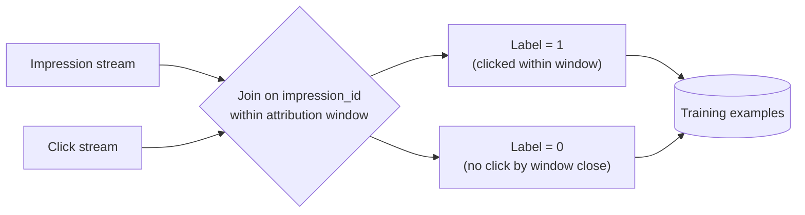
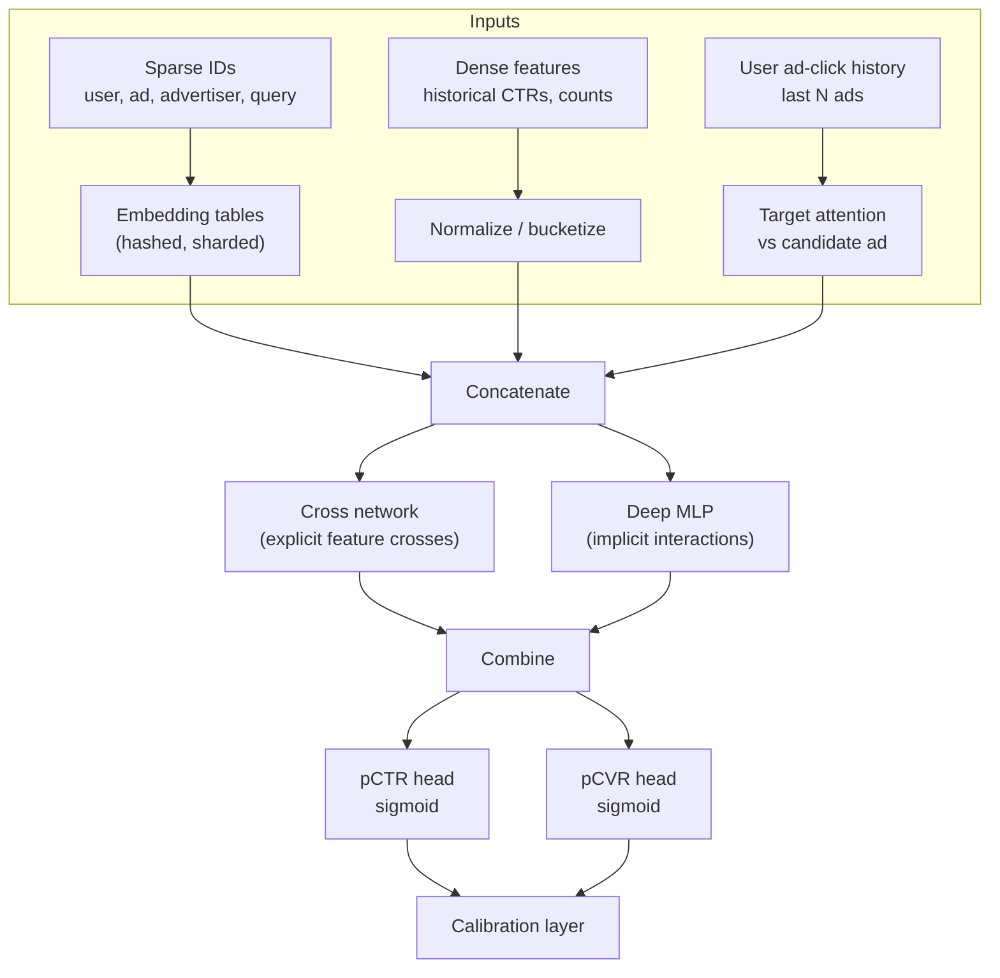
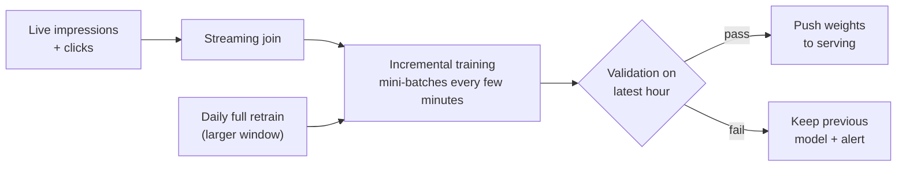
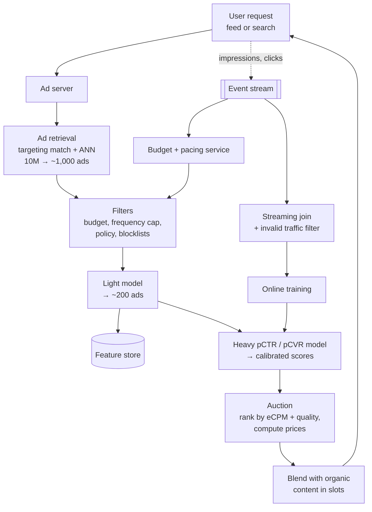

# Ad Click Prediction System

> **Problem:** Design the system that predicts the probability a user clicks on an ad, so the platform can decide which ads to show and how much to charge. Assume a large platform showing ads in a feed and in search results, with millions of advertisers.

Related: [Feed Ranking System](feed-ranking.md) covers feature interaction layers and multi-task models. This doc focuses on what's **unique to ads**: calibration, auctions, extreme sparsity, online learning, and delayed conversions.

---

## Table of Contents

1. [Clarifying Requirements](#1-clarifying-requirements)
2. [Framing as an ML Problem](#2-framing-as-an-ml-problem)
3. [Data Preparation](#3-data-preparation)
4. [Model Development](#4-model-development)
5. [Evaluation](#5-evaluation)
6. [Serving and System Architecture](#6-serving-and-system-architecture)
7. [Monitoring and Iteration](#7-monitoring-and-iteration)
8. [Interview Talking Points](#8-interview-talking-points)

---

## 1. Clarifying Requirements

| Question | Assumed answer |
|----------|----------------|
| What's being predicted? | **P(click \| user, ad, context)**. Also P(conversion \| click) for conversion-optimized campaigns. |
| How are ads priced? | Advertisers bid per click (CPC) or per conversion (oCPM / target CPA). Second-price style auction. |
| Where are ads shown? | Feed slots and search result slots |
| Scale? | ~1B DAU, ~10M active ads, ~100B ad impressions/day |
| Latency? | Ad request end to end < 100 ms. Scoring < 30 ms. |
| Freshness? | New campaigns launch constantly. User interests shift within hours. |
| Constraints? | Privacy (no sensitive targeting), advertiser budgets, user experience (limit ad load) |

### Why this is hard

```
Ad impressions / day     ≈ 100B
Average CTR              ≈ 1%   → extreme class imbalance
Feature space            ≈ billions of sparse IDs (user, ad, advertiser, query, crosses)
Ads launched / day       ≈ hundreds of thousands → constant cold start
Money depends directly on prediction accuracy → calibration matters
```

---

## 2. Framing as an ML Problem

### Where pCTR is used: the auction

Ads are ranked by **expected value per impression**, not by bid alone:

```
eCPM (expected revenue per 1,000 impressions) = bid × pCTR × 1000      (CPC ads)
eCPM                                           = bid_CPA × pCTR × pCVR × 1000   (conversion ads)

rank_score = eCPM + quality / user-experience adjustment
```

In a **generalized second-price (GSP)** auction, the winner of slot *i* pays the minimum needed to keep its position:

```
price_per_click_i = (bid_{i+1} × pCTR_{i+1}) / pCTR_i
```

### Why calibration is critical

| Use of pCTR | What goes wrong if it's miscalibrated |
|-------------|---------------------------------------|
| Ranking ads against each other | Mild errors are OK if every ad is off by the same factor, but they rarely are |
| **Pricing** | Over-predicting pCTR_i lowers the winner's price, so the platform loses revenue. Under-predicting overcharges the advertiser. |
| **Ads vs organic content** | When choosing whether a slot shows an ad or a post, the ad's value must be on a comparable scale |
| **Budget pacing** | The spend forecast depends on predicted clicks |

> In feed ranking, only the **order** matters. In ads, the **actual probability value** matters, because it directly sets prices.

### ML formulation

- **Binary classification:** click vs no click on an impression
- **Loss:** log loss (cross-entropy), which directly rewards calibrated probabilities
- **Output:** a calibrated probability, not just a score

---

## 3. Data Preparation

### Data sources

| Source | Content |
|--------|---------|
| **Impression logs** | user_id, ad_id, slot, position, timestamp, context. Plus the **features used at serving time** (feature logging). |
| **Click logs** | Clicks joined to impressions by impression_id |
| **Conversion logs** | Purchases, sign-ups. Reported by advertisers, often **days later**. |
| **Ad metadata** | Advertiser, campaign, creative (image, text, video), landing page, targeting, bid |
| **User data** | Demographics, interests, activity history, ad interaction history |

### Labels and the join



- **Click window:** clicks usually arrive within seconds to minutes, so a short window (~15 minutes) is fine.
- **Conversion window:** conversions can take **days**. Waiting the full window makes the data stale, but not waiting creates **false negatives**. Handle this with delayed-feedback modeling (see 4.4).
- **Invalid traffic:** remove bot clicks and accidental clicks (e.g. a click less than 1 s after the impression, or bouncing straight back from the landing page) before training.

### Features

| Group | Examples | Encoding |
|-------|----------|----------|
| **User** | Demographics, interests, device, historical CTR per category, recent clicks | Embeddings, bucketed counts |
| **Ad** | ad_id, campaign_id, advertiser_id, creative embedding (image or text), category, landing domain | High-cardinality IDs → embeddings or **hashing trick** |
| **Ad stats** | Historical CTR over 1 h / 1 d / 7 d, with smoothing for new ads | Bayesian smoothing: `(clicks + α) / (imps + α + β)` |
| **Context** | Slot type, position, page, time, query (search ads), surrounding content | Categorical |
| **Cross features** ⭐ | user_interest × ad_category, query × ad_keyword, age × advertiser | Learned by the model (DCN / FM) or hand-crafted and hashed |

**Hashing trick:** map `hash(feature_name + value) mod 2^k` to an embedding bucket. Memory stays bounded and unseen values are handled automatically, at the cost of occasional collisions.

---

## 4. Model Development

### 4.1 Model evolution (good to walk through in an interview)

| Generation | Model | Notes |
|------------|-------|-------|
| 1 | **Logistic regression** + hashed sparse crosses | Simple, fast, calibrated, easy to update online. Still a strong baseline. |
| 2 | **GBDT → LR**: tree leaves become features for the LR | GBDT learns non-linear crosses on dense features |
| 3 | **Factorization machines (FM / FFM)** | Learns pairwise interactions between sparse features through embeddings |
| 4 | **Deep models**: Wide & Deep, DeepFM, **DCN-v2**, DLRM | Embeddings + explicit cross layers + MLP |
| 5 | + **user behaviour sequences** (target attention) and **multi-task** (CTR + CVR) | Current state of the art |

### 4.2 Architecture



### 4.3 Training for freshness: online / continual learning

Ad performance changes fast (new creatives, budgets, trends), so models go stale within hours.



- **Warm start:** start from the last checkpoint and train on a stream of new examples.
- **Optimizers:** FTRL-Proximal for sparse logistic regression (it produces sparse weights). Adagrad or Adam for deep models, with per-feature learning rates for embeddings.
- **Embedding table growth:** new IDs appear constantly. Use hashing, or evict IDs not seen within N days.

### 4.4 Class imbalance and delayed conversions

**Negative downsampling:** keep all positives and a fraction `w` of negatives (e.g. 10%). This speeds up training a lot, but the probabilities are now inflated. Correct them:

```
p_true = p_model / (p_model + (1 − p_model) / w)
```

**Delayed conversions:** a conversion may arrive 3 days after the click. Options:

| Approach | How |
|----------|-----|
| Wait for the full window | Accurate labels, but the model trains on data that's days old |
| **Fake negatives + correction** | Train immediately with "no conversion yet" as a negative. When the conversion arrives, add a positive and use importance weighting to correct the bias. |
| **Delay model** | Jointly model P(convert) and P(delay ≤ elapsed time \| convert) |

### 4.5 Calibration

Even with log loss, models drift out of calibration, especially after downsampling or across segments.

- **Post-hoc calibration layer:** isotonic regression or Platt scaling, fitted on recent data.
- **Segment-level calibration:** compute the predicted/observed ratio per slot, country and ad type, and correct each.
- **Monitor continuously:** the calibration ratio (Σ pCTR / Σ clicks) should stay near 1.0.

### 4.6 Cold start for new ads

- **Content features:** creative embeddings (image, text) and advertiser history generalize to new ad IDs.
- **Smoothed priors:** start a new ad's CTR estimate at the advertiser's or category's average.
- **Exploration:** give new ads a small amount of boosted traffic to learn their real CTR (UCB-style or Thompson sampling on the uncertainty).

---

## 5. Evaluation

### Offline

| Metric | Why |
|--------|-----|
| **Log loss / normalized entropy (NE)** ⭐ | Primary metric. Measures discrimination **and** calibration. NE = log loss ÷ entropy of the average CTR, so it's comparable across datasets. |
| **ROC-AUC** | Ranking quality. Insensitive to calibration, so never use it alone. |
| **Calibration ratio** | Σ predicted ÷ Σ actual, overall and per segment. Target ≈ 1.0. |
| **Reliability plot** | Predicted vs actual CTR by bucket |

> Even small offline improvements matter: at this scale, a **0.1% NE improvement** can mean significant revenue.

Use **time-based splits**: train up to day N, test on day N+1. Also test on the **next hour** to match how fast online training updates.

### Online

| Stakeholder | Metrics |
|-------------|---------|
| **Platform** | Revenue per 1,000 impressions (RPM), total revenue, ad CTR |
| **Advertiser** | Cost per click, cost per acquisition, ROI, advertiser retention |
| **User** | Ad hide/report rate, organic engagement, session time. Ads must not damage the user experience. |
| **Guardrails** | Calibration ratio, latency, budget delivery, policy violations |

**A/B testing in ads markets:**
- Advertiser **budgets are shared** between control and treatment. If treatment spends budgets faster, control is starved, which biases the result. Split budgets per arm or use advertiser-level randomization.
- Measure both sides of the market. A revenue win that hurts advertiser ROI won't last.

---

## 6. Serving and System Architecture



**Latency budget (~100 ms total):** retrieval ~20 ms, filtering ~5 ms, light model ~10 ms, heavy model ~30 ms, auction + blending ~5 ms, plus network.

**Key serving points:**
- **Budget pacing:** spend each advertiser's budget smoothly through the day. Throttle participation in auctions based on spend rate.
- **Frequency capping:** don't show the same ad to a user more than N times per day.
- **Feature logging:** log exactly the features used at serving time, for training (prevents training-serving skew).
- **Model update propagation:** online training pushes new weights every few minutes. Serving loads them without downtime.

---

## 7. Monitoring and Iteration

| Signal | Why |
|--------|-----|
| **Calibration ratio by segment** | First sign something broke. Alert if it moves outside 0.95–1.05. |
| NE on the latest hour | Model quality |
| Feature null and missing rates | Upstream pipeline failures |
| Revenue, CTR, RPM | Business impact. Sudden drops mean an incident. |
| Click spam rate | Fraud attacks distort labels |
| Training lag | How stale the deployed model is |

**Failure modes:**
- **Feedback loop:** ads predicted low never get shown, so the model never learns they were good. Fix with exploration traffic.
- **Advertiser gaming:** misleading creatives drive accidental clicks. Fix with landing-page quality signals and accidental-click filtering.
- **Calibration drift after downsampling changes:** always recompute the correction when the sampling rate changes.
- **Holiday seasonality:** CTRs change sharply (e.g. shopping season). Online learning plus seasonality features.

---

## 8. Interview Talking Points

### Ads vs organic ranking: what's different

| Aspect | Organic feed | Ads |
|--------|--------------|-----|
| What matters | Order | **Absolute probability** (pricing) |
| Main metric | Engagement | **Normalized entropy + calibration**, revenue |
| Freshness | Daily or continuous | **Minutes** (online learning) |
| Stakeholders | Users, creators | Users, **advertisers**, platform |
| Constraints | Diversity, integrity | Budgets, pacing, frequency caps, auctions |

### Likely follow-up questions

1. **Why is AUC not enough?** It ignores calibration. A model can rank perfectly and still be 2× off in probability, which breaks pricing.
2. **How do you handle a new advertiser with no history?** Content and category features, smoothed priors, and exploration traffic.
3. **How do you predict conversions that happen days later?** Delayed-feedback modeling: fake negatives with importance weighting, or a joint delay model.
4. **What if CTR is great but advertisers are unhappy?** Check conversion quality and accidental clicks. Optimize for pCVR and value, not clicks alone.
5. **How do you decide between showing an ad and an organic post?** Compare the ad's expected value (eCPM) against the organic post's value plus a user-experience cost on the same scale. That's another reason calibration matters.

### Common pitfalls to avoid

- ❌ Using AUC as the only metric
- ❌ Forgetting to correct calibration after negative downsampling
- ❌ Training on data that's days old in a market that changes hourly
- ❌ Ignoring the advertiser side of the marketplace
- ❌ A/B testing without accounting for shared advertiser budgets

---

## References

- [Ad Click Prediction: a View from the Trenches, McMahan et al. 2013](https://doi.org/10.1145/2487575.2488200)
- [DeepFM: A Factorization-Machine based Neural Network for CTR Prediction, Guo et al. 2017](https://arxiv.org/abs/1703.04247)
- [DCN V2: Improved Deep & Cross Network, Wang et al. 2020](https://arxiv.org/abs/2008.13535)
- [Deep Interest Network, Zhou et al. 2018](https://arxiv.org/abs/1706.06978)
- [Wide & Deep Learning for Recommender Systems, Cheng et al. 2016](https://arxiv.org/abs/1606.07792)
- *Modeling Delayed Feedback in Display Advertising*, Chapelle, KDD 2014
