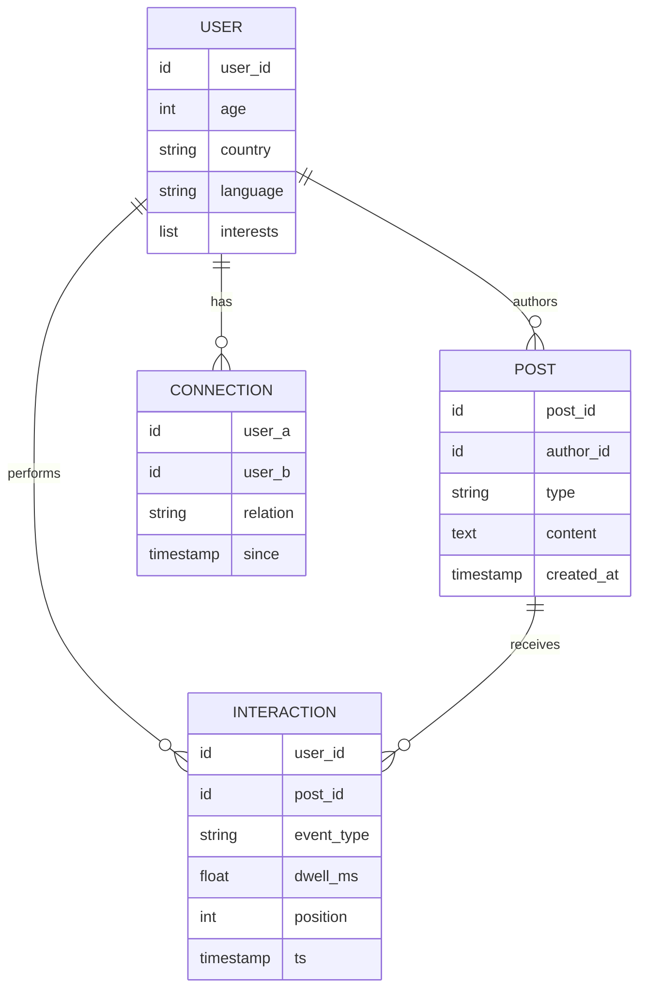
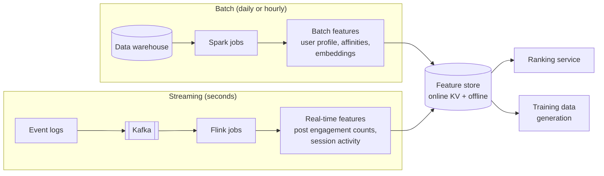
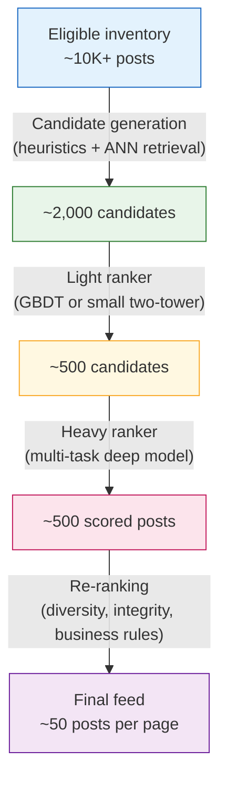
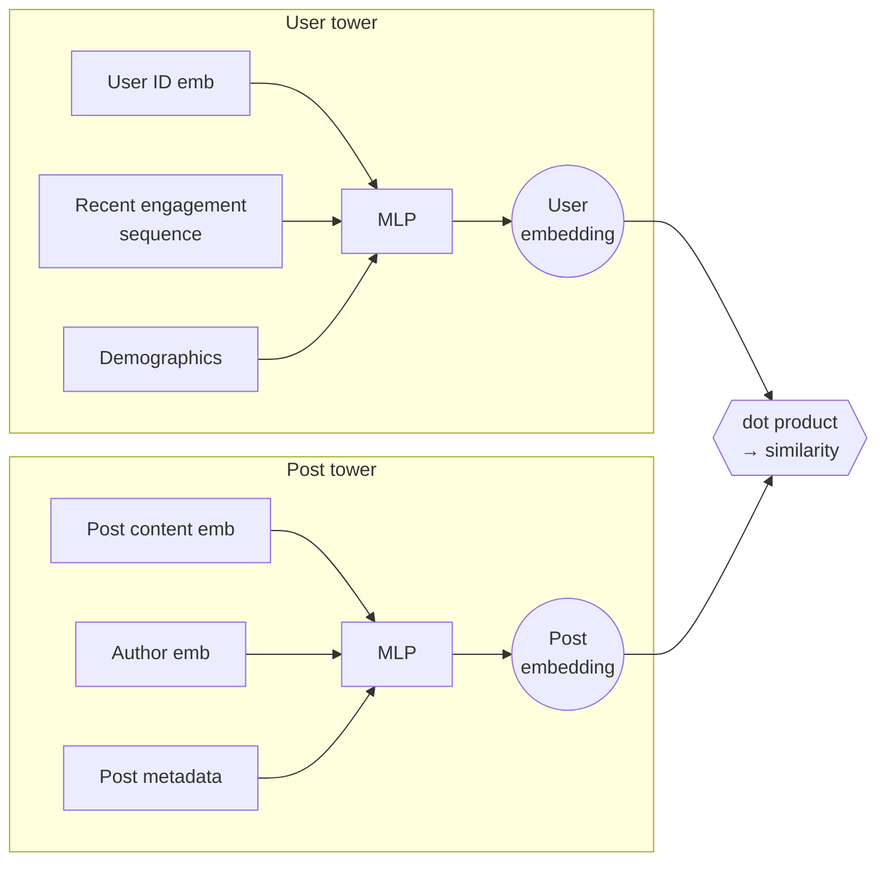
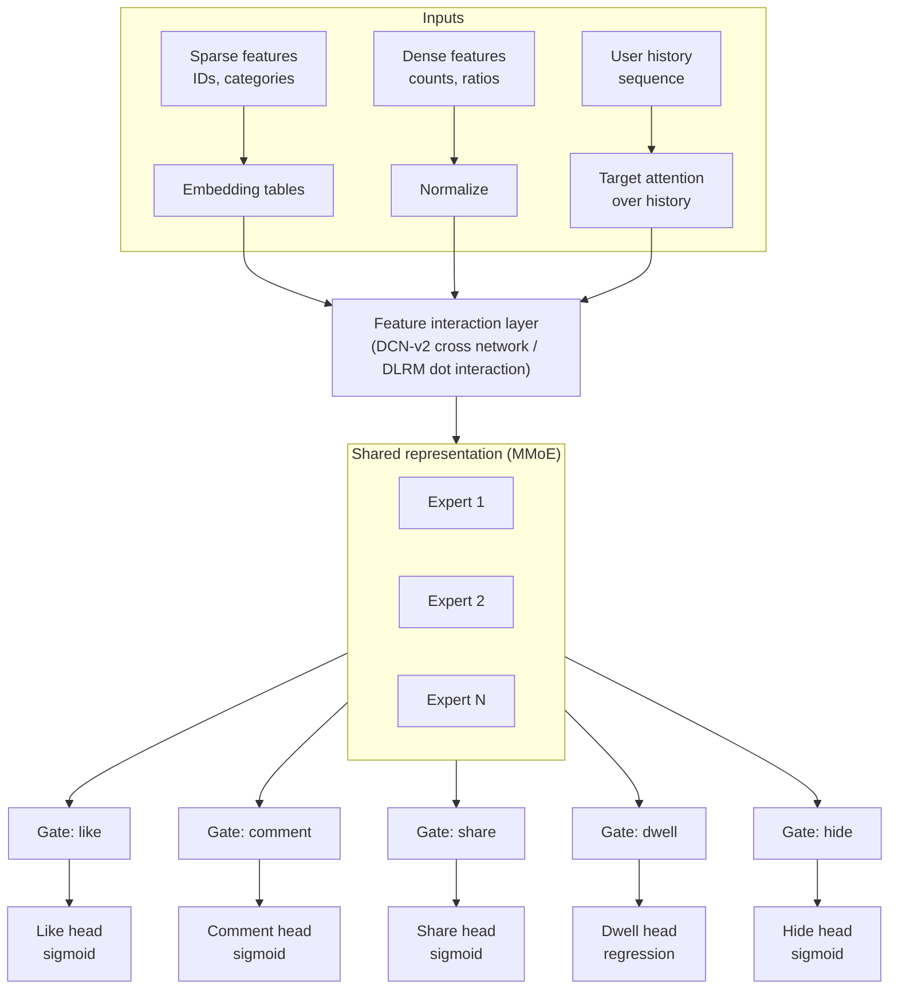
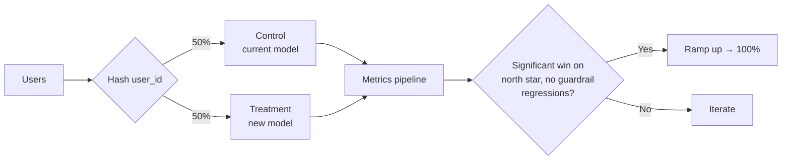
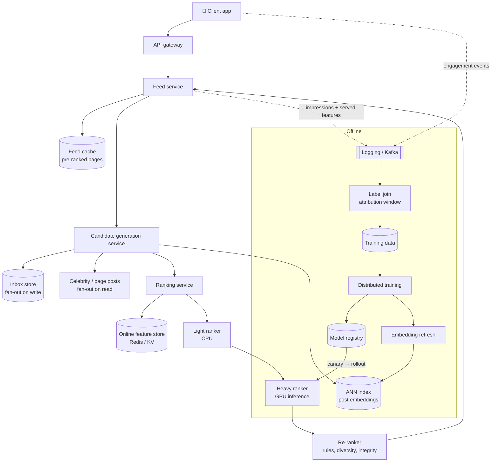
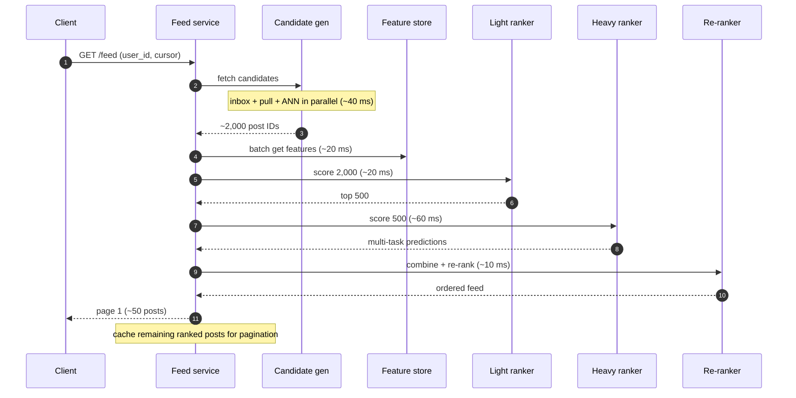
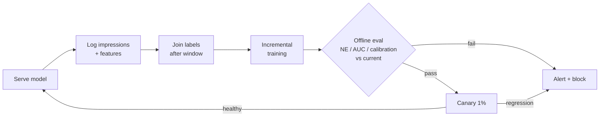

# Feed Ranking System for a Large-Scale Social Network

> **Problem:** Design the ML system that decides which posts appear in a user's home feed, and in what order, for a social network with about a billion daily active users.

---

## Table of Contents

1. [Clarifying Requirements](#1-clarifying-requirements)
2. [Framing as an ML Problem](#2-framing-as-an-ml-problem)
3. [Data Preparation](#3-data-preparation)
4. [Model Development](#4-model-development)
5. [Evaluation](#5-evaluation)
6. [Serving and System Architecture](#6-serving-and-system-architecture)
7. [Monitoring and Iteration](#7-monitoring-and-iteration)
8. [Interview Talking Points](#8-interview-talking-points)

---

## Interview Time Budget (45 min)

| Phase | Time | What to produce |
|-------|------|-----------------|
| Requirements | 5 min | Scope, scale numbers, success metric |
| ML framing | 5 min | Objective, labels, the multi-task formulation |
| Data and features | 8 min | Feature groups and the label pipeline |
| Model | 10 min | Multi-stage funnel and ranker architecture |
| Evaluation | 5 min | Offline metrics, online metrics, A/B testing caveats |
| Serving | 10 min | Architecture diagram, latency budget, scaling |
| Wrap-up | 2 min | Monitoring, trade-offs, next steps |

---

## 1. Clarifying Requirements

### Questions to ask

| Question | Assumed answer |
|----------|----------------|
| What content is eligible? | Posts from friends, followed pages, and groups, plus some **recommended** posts from accounts the user doesn't follow |
| What content types? | Text, images, video, links, reshares |
| What's the business goal? | Long-term engagement and user satisfaction. Not raw clicks, which reward clickbait. |
| Scale? | ~1B DAU, ~500M new posts per day |
| Latency? | Feed load p99 < 500 ms end to end, with **~200 ms for ranking** |
| How fresh must the feed be? | New posts from close friends should appear within minutes |
| Do we have to blend in ads? | Out of scope. Ads are ranked by a separate system and blended at the end. |
| Integrity constraints? | Content that violates policy must be removed. Borderline content should be demoted. |

### Back-of-the-envelope numbers

```
DAU                         = 1B
Feed requests / user / day  ≈ 5   (opens + pagination)
Requests / day              ≈ 5B   → ~58K QPS average, ~150K QPS at peak
Candidates per request      ≈ 1,000-10,000 eligible posts
Heavy-ranked per request    ≈ 500
Model predictions at peak   ≈ 150K × 500 ≈ 75M per second
Impressions logged / day    ≈ 1B users × ~100 = 100B events
```

> **Takeaway:** we can't run a heavy model on every eligible post. That forces a **multi-stage funnel**.

### Functional and non-functional requirements

- **Functional:** return a ranked, paginated list of posts. Support "pull to refresh" and infinite scroll.
- **Non-functional:** low latency, high availability (fall back to a chronological or cached feed if needed), freshness, scalability, fairness and integrity.

---

## 2. Framing as an ML Problem

### ML objective

Business goal → **ML objective**: maximize a weighted sum of predicted positive interactions, minus a penalty for predicted negative interactions.

```
score(user, post) =   w_like    · P(like)
                    + w_comment · P(comment)
                    + w_share   · P(share)
                    + w_dwell   · E[dwell_time]
                    + w_click   · P(click)
                    - w_hide    · P(hide)
                    - w_report  · P(report)
```

Example weights: like = 1, click = 1, comment = 5, share = 10, hide = −20, report = −100. Weights are tuned with online experiments to move north-star metrics such as long-term retention. Product and policy priorities also feed into them.

### Why not a single objective?

| Option | Problem |
|--------|---------|
| Optimize CTR only | Rewards clickbait and leaves out passive consumption |
| Optimize dwell time only | Biased toward long content. Ambiguous: did the user read it, or walk away? |
| Optimize likes only | Sparse. Ignores high-value actions such as comments and shares. |
| **Multi-task weighted sum** ✅ | Captures several signals. The weights are interpretable and adjustable without retraining. |

### Input and output

- **Input:** `(user, post, context)`
- **Output:** a probability per engagement type, combined into a scalar ranking score
- **ML category:** **pointwise learning-to-rank**, implemented as **multi-task binary classification** (plus one regression head for dwell time)

> Pointwise scoring is the industry default at this scale because it's simple, parallelizable, and calibrated. Pairwise and listwise approaches (LambdaMART, listwise softmax) are worth mentioning as an alternative. They optimize ordering directly but are harder to combine with business weights.

---

## 3. Data Preparation

### Data sources



### Labels

| Label | Positive | Negative |
|-------|----------|----------|
| Like / comment / share | User did the action on an impressed post | Impressed but no action |
| Click | Clicked a link, photo, or "see more" | Impressed, no click |
| Dwell | Regression target: seconds viewed (log-transformed). Or binary: dwell > threshold. | — |
| Hide / report | Explicit negative feedback | Impressed, no negative action |

**Key details to call out:**

- **Impression definition:** count a post as seen only if ≥ 50% of it was on screen for ≥ 1 s. Otherwise posts that were scrolled past pollute the negatives.
- **Delayed labels:** comments and shares can arrive hours later. Join impressions with actions over an **attribution window** (for example, 24 h) before writing out training examples.
- **Class imbalance:** P(share) can be under 0.1%. Use **negative downsampling** during training, then correct calibration:
  `p_calibrated = p / (p + (1 − p) / w)`, where `w` is the negative sampling rate.
- **Position bias:** items at the top get engaged with more regardless of relevance. Mitigations: log the position and use it as a feature during training (set it to a fixed value at serving time), or add a separate shallow "position tower".

### Feature engineering

| Group | Features | Encoding |
|-------|----------|----------|
| **User** | Demographics, locale, device, account age, activity level, learned user embedding | Categorical → embeddings. Numeric → normalized or bucketed. |
| **Post** | Content type, age (recency), length, language, has_media, hashtags, text, image, and video embeddings | Pretrained encoders (BERT-style for text, CLIP or ViT for images), precomputed |
| **Author** | Follower count, average engagement rate, posting frequency, integrity score | Log-transform counts |
| **User × Author** ⭐ | Affinity: historical like, comment, and message rate between the user and the author. Mutual friends. Relationship type. Time since last interaction. | The most predictive group in practice |
| **User × Post** | Similarity between user and post embeddings. Whether the user engaged with the same topic or hashtag. | Dot product or cosine |
| **Engagement (real-time)** | Likes, comments, and shares on the post in the last 1 h / 24 h, plus velocity | Streaming counters |
| **Context** | Time of day, day of week, device, network speed, session depth | Cyclical encoding for time |
| **Sequence** | Last N posts or authors the user engaged with | Fed to an attention or transformer layer |

### Feature pipeline



> **Training-serving skew:** log the exact feature values used at serving time alongside each impression ("feature logging"), and train on those logged values. Don't recompute features offline, because they may not match what the model actually saw.

---

## 4. Model Development

### Multi-stage ranking funnel



Each stage trades accuracy for cost. Early stages have to be **high recall and cheap**. Later stages have to be **high precision and can be expensive**.

### Stage 1: Candidate generation

Candidates come from several sources, which are merged and deduplicated:

| Source | Method |
|--------|--------|
| Friends and followed accounts | Recent posts (last N days) from the social graph, read from a precomputed inbox (see fan-out below) |
| Groups and pages | Recent posts from joined groups and followed pages |
| Recommended (out-of-network) | **Two-tower model** + **ANN search** (FAISS or ScaNN) over post embeddings |
| Trending | Locally or globally viral posts |

**Two-tower retrieval model:**



- Trained on (user, engaged post) positives with **in-batch negatives** plus a sampled softmax loss. Apply a log-Q correction for popularity bias.
- Post embeddings are precomputed and indexed in ANN. The user embedding is computed at request time.

### Stage 2: Light ranker

- A small model (GBDT, or a distilled two-tower) using a subset of cheap features.
- Often trained by **distillation** from the heavy ranker, so the two stages agree on what "good" means.
- Reduces ~2,000 candidates to ~500 within ~20 ms.

### Stage 3: Heavy ranker (multi-task DNN)



**Design choices to discuss:**

| Choice | Options | Recommendation |
|--------|---------|----------------|
| Feature interactions | Manual crosses, Wide & Deep, DeepFM, **DCN-v2**, DLRM | DCN-v2 or DLRM: they learn crosses explicitly and are proven at scale |
| Multi-task structure | Separate models, shared bottom, **MMoE / PLE** | MMoE: lets tasks share signal without conflicting tasks dragging each other down (negative transfer) |
| User history | Pooled average, **target attention (DIN)**, transformer | Target attention: weights past items by relevance to the candidate post |
| Loss | `L = Σ_k λ_k · BCE_k + λ_dwell · MSE(log dwell)` | Tune λ, or use uncertainty weighting |

**Training:**

- **Data:** billions of impressions per day. Use negative downsampling and a sliding window of the last N days.
- **Cadence:** a daily full retrain, or **continuous incremental training** (warm start from yesterday's checkpoint on fresh data). Freshness matters a lot, because content trends move fast.
- **Infrastructure:** data-parallel training for the dense layers and **model-parallel sharded embedding tables** for the sparse layers. Embedding tables can reach the terabyte range.
- **Baseline first:** a logistic regression or GBDT on hand-crafted features. Always start here and show the deep model beats it.

### Stage 4: Re-ranking

The heavy ranker scores each post independently. Re-ranking fixes problems that only show up at the **list level**:

- **Diversity:** avoid five posts in a row from the same author or of the same type. Use MMR (maximal marginal relevance), DPP (determinantal point processes), or simple rule-based penalties.
- **Integrity:** remove posts that violate policy. Demote borderline posts or misinformation using classifier scores.
- **Freshness:** boost posts the user hasn't seen. Dedupe posts already shown in a previous session.
- **Fairness and creator health:** ensure a minimum exposure for new creators.
- **Exploration:** reserve a few slots for exploring uncertain candidates (ε-greedy or Thompson sampling) to fight feedback loops.

### Cold start

| Case | Strategy |
|------|----------|
| **New user** | Onboarding interest selection. Demographic and locale priors. Popular posts in their region. Rely on content features, since there's no ID embedding yet. Explore heavily. |
| **New post** | Content embeddings plus author features stand in for missing engagement. Give it a small "exploration" exposure to collect early signal. |
| **New author** | Use account-level features. Boost into followers' feeds. |

---

## 5. Evaluation

### Offline metrics

| Level | Metric | Why |
|-------|--------|-----|
| Per task | **ROC-AUC**, PR-AUC | Discrimination. PR-AUC is better for rare events such as shares. |
| Per task | **Normalized entropy (NE)** = log loss / entropy of the background CTR | Sensitive to calibration as well as ranking. |
| Per task | **Calibration** (predicted / observed ratio) | Calibration matters because scores are combined with weights |
| Ranking | **nDCG@k**, MAP, recall@k, computed per session | Measures the quality of the order across the whole list |
| Retrieval | Recall@K of engaged posts among the candidates | Measures candidate generation coverage |

> Use **time-based splits** (train on days 1–N, test on day N+1), never random splits. Random splits leak future information.

### Online metrics

| Category | Metrics |
|----------|---------|
| **Engagement** | Likes, comments, and shares per user. CTR. Time spent. Sessions per user. |
| **Satisfaction** | Hide and report rate. "Not interested" clicks. Survey-based scores ("Is this worth your time?"). |
| **Long-term (north star)** | DAU / MAU, 7-day and 28-day retention |
| **Ecosystem** | Creator retention, content production, distribution concentration (Gini coefficient) |
| **Guardrails** | Latency, error rate, integrity prevalence, ads revenue |

### A/B testing



**Social-network pitfalls:**

- **Network effects / interference:** a treatment user's extra shares change what control users see. Mitigate with **cluster-based (graph) randomization** or geo-based splits.
- **Novelty and primacy effects:** run tests for ≥ 2 weeks and look at long-term holdouts.
- **Short-term vs long-term:** clickbait can win a 1-week test and still hurt 3-month retention. Keep **long-term holdout** groups.
- **Offline–online gap:** an AUC improvement doesn't guarantee an online win. Use interleaving for faster, more sensitive ranking comparisons.

---

## 6. Serving and System Architecture

### High-level architecture



### Fan-out strategy for in-network candidates

| Strategy | How it works | Good for | Bad for |
|----------|--------------|----------|---------|
| **Fan-out on write (push)** | When a user posts, write the post ID into every follower's inbox | Normal users. Fast reads. | Celebrities with 100M followers (write storm) |
| **Fan-out on read (pull)** | At request time, fetch recent posts from each followed account | Celebrities. Inactive followers. | Users who follow thousands of accounts (slow reads) |
| **Hybrid** ✅ | Push for normal authors, pull for high-follower authors, merge at read | Everyone | Extra complexity |

### Request flow and latency budget



**Total ranking budget is ~150–200 ms.** Candidate fetches, feature fetches, and model shards all run in parallel.

### Scaling techniques

- **Caching:** rank once and cache the next several pages. On scroll, serve from cache. Invalidate if the user is away for a long time.
- **Precomputation:** run offline ranking for inactive users just before their typical login time.
- **Model optimization:** quantization (FP16 / INT8), distilling into smaller models, and batching requests on the GPU.
- **Embedding serving:** shard large embedding tables. Cache hot IDs.
- **Graceful degradation:** if the heavy ranker times out, fall back to light-ranker scores. If that fails, fall back to a reverse-chronological feed.
- **Feature store:** colocate it with the rankers. Use batched multi-get calls. Precompute expensive cross features offline.

---

## 7. Monitoring and Iteration

### What to monitor

| Area | Signals |
|------|---------|
| **System** | p50/p99 latency per stage, QPS, error and timeout rates, fallback rate |
| **Data** | Feature null rates, feature distribution drift (PSI, KL divergence), feature freshness lag |
| **Model** | Calibration drift (predicted vs actual CTR), NE on live traffic, score distribution shifts |
| **Business** | Engagement, hide and report rates, retention, creator metrics, broken down by segment (country, device, new users) |

### Common failure modes

- **Training-serving skew:** features computed differently offline and online. Fix with feature logging and a shared feature definition.
- **Feedback loops and filter bubbles:** the model only learns from what it showed. Fix with exploration slots, diversity constraints, and counterfactual or inverse propensity scoring (IPS) corrections.
- **Model staleness:** performance decays within days. Fix with continuous training and alerts on NE degradation.
- **Engagement bait:** the model learns to promote outrage. Fix with integrity classifiers, survey-based satisfaction labels, and negative-feedback weights.
- **Delayed-label bias:** incremental training that runs before labels arrive sees false negatives. Fix by waiting for the attribution window, or using delayed-feedback modeling.

### Retraining loop



---

## 8. Interview Talking Points

### Key trade-offs

| Trade-off | Discussion |
|-----------|------------|
| Engagement vs well-being | Pure engagement optimization rewards outrage. Weight in negative signals and survey-based satisfaction. |
| Accuracy vs latency | More stages, smaller models early, heavy compute only on the top few hundred |
| Freshness vs relevance | Recency features, plus real-time counters, plus continuous training |
| In-network vs out-of-network | Blending recommended content raises discovery but can make the feed feel less personal. Tune the ratio per user. |
| Exploitation vs exploration | Without exploration, the system converges to popular content and starves new creators |
| Pointwise vs listwise | Pointwise is simpler and calibrated. Listwise optimizes the whole page. Re-ranking bridges the gap. |

### Likely follow-up questions

1. **How do you pick the weights in the scoring formula?** Online experiments that optimize the north-star metric. Some teams fit weights with regression against long-term outcomes such as retention.
2. **How would you handle a post going viral?** Real-time engagement-velocity features, a streaming feature pipeline, and a trending candidate source.
3. **How do you prevent a feed full of one creator?** Author fatigue penalties during re-ranking, plus diversity constraints.
4. **How do you add video, a new content type?** Add content encoders and a dwell / watch-time head. Recalibrate the weights. Possibly train a separate retrieval source.
5. **How do you debug a sudden drop in engagement?** Check system metrics, then feature freshness and nulls, then calibration, then model version, then recent launches. Segment by country and device.
6. **How do you rank for a user who opens the app twice a day vs hourly?** The context feature "time since last session" changes the balance between catch-up (best of the period) and fresh posts.
7. **How do you integrate ads?** A separate auction system. Blend ads at fixed or dynamic slots using a value model that weighs ad revenue against the user-experience cost.

### Common pitfalls to avoid

- ❌ Jumping straight to "use a transformer" without a baseline or a funnel
- ❌ Optimizing only for clicks or CTR
- ❌ Splitting train and test data randomly instead of by time
- ❌ Forgetting position bias and feedback loops
- ❌ Ignoring latency. A single model can't score 10K posts in 200 ms.
- ❌ Forgetting network effects in A/B tests on social products

---

## References

- [Deep Learning Recommendation Model (DLRM), Naumov et al. 2019](https://arxiv.org/abs/1906.00091)
- [DCN V2: Improved Deep & Cross Network, Wang et al. 2020](https://arxiv.org/abs/2008.13535)
- [MMoE: Modeling Task Relationships in Multi-task Learning, Ma et al. 2018](https://dl.acm.org/doi/10.1145/3219819.3220007)
- [Deep Interest Network (DIN), Zhou et al. 2018](https://arxiv.org/abs/1706.06978)
- [Sampling-Bias-Corrected Neural Modeling for Large Corpus Item Recommendations, Yi et al. 2019](https://doi.org/10.1145/3298689.3346996)
