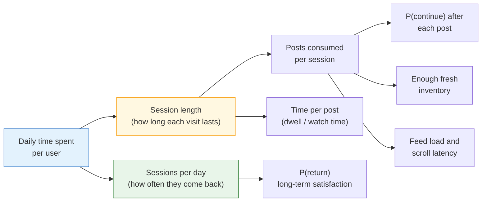
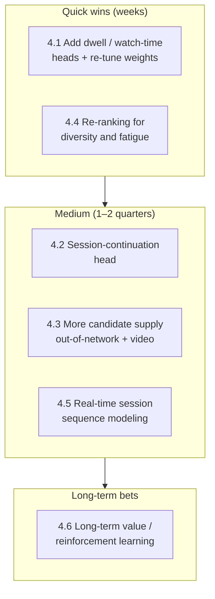
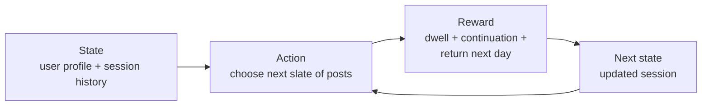
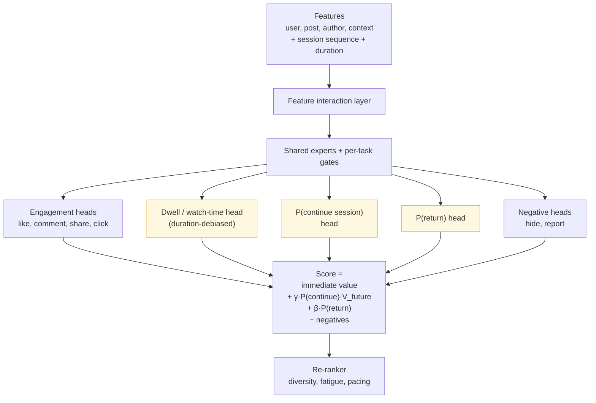
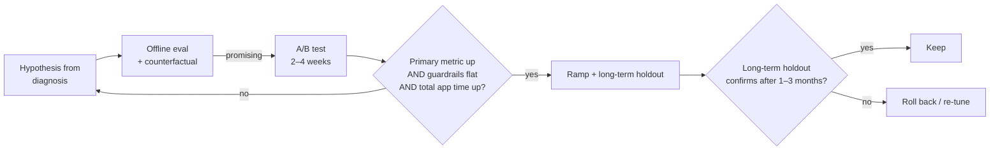
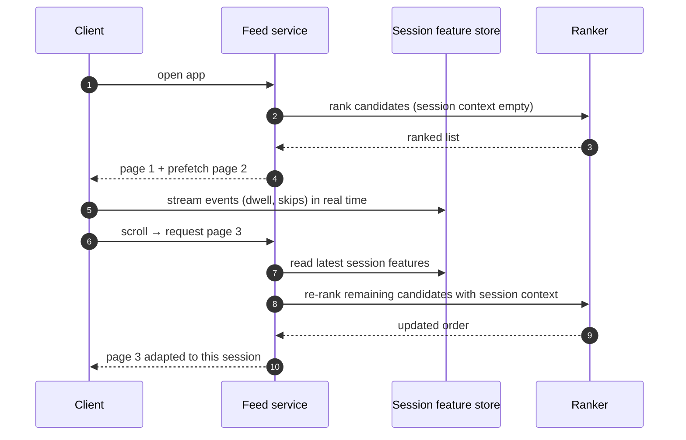

# Improving a Feed Ranking System to Increase Time Spent

> **Problem:** You already have a working feed ranking system. How would you improve it so users spend more time engaging with the feed?
>
> This is an **"improve an existing system"** question, not a "design from scratch" question. The baseline architecture (multi-stage funnel, multi-task ranker, serving) is covered in [Feed Ranking System](feed-ranking.md). This doc focuses on **what to change, why, and how to prove it worked**.

---

## Table of Contents

1. [Clarifying Requirements](#1-clarifying-requirements)
2. [Framing: Defining and Decomposing Time Spent](#2-framing-defining-and-decomposing-time-spent)
3. [Diagnosis and Data](#3-diagnosis-and-data)
4. [Model Improvements](#4-model-improvements)
5. [Evaluation](#5-evaluation)
6. [Serving and System Changes](#6-serving-and-system-changes)
7. [Monitoring and Risks](#7-monitoring-and-risks)
8. [Interview Talking Points](#8-interview-talking-points)

---

## Interview Time Budget (45 min)

| Phase | Time | What to produce |
|-------|------|-----------------|
| Clarify | 5 min | Exactly which metric, what the current system is, guardrails |
| Decompose | 5 min | A driver tree for time spent |
| Diagnose | 5 min | Where time is being lost, as hypotheses |
| Improvements | 18 min | Prioritized levers: objective, model, candidates, re-ranking, system |
| Evaluation | 7 min | Offline proxies, A/B design, long-term holdouts |
| Risks | 5 min | Well-being, cannibalization, feedback loops |

> **What interviewers look for:** a structured approach (define → decompose → diagnose → prioritize → measure), not a list of random model tweaks. And awareness that **"more time" is not automatically good**.

---

## 1. Clarifying Requirements

| Question | Why it matters | Assumed answer |
|----------|----------------|----------------|
| Which metric exactly? Daily time per user, session length, or sessions per day? | Different levers move different components | **Daily time spent in the feed per DAU** |
| Time on the feed, or time in the whole app? | Feed gains may just be **cannibalized** from other surfaces | The goal is total app time. The feed is the lever. |
| What does the current system optimize? | Tells us what's missing | Weighted sum of P(like), P(comment), P(share), P(click), with a weak dwell signal |
| Content types? | Video changes the picture a lot | Text, images, links, short video |
| Any guardrails? | Time spent can be gamed with low-quality or addictive content | No regression in satisfaction surveys, negative feedback, integrity, or retention |
| Short-term or long-term? | Short-term gains often fail to last | **Long-term (weeks)** time spent and retention |

**Restated goal:** increase **meaningful, long-term** time spent per user, without hurting satisfaction or integrity, and without just shifting time from other surfaces.

---

## 2. Framing: Defining and Decomposing Time Spent

### Driver tree

Breaking the metric into parts shows **where** each lever acts:



```
time_spent = sessions_per_day × posts_per_session × avg_time_per_post
```

| Component | ML lever |
|-----------|----------|
| **Time per post** | Better dwell / watch-time prediction, more rich content (video) |
| **Posts per session** | Rank for **session continuation**, not just per-item engagement. Diversity to avoid fatigue. Avoid running out of content. |
| **Sessions per day** | Optimize for **long-term satisfaction and return**, not only immediate clicks |

### Reframing the ML objective

The baseline ranks each post **independently** by immediate engagement:

```
score = Σ wₖ · P(eventₖ)                     ← item-level, myopic
```

To increase time spent, we move toward **session-level** and **long-term** value:

```
score = immediate value of the post
      + γ · P(user continues the session | post) · expected future session value
      + β · Δ P(user returns tomorrow)
```

That's the core idea of this design. Every improvement below is a step from **"what will they click?"** toward **"what keeps them engaged, and coming back?"**

---

## 3. Diagnosis and Data

### Find where time is being lost first

Before changing models, analyze the logs:

| Analysis | What it reveals | Possible fix |
|----------|-----------------|--------------|
| **Session exit position distribution** | Do users leave after only 3–5 posts? | The top of the feed isn't compelling. Improve the early-position ranking. |
| **Exit-triggering posts** | Which content types or authors come right before a session ends? | Learn P(exit). Demote session-killers. |
| **"End of feed" rate** | Do users scroll until no new content is left? | **Inventory problem.** Add out-of-network recommendations. |
| **Dwell by content type** | Is video watched but ranked low because it gets few likes? | The objective under-values passive consumption. Add a watch-time head. |
| **Latency vs session length** | Do slow loads correlate with shorter sessions? | A systems fix, not an ML fix |
| **Cohort breakdown** | New users, light users, regions | Cold start for new users. Different content mix per segment. |
| **Repeated or stale content** | Are users seeing the same posts again? | Better dedupe, freshness features |

> In an interview, say you'd **segment first** and pick the biggest bucket. If 30% of sessions end because the feed runs out of fresh content, a better model won't fix that; more inventory will.

### New labels needed

| Label | Definition | Used for |
|-------|------------|----------|
| **Dwell time** | Time the post is ≥ 50% on screen, capped (e.g. at 60 s for non-video) | Time-per-post head |
| **Watch time / completion** | Seconds watched; fraction of the video completed | Video head |
| **Session continuation** | 1 if the user viewed at least one more post after this one in the same session, else 0 | P(continue) head |
| **Session exit** | The post was the last impression before the app was closed or backgrounded | Same thing, inverted |
| **Return** | User opened the app again within 24 h | Long-term head, at user or session level |
| **Satisfaction survey** | "Was this post worth your time?", asked of a small random sample | Calibration and guardrail; guards against empty time spent |

### New features

- **Session context:** session depth (posts seen so far), session duration so far, content types already seen this session, time since the last session.
- **Fatigue:** how many posts from the same author or topic have been seen recently.
- **Content duration:** video length, estimated reading time. Needed to debias dwell (see 4.1).
- **User consumption style:** history of dwell and watch time per content type (some users watch, some skim).

---

## 4. Model Improvements

Ordered roughly by **expected impact ÷ effort**:



### 4.1 Predict time per post properly

Add **dwell time** and **watch time** heads to the multi-task ranker. That's one more tower each in the MMoE model, as described in the baseline doc.

**Problem 1: regression on dwell is hard.** Dwell is heavy-tailed and mostly near zero. Options:

| Approach | How |
|----------|-----|
| Regression on `log(1 + dwell)` | Simple. MSE loss on the log-transformed target. |
| **Weighted logistic regression** | Train a "was it viewed" classifier, weighting each positive by its dwell time and each negative by 1. The learned odds `e^logit` approximate **expected dwell**. Stable to train, and it fits into a classifier pipeline. |
| Bucketed classification | Predict a distribution over dwell buckets (0–2 s, 2–5 s, …). Take the expected value. |

**Problem 2: duration bias.** A 3-minute video gets more watch time than a 15-second one, even when the user liked the short one more. A naive watch-time head **promotes long content** regardless of quality.

Fixes:
- **Duration-normalized labels:** predict the **watch-time quantile within the same duration bucket** instead of raw seconds. Convert back to expected seconds at serving time.
- Or predict the **completion rate** together with the duration.
- Always include duration as a feature.

**Then re-tune the scoring weights.** Raise the weight on `E[dwell]` / `E[watch_time]` and run A/B tests over several weight settings to find a good point between time spent and the guardrails.

### 4.2 Optimize for the session, not just the post ⭐

This is the biggest conceptual change. The baseline ranks a post highly if it gets a like, even if the user **closes the app right after**. We want posts that keep the session going.

**Add a session-continuation head:**

```
P(continue | user, post, session_context)
```

Labels come from logs: did the user view another post after this one?

**Combine it with a one-step lookahead:**

```
score(post) = immediate_value(post)
            + γ · P(continue | post) · V_future(user, session_depth)
```

- `immediate_value` is the existing weighted sum, now including dwell.
- `V_future` is the expected value of the rest of the session. A simple version is the average remaining session value for this user at this session depth, estimated from history.
- `γ` controls how much future value counts. Tune it with A/B tests.

**Why this works:** a post that's mildly interesting but leads to a long scroll can now beat a post that's very engaging but ends the session.

**Gotcha:** sessions also end for reasons unrelated to content (the user's bus arrived). The P(continue) labels are noisy, so they need lots of data. Use time-of-day and context features, and evaluate calibration carefully.

### 4.3 Expand candidate supply

You can't increase consumption if there's nothing good left to show.

- **Out-of-network recommendations:** a two-tower retrieval model over content from accounts the user doesn't follow. This is essential for users who run out of friends' posts.
- **More video candidates:** a dedicated video retrieval source with watch-time-trained embeddings.
- **Topic and interest expansion:** retrieve by interest clusters, not just the social graph.
- **Re-surfacing:** high-quality older posts the user hasn't seen ("you missed this").

Monitor the **in-network / out-of-network mix** per user. Too much recommended content makes the feed feel impersonal and can hurt long-term retention.

### 4.4 Re-ranking for diversity and fatigue

Users leave when the feed feels repetitive.

- **Author and topic fatigue penalties:** decay a post's score if similar content appeared recently in the session.
- **Format pacing:** interleave video, photo and text instead of clustering by format.
- **Slate-level diversity:** MMR or DPP (determinantal point process) re-ranking over the top N.
- **Freshness:** boost unseen and recent posts. Strictly dedupe posts already viewed.

### 4.5 Real-time session modeling

What a user wants **right now** depends on what they just did.

- Feed the **sequence of posts consumed in this session**, with their dwell times, into a transformer or target-attention module in the ranker.
- If the user just skipped three videos, the model should down-rank video for the rest of the session.
- This needs **streaming features** with seconds-level freshness, and possibly **mid-session re-ranking** (see Section 6).

### 4.6 Long-term value and reinforcement learning

The most advanced lever: treat ranking as a **sequential decision problem**.



- **Reward:** time spent, discounted over the session and over future sessions, plus satisfaction signals.
- **Training:** off-policy learning from logged data (e.g. REINFORCE with off-policy correction). The logs come from the **old** policy, so importance weighting is needed to correct for that.
- **Simpler intermediate step:** add a **P(return within 24 h)** head, or a user-level long-term value model, and add it as a term in the score.
- **Risks:** high variance, hard to debug, and it needs careful exploration and strong guardrails.

### Updated ranker



The highlighted heads are new compared with the baseline.

---

## 5. Evaluation

### Offline

| What | Metric |
|------|--------|
| Dwell / watch-time head | RMSE or MAE on log dwell. Calibration **within each duration bucket**, to check for duration bias. |
| Continuation head | AUC, normalized entropy, calibration |
| Ranking | nDCG with **dwell-weighted relevance** |
| Session level | **Counterfactual / off-policy evaluation**: estimate session time under the new policy from logged data using inverse propensity scoring (IPS) or doubly robust estimators |

> Offline metrics are weak predictors of time-spent changes. Use them to filter candidates, and treat the A/B test as the source of truth.

### Online A/B testing

| Type | Metrics |
|------|---------|
| **Primary** | Daily time spent per user in the feed |
| **Decomposition** | Sessions per user, session length, posts per session, time per post |
| **Ecosystem** | **Total app time** (catches cannibalization), creator engagement received |
| **Guardrails** | Satisfaction surveys, hide and report rate, integrity prevalence, retention (D7 / D28), latency, ads metrics |

**Experiment design:**
- Run **≥ 2–4 weeks** to get past novelty effects. A new content mix often spikes and then fades.
- Keep a **long-term holdout**: about 1% of users who stay on the old system for months, to measure the cumulative effect on retention.
- Watch **heterogeneous effects**: a change can help heavy users and hurt new ones.
- **Ramp up** gradually: 1% → 5% → 50%, checking guardrails at each step.



---

## 6. Serving and System Changes

Some of the biggest wins aren't model changes at all.

| Change | Why it helps time spent |
|--------|-------------------------|
| **Lower feed load latency** | Every extra 100 ms at app open loses some sessions. Faster cold starts mean more sessions. |
| **Prefetch the next page** and preload media | No spinners while scrolling, so fewer exits |
| **Mid-session re-ranking** | Re-rank the cached feed when the session signal changes (e.g. after several skips), instead of serving a stale ranked list |
| **Streaming session features** | The session sequence model needs features with seconds-level freshness |
| **Inventory fallback** | When in-network content runs out, blend in recommendations instead of showing "you're all caught up" |

Mid-session re-ranking flow:



---

## 7. Monitoring and Risks

### Risks specific to optimizing time spent

| Risk | What happens | Mitigation |
|------|--------------|------------|
| **Empty time / compulsive use** | Time goes up, but users report feeling worse. Long-term churn follows. | Satisfaction surveys as a guardrail and as a training label. Weight "worth your time" signals. |
| **Clickbait and outrage** | Provocative content gets long dwell | Integrity classifiers. Negative-feedback heads. Penalties during re-ranking. |
| **Duration bias** | Long videos dominate the feed | Duration-debiased labels, as in 4.1 |
| **Cannibalization** | Feed time rises but messaging or other surfaces fall, so the total doesn't move | Measure total app time and per-surface time |
| **Creator ecosystem damage** | Optimizing for consumption concentrates exposure on a few viral creators | Creator-side metrics, exposure fairness constraints |
| **Feedback loops** | The model learns only from what it showed and narrows over time | Exploration slots, off-policy correction |
| **Vulnerable users** | Teens, or users with excessive usage | Usage-aware policies. Don't optimize time spent for these segments. |

### What to monitor after launch

- Time spent broken down into sessions, session length, posts per session, and time per post. Know **which component** moved.
- Content mix shift: % video, % out-of-network, average content duration.
- Satisfaction and negative-feedback trends over time, not just in the first week.
- Calibration of the new heads (dwell, continuation), sliced by content duration.

---

## 8. Interview Talking Points

### Structured answer outline (2-minute version)

1. **Clarify** the metric (daily time per user), its scope (feed vs app), and the guardrails (satisfaction, integrity).
2. **Decompose:** sessions × posts per session × time per post.
3. **Diagnose:** where users exit, inventory exhaustion, latency, content-type gaps.
4. **Improve**, prioritized:
   - add dwell and watch-time heads, debiased for duration;
   - session-continuation head with lookahead scoring;
   - more inventory (out-of-network, video);
   - diversity and fatigue re-ranking;
   - real-time session modeling;
   - long-term value / RL.
5. **Measure** with long A/B tests, total app time, long-term holdouts and well-being guardrails.

### Key trade-offs

| Trade-off | Discussion |
|-----------|------------|
| Time spent vs satisfaction | Optimizing raw time can produce compulsive, low-value use. Include survey-based labels. |
| Short-term vs long-term | Session-level gains can hurt next-week retention. Use long-term holdouts. |
| Personal vs discovery | Out-of-network content adds inventory but can feel impersonal |
| Model complexity vs debuggability | RL can optimize long-term value but is hard to reason about. Start with explicit heads and lookahead. |

### Likely follow-up questions

1. **Time spent went up but DAU went down. What happened?** Heavy users consume more while light users churn. Check the cohort breakdown, and probably add a return/retention term.
2. **How do you know time spent is "good" time?** Satisfaction surveys, return rate, negative feedback. Treat time spent as a means, not an end.
3. **How would you handle a user who opens the app for 30 seconds while waiting in line?** Context features such as typical session length, time of day and session depth. Rank the most valuable content first, and don't force long videos.
4. **How do you avoid just recommending longer videos?** Duration-normalized watch-time labels and completion rate.
5. **How do you evaluate a session-level policy offline?** Counterfactual evaluation (IPS or doubly robust) on logged data with known propensities, which requires the logging policy to include randomized exploration.

### Common pitfalls to avoid

- ❌ Jumping to "add a bigger model" without diagnosing where time is lost
- ❌ Optimizing raw dwell, which rewards long and low-quality content
- ❌ Measuring only feed time and ignoring cannibalization of other surfaces
- ❌ Running 1-week A/B tests and declaring victory (novelty effect)
- ❌ Ignoring user well-being, which interviewers increasingly ask about explicitly

---

## References

- [Feed Ranking System (baseline design)](feed-ranking.md)
- [Top-K Off-Policy Correction for a REINFORCE Recommender System, Chen et al. 2019](https://arxiv.org/abs/1812.02353)
- [MMoE: Modeling Task Relationships in Multi-task Learning, Ma et al. 2018](https://dl.acm.org/doi/10.1145/3219819.3220007)
- *Deconfounding Duration Bias in Watch-time Prediction for Video Recommendation*, Zhan et al., KDD 2022
