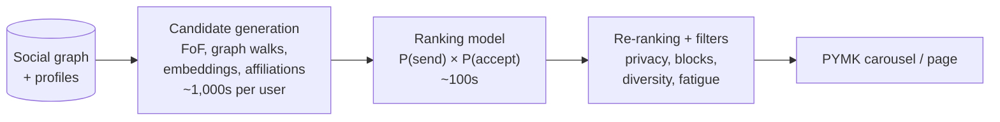
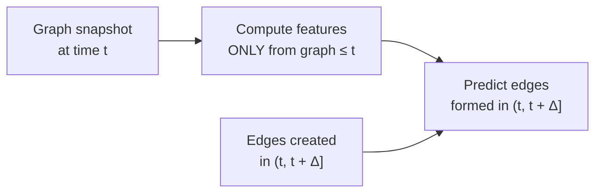
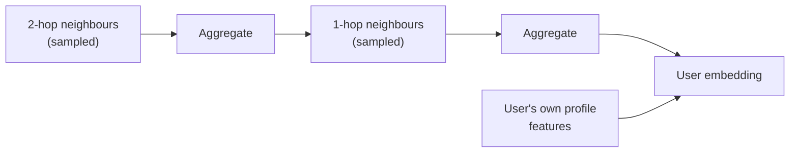
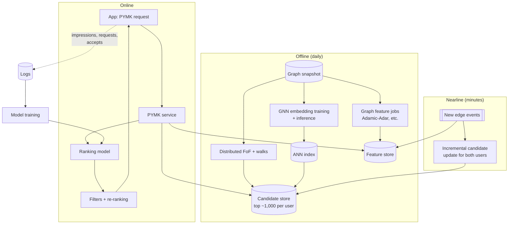

# People You May Know (Friend Recommendation)

> **Problem:** Design the system that recommends people a user might want to connect with on a large social network, the "People You May Know" (PYMK) feature. Good recommendations help users build their network, which drives long-term engagement, especially for new users.

Unlike content recommendation, this is a **graph problem** (predicting which new edges will form), it's **two-sided** (both people must want the connection), and **privacy** concerns are unusually strong.

---

## Table of Contents

1. [Clarifying Requirements](#1-clarifying-requirements)
2. [Framing as an ML Problem](#2-framing-as-an-ml-problem)
3. [Data Preparation](#3-data-preparation)
4. [Model Development](#4-model-development)
5. [Evaluation](#5-evaluation)
6. [Serving and System Architecture](#6-serving-and-system-architecture)
7. [Monitoring and Iteration](#7-monitoring-and-iteration)
8. [Interview Talking Points](#8-interview-talking-points)

---

## 1. Clarifying Requirements

| Question | Assumed answer |
|----------|----------------|
| Connection type? | **Symmetric friendship**: A sends a request, B must accept. (A follow graph is one-sided and simpler.) |
| Scale? | ~1B users, average ~300 connections, ~100M new connections/day |
| Where shown? | A dedicated PYMK page, a carousel in the feed, and onboarding for new users |
| Objective? | **Accepted** connections that lead to real interaction, not just requests sent |
| Latency? | Page load < 200 ms. Recommendations can be largely precomputed. |
| Freshness? | After a user adds a friend, recommendations should update within minutes (new friends-of-friends appear) |
| Privacy constraints? | Don't reveal sensitive relationships; respect blocks and privacy settings; be careful with contact-book and location signals |

### Back-of-the-envelope

```
Friends-of-friends (FoF) per user ≈ 300 × 300 = 90,000 (before de-duplication)
FoF pairs across all users        ≈ 1B × 90K = 9 × 10^13 → can't enumerate naively every day
Recommendations shown / day       ≈ 1B users × ~10 impressions ≈ 10B
```

---

## 2. Framing as an ML Problem

### Formulation

**Link prediction:** given the graph at time *t*, predict which new edges will form by time *t + Δ*.

For ranking, predict a **two-sided** outcome:

```
score(A → B) = P(A sends request to B | shown)  ×  P(B accepts | request from A)
             [× optionally E(value of connection), e.g. P(they interact afterwards)]
```

Why both parts? Optimizing only "A sends" recommends celebrities and strangers who won't accept. Unaccepted requests annoy recipients and can become spam.

### Pipeline



---

## 3. Data Preparation

### Data sources

| Source | Examples |
|--------|----------|
| **Graph** | Connections with timestamps, pending and declined requests, blocks |
| **Profiles** | School, employer, city, age range, language |
| **Affiliations** | Groups, events attended, pages followed |
| **Interactions** | Profile views, comments on the same posts, tags in the same photos, messages |
| **PYMK logs** | Impressions, requests sent, accepted / ignored / declined, "remove suggestion" clicks |
| **Contacts** (opt-in only) | Uploaded address book matches |

### Labels

| Task | Positive | Negative |
|------|----------|----------|
| Send | Shown → request sent within N days | Shown, no request; "remove suggestion" = strong negative |
| Accept | Request → accepted within N days | Declined, or ignored past the window |
| Long-term value (optional) | Interaction within 30 days after connecting | Connected but never interacted |

### Temporal split (avoid leakage) ⭐



- Features must come from the graph **as of time t**. If the target edge A–B is already in the graph used for features (e.g. counted in mutual friends after A and B connected), the model learns from the answer.
- Train on several snapshots; test on a later period.

### Features

| Group | Features |
|-------|----------|
| **Graph structure** ⭐ | # mutual friends; **Adamic-Adar** (mutual friends weighted by 1 / log(their degree), so a mutual friend with 5,000 friends counts less); Jaccard similarity of friend sets; personalized PageRank score; shortest path length |
| **Mutual friend quality** | How close A is to each mutual friend (interaction strength); how recently those friendships formed (a cluster of recent friendships signals a new school or job) |
| **Embeddings** | Similarity of graph embeddings (node2vec / GNN) and profile embeddings |
| **Profile similarity** | Same school, employer, city; age difference; shared language |
| **Interactions** | A viewed B's profile; commented on the same posts; tagged together |
| **Recipient behaviour** | B's acceptance rate, B's pending request count (avoid overloading popular users), B's privacy settings |
| **Requester behaviour** | A's request rate (spammers send many), account age |
| **Context** | Surface (onboarding vs feed), A's current friend count (new users need different recommendations) |

---

## 4. Model Development

### 4.1 Candidate generation

| Source | How | Notes |
|--------|-----|-------|
| **Friends of friends** ⭐ | Enumerate 2-hop neighbours, keep the top by mutual count / Adamic-Adar | Covers most accepted connections. Expensive at scale (see below). |
| **Graph random walks** | Personalized PageRank / random walk with restart from A | Reaches 3+ hops; captures community structure |
| **Graph embeddings + ANN** | Learn node embeddings (node2vec, GraphSAGE-style GNN); retrieve nearest neighbours | Finds similar people beyond 2 hops |
| **Affiliations** | Same school + year, same employer, same group, same event | Strong for new users with few friends |
| **Contacts** (opt-in) | Uploaded contacts who are users | High precision; needs strict consent and privacy rules |
| **Reverse interest** | People who viewed A's profile or sent requests to similar users | Use carefully: can reveal who looked at you |

**Computing FoF at scale:**
- Distributed join over the edge list: for each user, emit pairs of their friends → aggregate mutual counts per pair.
- **Prune** heavy hubs: users with thousands of friends create quadratic pairs; sample or skip them as intermediaries (they're weak signals anyway, which Adamic-Adar captures).
- Keep only the top ~1,000 candidates per user by mutual-friend score.
- Recompute daily in batch; update **incrementally** when an edge is added (A connects to C → add C's friends to A's candidates).

### 4.2 Graph neural network embeddings

A GNN (GraphSAGE-style) computes each user's embedding by aggregating features from sampled neighbours:



- Trained with a link-prediction loss: connected pairs close, random (or hard) non-connected pairs far.
- **Inductive:** works for new users from their profile and few edges, without retraining.
- Embeddings are recomputed daily and indexed for ANN retrieval; they're also ranking features.

### 4.3 Ranking model

- **Baseline:** logistic regression or GBDT on the graph and profile features. Mutual friends and Adamic-Adar alone are strong.
- **Production:** multi-task model with **send** and **accept** heads (plus optional long-term-interaction head), sharing a bottom (see [MMoE discussion](../ranking/feed-ranking.md#stage-3-heavy-ranker-multi-task-dnn)).
- The **accept** head is trained only on sent requests (selection bias: we only observe acceptance for requests that happened). Correct by weighting or by modeling P(accept) over all candidates using recipient features.

### 4.4 Re-ranking and filtering

- **Hard filters:** blocks, existing connections, pending requests, users who disabled being suggested, minors' safety rules.
- **Privacy filters:** don't suggest based on signals that would reveal something sensitive (e.g. both people's contact books containing a therapist's number). Some signals can be used for candidate generation only if the explanation shown is innocuous.
- **Fatigue:** don't show the same suggestion forever; decay after N impressions without action.
- **Recipient protection:** cap how often a popular user is recommended, to avoid floods of requests.
- **Diversity:** mix communities (school, work, family) instead of 10 people from one group.
- **Explanations:** "12 mutual friends", "Went to X school". These increase trust and acceptance.

### 4.5 Cold start (new users)

New users with 0–5 friends get the most value from PYMK, and it's where it's hardest:
- Affiliation candidates from onboarding (school, workplace, city).
- Contacts import (opt-in).
- The first few connections unlock FoF, so update recommendations in near real time after each new connection.
- Track a **network health** goal: e.g. new users reaching N friends within their first 2 weeks, which strongly predicts retention.

---

## 5. Evaluation

### Offline

| Metric | Why |
|--------|-----|
| **Recall@K** of edges formed in the test period | Candidate generation coverage |
| **Precision@K, nDCG@K** | Ranking quality per user |
| **AUC / log loss** per head (send, accept) | Model quality and calibration |
| Slices | New vs established users, by country, by friend count |

### Online

| Metric | Definition |
|--------|------------|
| **Accepted connections per user** ⭐ | Main outcome |
| Request send rate, acceptance rate | Funnel health |
| Decline, ignore, "remove suggestion" and report rates | Quality and spam guardrails |
| New-user network growth | e.g. % of new users reaching N friends in 14 days |
| Downstream engagement | Interactions between new connections; retention |

### A/B testing with network effects

A recommendation to A also affects B (B receives a request). Plain user-level randomization leaks treatment effects into control.
- **Cluster-based randomization:** split the graph into communities and randomize by cluster.
- Measure effects on **both** requesters and recipients.
- Watch for **recipient overload** in treatment (more requests sent to the same popular users).

---

## 6. Serving and System Architecture



**Key serving points:**
- **Precompute candidates; rank online:** candidates change slowly, but ranking can use fresh features (just-viewed profiles, the latest connections).
- **Incremental updates:** when A and C connect, push C's friends into A's candidate list (and vice versa) so the next PYMK load reflects it.
- **Cache** the ranked list for a short time; invalidate on new connections.
- **Filtering at serve time:** blocks and privacy settings change anytime, so always check them online, never only in batch.

---

## 7. Monitoring and Iteration

| Signal | Why |
|--------|-----|
| Acceptance rate trend | Falling = recommending people who don't want to connect |
| Requests received per popular user | Recipient overload |
| Spam/fake account involvement in PYMK | Fake accounts try to get recommended widely |
| Candidate coverage for new users | Cold-start health |
| Privacy incident reports | "How did it know I know this person?" complaints need investigation |

**Abuse:** fake accounts befriend real users to appear in many PYMK lists. Integrate fake-account detection signals and exclude low-trust accounts from candidate generation.

---

## 8. Interview Talking Points

### Key trade-offs

| Trade-off | Discussion |
|-----------|------------|
| Requests sent vs accepted | Optimize two-sided outcomes, or you create spam |
| Graph heuristics vs GNN | Heuristics (mutual friends, Adamic-Adar) are strong and explainable; GNNs add reach and cold-start help |
| Growth vs privacy | Contacts, location and profile-view signals improve recall but can feel invasive. Restrict, explain, and allow opt-out. |
| Batch vs real-time | Batch is cheap; incremental updates make PYMK react immediately to new connections |
| Popular users | High acceptance from users who accept everyone vs overloading them. Cap exposure. |

### Likely follow-up questions

1. **How do you compute friends-of-friends for a billion users?** Distributed pair counting with hub pruning, top-K truncation, and incremental updates.
2. **Why Adamic-Adar instead of mutual friend count?** It discounts mutual friends who are connected to everyone, who carry little signal.
3. **How do you avoid leakage in training data?** Features from the graph snapshot before the label period only.
4. **How would you A/B test PYMK?** Cluster-based randomization; measure both sides; watch recipient overload.
5. **What's different for a follow graph (one-sided)?** No accept step; more like content recommendation; popularity bias is stronger.

### Common pitfalls to avoid

- ❌ Optimizing requests sent instead of accepted connections
- ❌ Graph features computed after the edge formed (leakage)
- ❌ Ignoring privacy-revealing recommendations
- ❌ Plain user-level A/B tests on a social graph
- ❌ Enumerating FoF without hub pruning

---

## References

- [Inductive Representation Learning on Large Graphs (GraphSAGE), Hamilton et al. 2017](https://arxiv.org/abs/1706.02216)
- [node2vec: Scalable Feature Learning for Networks, Grover & Leskovec 2016](https://arxiv.org/abs/1607.00653)
- [Graph Convolutional Neural Networks for Web-Scale Recommender Systems, Ying et al. 2018](https://arxiv.org/abs/1806.01973)
- [The Link Prediction Problem for Social Networks, Liben-Nowell & Kleinberg 2003](https://doi.org/10.1145/956863.956972)
