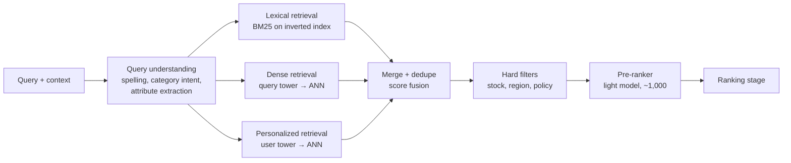
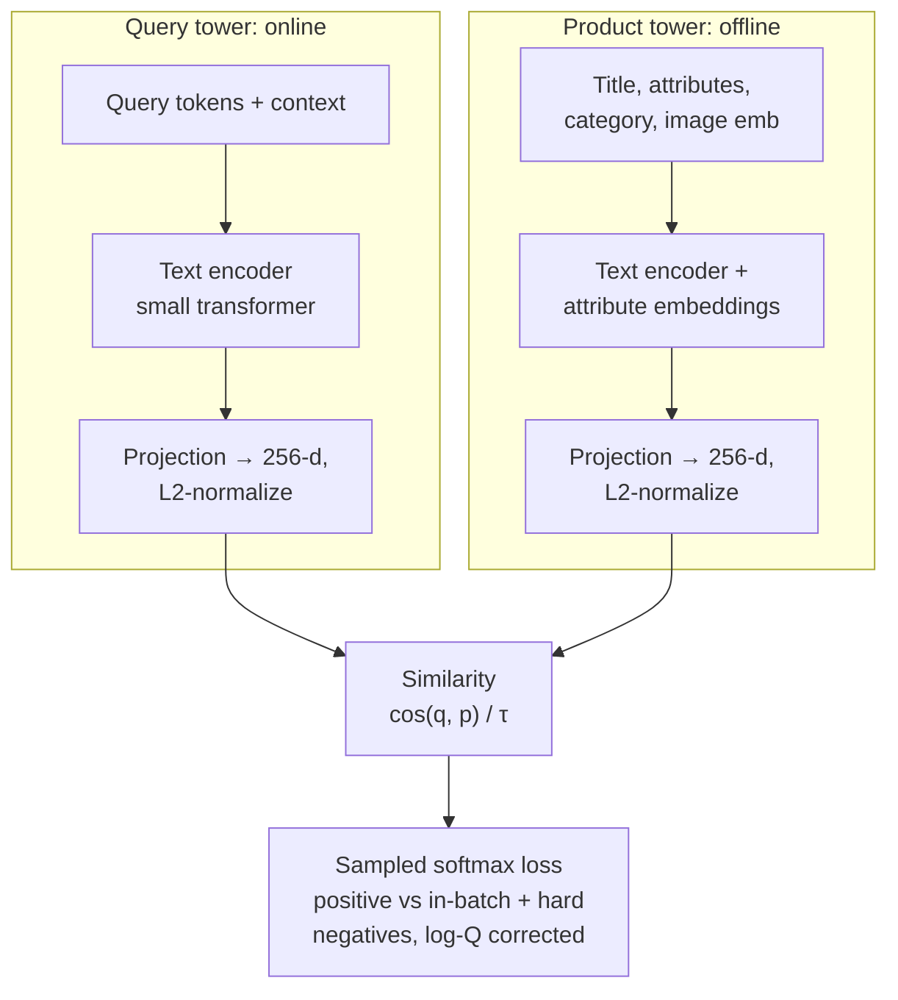
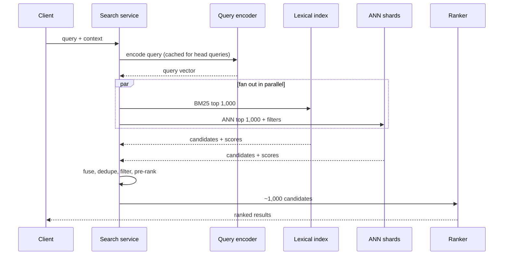
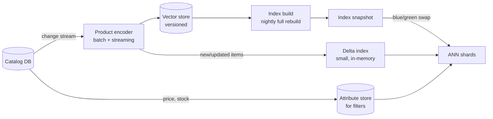

# Embedding-Based Retrieval for Product Search

> **Problem:** Design the retrieval stage of a large e-commerce search engine. Given a text query (and the user's context), find the few thousand most relevant products out of a catalog of hundreds of millions, in tens of milliseconds, so that a heavier ranker can order them.

Retrieval is the **recall stage** of a search or recommendation funnel. The ranker can only reorder what retrieval hands it: an item missed here is lost for good. That makes retrieval a different design problem from ranking. It optimizes **recall under a strict latency and memory budget**, and it has to scale to the whole corpus.

---

## Table of Contents

1. [Clarifying Requirements](#1-clarifying-requirements)
2. [Framing as an ML Problem](#2-framing-as-an-ml-problem)
3. [Data Preparation](#3-data-preparation)
4. [Model Development](#4-model-development)
5. [Evaluation](#5-evaluation)
6. [Serving and System Architecture](#6-serving-and-system-architecture)
7. [Monitoring and Iteration](#7-monitoring-and-iteration)
8. [Interview Talking Points](#8-interview-talking-points)

---

## 1. Clarifying Requirements

| Question | Assumed answer |
|----------|----------------|
| Corpus? | ~500M products: title, description, attributes, category, images, price, seller |
| Query volume? | ~1B searches/day |
| Output? | Top ~1,000 candidates per query, passed to the ranking stage |
| Latency? | Retrieval budget **p99 < 50 ms** (the whole search page has ~200 ms) |
| Freshness? | New products searchable within **minutes**; price and stock changes within seconds |
| Filters? | Hard constraints: in stock, ships to the user's region, category, price range, policy-compliant |
| Personalization? | Light: user context can shift results, but the query intent dominates |
| Languages? | Multilingual queries and listings |

### Back-of-the-envelope

```
QPS                   ≈ 1B / 86,400 ≈ 11.6K average, ~35K at peak (3×)
Raw vectors           = 500M × 256 dims × 4 bytes (fp32) = 512 GB
Product-quantized     = 500M × 64 bytes                 = 32 GB   → fits in RAM on a few machines
Brute-force per query = 500M × 256 ≈ 1.3 × 10^11 multiply-adds → far too slow at 35K QPS
```

So: **approximate** nearest-neighbour (ANN) search over **compressed** vectors, sharded across machines.

---

## 2. Framing as an ML Problem

### Objective

Learn a scoring function `s(query, product)` that can be computed **for the whole corpus cheaply**. The trick that makes this possible is to split the scoring into two independent encoders:

```
s(q, p) = ⟨ f(q), g(p) ⟩       (dot product or cosine of two embeddings)
```

- `g(p)` is computed **offline** for every product and stored in an index.
- `f(q)` is computed **online**, once per query.
- Retrieval becomes **maximum inner product search (MIPS)**, which ANN indexes solve in sub-linear time.

The price: query and product never "see" each other inside the model, so fine-grained matching (exact attributes, negations, numbers) is weaker. The ranker, which uses cross features, makes up for it.

### Retrieval is multi-source

No single retriever covers every query type, so production systems run several in parallel and merge them:

| Source | Good at | Weak at |
|--------|---------|---------|
| **Lexical** (inverted index, BM25) | Exact terms, model numbers, brands, rare tokens | Synonyms, paraphrases, vague intent ("gift for dad who hikes") |
| **Dense / semantic** (two-tower + ANN) | Semantic matches, misspellings, multilingual, long-tail phrasing | Exact identifiers, new vocabulary not seen in training |
| **Personalized** (user embedding + ANN) | Short ambiguous queries ("shoes") | Users with little history |
| **Rules / curated** | Navigational queries, promotions, safety overrides | Coverage |



---

## 3. Data Preparation

### Training signal

There are no relevance labels for 500M products, so the main signal is **logged search behaviour**:

| Signal | Strength | Caveat |
|--------|----------|--------|
| Purchase after the query | Strongest positive | Sparse; biased toward cheap, popular items |
| Add to cart | Strong positive | |
| Click with long dwell | Medium positive | Clickbait titles and thumbnails |
| Click with quick bounce | Weak or negative | |
| Impression, no click | **Not** a clean negative | Position bias: lower results are rarely examined |
| Human relevance ratings | Clean, graded | Expensive; used for evaluation, not bulk training |

Positives are `(query, engaged product)` pairs. Weight them by action type (purchase > cart > click).

### Negatives: the most important design choice

The model scores the whole corpus at serving time, so it must learn to reject **random** products as well as **near-miss** products.

| Negative type | How | Teaches |
|---------------|-----|---------|
| **In-batch** | Other positives in the same batch | Cheap; coarse separation |
| **Random from corpus** | Uniform samples | Fixes popularity bias of in-batch negatives |
| **Hard negatives** | Highly-ranked by the current model but not engaged, or same category with wrong attributes | Fine distinctions ("phone case" vs "phone") |
| **Shown-but-skipped** | Impressions with no click, top positions only | Real user rejections (mild bias) |

In-batch negatives over-penalize popular items, because popular items appear in many batches. Apply **log-Q correction**: subtract `log P(item is sampled)` from the logit during training.

Hard negatives must not be **false negatives**. The "hardest" items are often relevant but simply weren't clicked. Skip the top few neighbours, or filter them with a cross-encoder.

### Features

| Tower | Features |
|-------|----------|
| **Query tower** | Query text (subword tokens), detected language, predicted category, extracted attributes (color, size), user context (country, device; optional user embedding) |
| **Product tower** | Title, description, attributes, category path, brand, image embedding, price bucket, aggregated popularity (careful: favours old items) |

Keep **volatile** fields (price, stock, ratings) **out of the embedding**. Otherwise every price change forces a re-embed. Handle them as filters or as ranker features instead.

### Splits

Split by **time**: train on weeks 1–N, evaluate on week N+1. Random splits leak future popularity and duplicate queries.

---

## 4. Model Development

### Baselines

1. **BM25** on title and attributes. Hard to beat on head queries with exact terms; always keep it as a retriever.
2. **Pretrained sentence embeddings**, off the shelf. Good semantic coverage, but they don't know the catalog's language or what users actually buy.

### Two-tower model



**Loss:** sampled softmax (InfoNCE) over one positive and many negatives:

```
L = − log  exp(s(q, p⁺)/τ − log Q(p⁺)) / Σⱼ exp(s(q, pⱼ)/τ − log Q(pⱼ))
```

- `τ` (temperature) controls how sharply the model separates scores; it is usually learned or tuned.
- Large batches (thousands of examples) give more negatives per step, which matters more than model size.

**Design choices:**

| Choice | Recommendation | Why |
|--------|----------------|-----|
| Shared vs separate towers | Separate, or a shared text encoder with different heads | Queries are short; products are long and structured |
| Encoder size | Query tower small (runs online, < 5 ms); product tower can be large (runs offline) | **Asymmetric** cost budget |
| Embedding dimension | 128–256 | Index memory grows linearly with dimension |
| Normalization | L2-normalize, then use cosine | Stabilizes training; stops popular items winning by vector norm |
| Initialization | Pretrained language model, then fine-tune on search logs | Cold-start vocabulary and multilingual coverage |

### Training curriculum

1. Train with in-batch and random negatives.
2. Mine **hard negatives** with the model from step 1, refreshing them every few epochs.
3. Optionally **distill** from a cross-encoder teacher, which scores (query, product) jointly and is far more accurate but too slow for retrieval. The teacher's soft scores give cleaner targets than clicks.

### Cold start for new products

The product tower only reads **content** (text, attributes, image), with no product ID embedding. A new product therefore gets a meaningful vector the moment it's listed. ID embeddings help memorize head items, but they break cold start. If you use them, add dropout on the ID feature so the model also learns to rely on content.

---

## 5. Evaluation

### Offline

| Metric | What it measures |
|--------|------------------|
| **Recall@K** ⭐ (K = 100, 1,000) | Fraction of relevant (engaged or human-rated) products that make it into the top K. The primary metric for retrieval. |
| **ANN recall** | Overlap of ANN results with exact brute-force top K. Isolates index loss from model loss. |
| **nDCG@K / MRR** | Order quality. Secondary for retrieval, since the ranker reorders anyway. |
| **Coverage** | Fraction of the catalog that ever gets retrieved; catches popularity collapse |
| **Recall by segment** | Head / torso / tail queries, new products, each language, each category |

Measure **end-to-end** as well: replay queries through the full funnel (retrieval → ranker) and compare the final nDCG against the current system. A retrieval change that adds recall the ranker can't use doesn't help.

Watch the **labels**: logged engagement only covers what the old system showed. A new retriever that surfaces good, never-shown products looks like it's retrieving "irrelevant" ones. Use human-rated query sets, or LLM-judged relevance calibrated against human ratings, to measure these.

### Online (A/B test)

| Metric | Type |
|--------|------|
| Purchases (conversion) per search | Primary |
| Search success rate (searches ending in a click or purchase) | Primary |
| Null and low-result rate | Secondary, where dense retrieval should help a lot |
| Query reformulation rate | Secondary, lower is better |
| Retrieval latency p99, CPU and memory cost | Guardrail |
| Revenue per search, return rate | Guardrail |

---

## 6. Serving and System Architecture

### Online path



**Latency budget (p99):** query encoding ~5 ms (cache hits ~0 ms), ANN ~15 ms, lexical ~15 ms in parallel, fusion and filtering ~5 ms. Total ≈ 25–35 ms, inside the 50 ms budget.

**Query embedding cache:** a small share of queries makes up a large share of traffic (head queries). Caching their vectors removes most encoder calls.

### ANN index

| Index | How it works | Trade-off |
|-------|--------------|-----------|
| **HNSW** (graph) | Navigable multi-layer proximity graph; greedy search from the top layer | Best recall and latency; high memory (graph links + full vectors); slow to build |
| **IVF** (inverted file) | k-means into ~√N clusters; search only the `nprobe` nearest clusters | Simple, shards well; recall depends on `nprobe` |
| **IVF-PQ** | IVF + product quantization (vector split into sub-vectors, each stored as a 1-byte code) | ~16–32× compression; lower accuracy → re-score the top results with full vectors |

**Choice at this scale:** IVF-PQ, sharded by vector across ~10–20 machines, with full-precision re-scoring of the top few thousand results. HNSW per shard is the alternative if memory allows.

**Sharding:** split the corpus randomly across shards. Each shard returns its local top K and the aggregator merges them. Random sharding balances load, but every query touches every shard. Sharding by category cuts fan-out, but hot categories overload single shards.

**Replication:** replicate each shard for QPS and availability. Hedge requests to cut tail latency.

### Filtering with ANN

Hard filters (in stock, region, price range) interact badly with ANN:

| Strategy | Problem |
|----------|---------|
| **Post-filter** (ANN top K, then filter) | A strict filter can leave far fewer than K results |
| **Pre-filter** (filter, then exact search) | Fine for very selective filters (small subsets); too slow for broad ones |
| **Filter-aware ANN** (skip non-matching items during traversal) | Best general answer; supported by most modern vector indexes |
| **Separate indexes per partition** (e.g. per region) | Fast, but costs memory; only for a few high-cardinality filters |

A common trick: over-fetch (ask for 3× K), post-filter, and fall back to pre-filtering if too few survive.

### Merging sources

Lexical and dense scores aren't on the same scale, so you can't simply add them:

- **Reciprocal rank fusion (RRF):** `score(d) = Σ_sources 1 / (k + rank_s(d))`, with k ≈ 60. Uses only ranks; needs no tuning; robust.
- **Learned fusion:** the pre-ranker takes each source's score and rank as features. It works better, but it needs training data.
- **Quotas:** reserve a minimum number of slots per source, so a weak source isn't drowned out.

### Offline path and index freshness



- **New products:** embedded by a streaming job and inserted into a small **delta index**, queried alongside the main index. The nightly rebuild folds them in.
- **Deletes and out-of-stock:** a tombstone or filter bit, never waiting for a rebuild.
- **Price and stock:** live in the attribute store used for filtering. They don't touch the embeddings.

### Model updates require re-indexing

A new product tower puts vectors in a **different embedding space**. Query vectors from model v2 are meaningless against product vectors from v1. So:

1. Re-embed the full corpus with v2 (500M items is a large batch GPU job: hours).
2. Build the v2 index alongside v1.
3. Switch the query encoder and the index **atomically**, per experiment arm.
4. Keep v1 hot for rollback.

This makes retrieval model launches slow and costly, so batch improvements together. Backward-compatible training (aligning v2's space to v1) is an option, but it constrains the model.

---

## 7. Monitoring and Iteration

| What | Why |
|------|-----|
| **ANN recall** on a sampled set (vs brute force) | Silent index degradation after rebuilds or parameter changes |
| Null-result and low-result rate | Filters too strict, an index shard down, or encoder failures |
| Per-source contribution | Share of final clicks coming from each retriever; a source drifting to zero |
| Embedding drift | Distribution of query vectors vs training; a new vocabulary (trends, new brands) |
| Delta index size and lag | Freshness SLA for new products |
| Latency per shard | Hot shards, garbage collection pauses, memory pressure |
| Query-model / index version match | A mismatch silently wrecks results |

**Failure modes:**

- **Popularity collapse:** retrieval converges on bestsellers; tail products never surface, so they never get engagement, which reinforces the collapse. Fix with log-Q correction, random negatives and a coverage metric.
- **Feedback loop:** the model is trained on what it retrieved. Keep a lexical retriever and a small exploration slice for unbiased data.
- **Semantic drift on exact queries:** dense retrieval returns "similar" items for a model number. Route identifier-like queries to lexical retrieval or boost exact matches.
- **Stale index:** the rebuild pipeline fails silently. Alert on snapshot age.

**Retraining cadence:** retrain the query tower often (weekly), since it only needs the index to stay compatible if the product tower is frozen. Retrain the product tower less often, because each update requires a full re-index.

---

## 8. Interview Talking Points

### Key trade-offs

| Trade-off | Discussion |
|-----------|------------|
| Two-tower vs cross-encoder | Two-tower scales to the whole corpus but can't model fine query-product interactions. Use the cross-encoder in ranking, or as a distillation teacher. |
| Lexical vs dense | Complementary; hybrid beats either alone. Lexical handles identifiers and new words; dense handles meaning. |
| Recall vs latency vs memory | ANN parameters (`nprobe`, `efSearch`, PQ code size) trade all three; tune on the ANN-recall vs latency curve. |
| Embedding dimension | Higher dimension → more expressive, but index memory and latency grow linearly |
| ID features vs content only | IDs memorize the head; content generalizes to new items. Use both, with dropout on IDs. |
| Model freshness vs re-index cost | Every product-tower change means re-embedding everything; freeze it longer and update the query tower more often |

### Likely follow-up questions

1. **Why not use the ranker on all products?** 500M cross-feature model calls per query is impossible; retrieval exists to cut the corpus to ~1,000 cheaply.
2. **How do you pick negatives?** In-batch plus random, then mined hard negatives; log-Q correction for popularity; guard against false negatives.
3. **How do you evaluate retrieval separately from ranking?** Recall@K against engaged and human-labelled items, ANN recall against brute force, plus end-to-end replay through the ranker.
4. **How do you handle filters like "in stock, ships to me"?** Filter-aware ANN or over-fetch plus post-filter; keep volatile attributes out of the embedding.
5. **What happens when you ship a new embedding model?** Full re-embed and re-index, versioned and swapped atomically with the query encoder.
6. **How would this change for RAG over documents?** Same architecture: chunking replaces products, a cross-encoder re-ranker is standard, and relevance labels often come from LLM judges.

### Common pitfalls to avoid

- ❌ Treating unclicked impressions as definite negatives
- ❌ Only in-batch negatives, with no popularity correction
- ❌ Putting price or stock into the embedding
- ❌ Dropping lexical retrieval once dense works
- ❌ Evaluating only nDCG and not Recall@K
- ❌ Mixing query and product embeddings from different model versions

---

## References

- [Embedding-based Retrieval in Facebook Search, Huang et al. 2020](https://arxiv.org/abs/2006.11632)
- [Dense Passage Retrieval for Open-Domain Question Answering, Karpukhin et al. 2020](https://arxiv.org/abs/2004.04906)
- [Sampling-Bias-Corrected Neural Modeling for Large Corpus Item Recommendations, Yi et al. 2019](https://doi.org/10.1145/3298689.3346996)
- [Efficient and robust approximate nearest neighbor search using Hierarchical Navigable Small World graphs, Malkov & Yashunin 2016](https://arxiv.org/abs/1603.09320)
- [Product Quantization for Nearest Neighbor Search, Jégou et al. 2011](https://doi.org/10.1109/TPAMI.2010.57)
- [Billion-scale similarity search with GPUs, Johnson et al. 2017](https://arxiv.org/abs/1702.08734)
- [Accelerating Large-Scale Inference with Anisotropic Vector Quantization, Guo et al. 2019](https://arxiv.org/abs/1908.10396)
- [ColBERT: Efficient and Effective Passage Search via Contextualized Late Interaction over BERT, Khattab & Zaharia 2020](https://arxiv.org/abs/2004.12832)
- [Reciprocal Rank Fusion Outperforms Condorcet and Individual Rank Learning Methods, Cormack et al. 2009](https://doi.org/10.1145/1571941.1572114)
