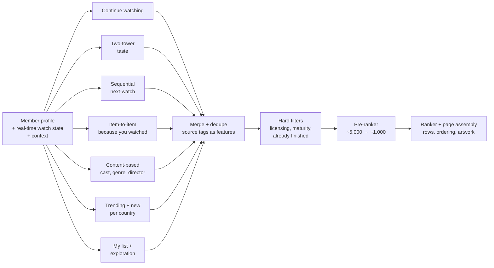
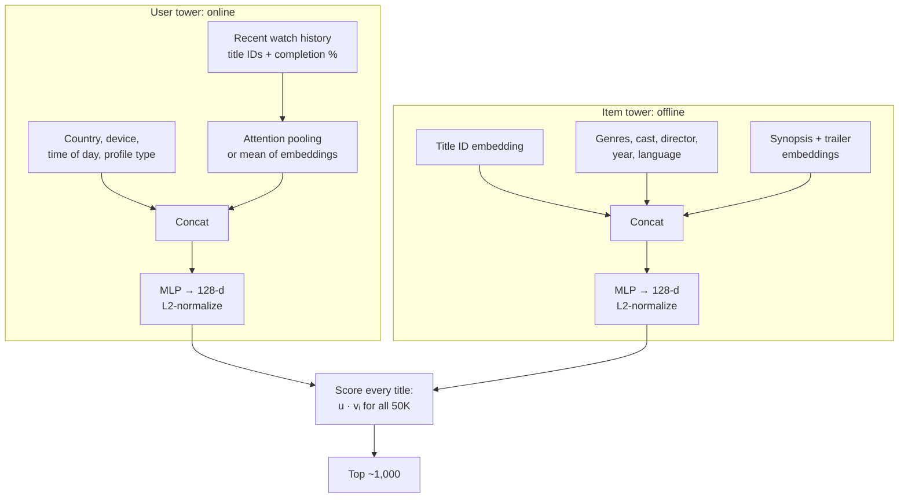
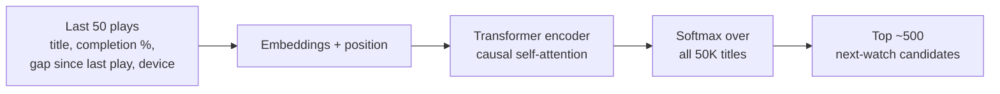
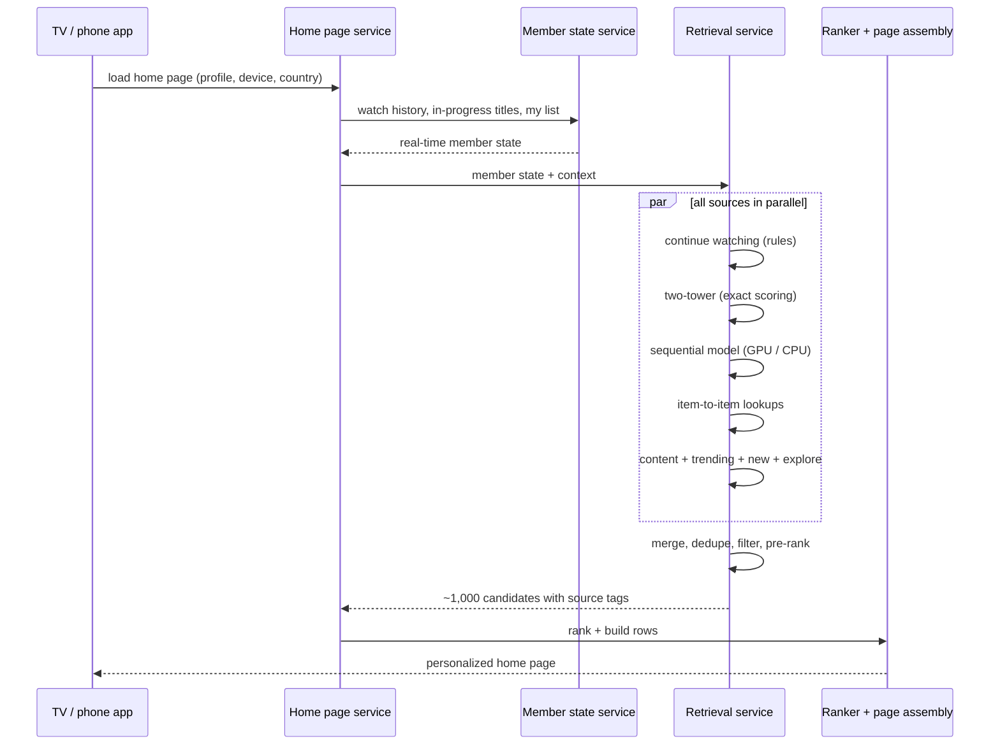
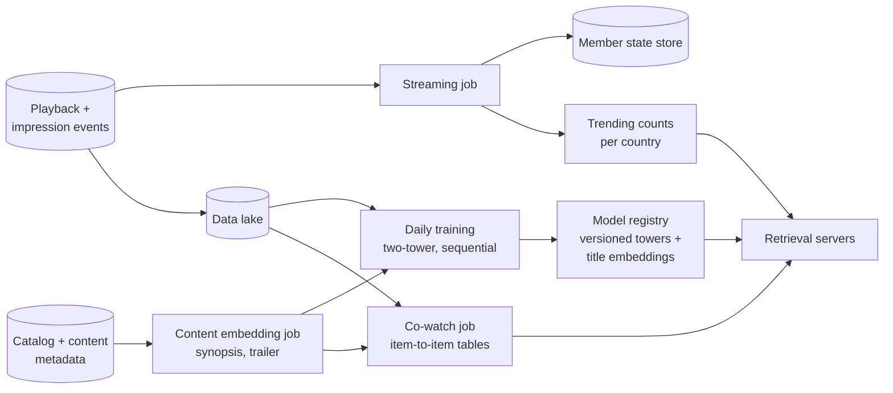

# Candidate Retrieval for a Movie Streaming Service

> **Problem:** Design the full retrieval system behind the home page of a subscription movie and TV streaming service. For each member, the system must gather a few thousand candidate titles from many sources (personalized models, "because you watched", trending, new releases, continue watching, and more), so that the ranking and page-assembly stages can build a personalized home page.

This doc focuses on the **retrieval layer as a whole**: the set of candidate sources, how each one works, how they're merged, and how the system is served and kept fresh. For the ranking side of a video platform, see [Video Recommendation System](../recommendations/video-recommendation.md). For retrieval over a huge corpus with approximate nearest-neighbour search, see [Embedding-Based Retrieval for Product Search](embedding-based-retrieval.md).

---

## Table of Contents

1. [Clarifying Requirements](#1-clarifying-requirements)
2. [Framing as an ML Problem](#2-framing-as-an-ml-problem)
3. [Data Preparation](#3-data-preparation)
4. [Model Development](#4-model-development)
5. [Evaluation](#5-evaluation)
6. [Serving and System Architecture](#6-serving-and-system-architecture)
7. [Monitoring and Iteration](#7-monitoring-and-iteration)
8. [Interview Talking Points](#8-interview-talking-points)

---

## 1. Clarifying Requirements

| Question | Assumed answer |
|----------|----------------|
| Catalog? | ~50K titles (movies and series; episodes roll up to their series). Availability differs by country because of licensing. |
| Members? | ~300M member profiles, ~100M daily active |
| Surface? | The home page: ~40 rows × ~40 titles, each row with a theme ("Continue watching", "Because you watched X", "Trending now", genre rows) |
| Objective? | Members find something they enjoy and **watch it**; long term, members stay subscribed |
| Latency? | Home page < 300 ms end to end; retrieval budget **p99 < 60 ms** |
| Freshness? | Finishing or starting a title should change the next home page load (seconds to minutes) |
| Constraints? | Licensing per country, maturity ratings and kids profiles, titles leaving the catalog, shared household accounts |
| Output of retrieval? | ~2,000–5,000 candidate titles per request, tagged with which source(s) produced them |

### Back-of-the-envelope

```
Home page loads / day   ≈ 100M DAU × 5         = 500M → ~5.8K QPS average, ~20K peak
Title embeddings        = 50K × 128 dims × 4 B  ≈ 26 MB → fits in every server's RAM
Exact scoring / request = 50K × 128             ≈ 6.4M multiply-adds → ~1 ms on one CPU core with SIMD
Item-to-item tables     = 50K titles × 200 neighbours × 8 B ≈ 80 MB
```

**The key insight:** unlike web search or short-video feeds, the catalog is **small**. You can score every title exactly for every request. There's no need for an approximate nearest-neighbour index, and no recall lost to one. The hard parts of retrieval here are different:

- **Coverage of intents:** one member wants to finish a series, rewatch a comfort film, and find something new, all on one page.
- **Sparse, high-cost feedback:** a movie is a 2-hour commitment. Members watch a few titles a week, not hundreds of items a day.
- **Constraints:** licensing, maturity and shared accounts change what's allowed per request.
- **Cold start:** new titles launch with no history but often matter most to the business.

---

## 2. Framing as an ML Problem

### Objective

For a member `u` in context `c` (country, device, time of day), retrieve the set of titles with the highest chance of a **qualified play**: a play that lasts past a meaningful threshold (e.g. > 10 minutes, or > 30% of a movie), not just a click.

```
Retrieval goal:  maximize  Recall@K( titles u will have a qualified play on  |  u, c )
                 subject to  latency, availability and policy constraints
```

### Retrieval is a portfolio of sources

No single model covers every reason someone watches something. Each source has its own job:

| Source | Answers | Type |
|--------|---------|------|
| **Continue watching** | "What was I in the middle of?" | Rules over watch state |
| **Personalized two-tower** | "What fits my overall taste?" | Learned embeddings, exact dot product |
| **Sequential next-watch** | "What do I watch *after* this?" | Sequence model over recent history |
| **Because you watched X** | "More like a title I enjoyed" | Item-to-item: co-watch + content similarity |
| **Content-based** | "New titles with my favourite actors, genres, directors" | Metadata and content embeddings; cold start |
| **Trending / popular** | "What's everyone watching?" | Counts by country, decayed over time |
| **New and upcoming** | "What just arrived?" | Catalog events plus a boost |
| **Explicit signals** | "My list", thumbs up, onboarding picks | Direct lookup + expansion |
| **Exploration** | Unbiased data; testing new titles | Random or bandit-chosen slots |



### Retrieval feeds rows, not one list

The home page is a grid of **rows**. Some rows map one-to-one to a source ("Continue watching", "Because you watched X", "Trending now"). Others are built later by grouping ranked candidates by theme ("Feel-good comedies"). So retrieval must return candidates **with their source and reason attached**, because the row title ("Because you watched *The Heist*") comes from the source.

---

## 3. Data Preparation

### Data sources

| Source | Examples |
|--------|----------|
| **Playback events** | Play start, progress heartbeats, pause, stop, completion, rewatch |
| **Impressions** | Which titles were shown, in which row and position, on which device |
| **Explicit feedback** | Thumbs up/down, added to "My list", removed from "Continue watching" |
| **Search** | Queries and the titles played from search results (strong intent signal) |
| **Catalog metadata** | Genres, cast, director, year, runtime, language, maturity rating, synopsis, tags |
| **Content signals** | Trailer and artwork embeddings, subtitle/script text embeddings, audio mood |
| **Availability** | Per-country licensing windows (start and end dates) |

### Labels

| Label | Definition | Use |
|-------|------------|-----|
| **Qualified play** ⭐ | Play past a threshold (e.g. > 10 min or > 30% of runtime) | Main positive |
| Completion | Finished a movie, or watched ≥ N episodes of a series | Stronger positive, upweighted |
| Short play / abandon | Started, stopped within ~5 minutes | Weak negative |
| Thumbs down, removed from row | Explicit dislike | Strong negative (rare) |
| Impressed, not played | Shown, ignored | **Weak** negative: the member may not have looked |

Raw play counts favour short content and autoplay. Use **qualified plays**, and turn off credit for autoplay previews that the member didn't choose.

### Features

| Group | Features |
|-------|----------|
| **Member** | Watch history (sequence of titles with completion %, time since watch), genre/language affinity, profile type (kids/adult), country, tenure, typical viewing hours |
| **Context** | Device (TV vs phone), time of day, day of week, session so far |
| **Title** | ID embedding, genres, cast and director embeddings, year, runtime, language, maturity, content embeddings (synopsis text, trailer), popularity in country (recent window) |

### Shared accounts

One profile can be several people (a household sharing a profile). Signs: very mixed genres, kids titles mixed with adult thrillers, distinct viewing-time clusters. The retrieval portfolio handles this naturally: multiple item-to-item seeds and sequential models cover separate threads of interest, where a single averaged taste vector would land between them.

### Splits

Split by **time**: train on events up to day *T*, evaluate on plays in the days after *T*. For sequential models, use **leave-last-out** per member as a quick check, but report final numbers on the time split. Random splits leak future popularity, especially around big launches.

---

## 4. Model Development

### Source 1: Continue watching (rules)

- In-progress movies (between ~5% and ~90% watched) and series with a next unwatched episode.
- Ordered by recency, with decay: a show abandoned 6 months ago drops out.
- Rarely needs ML for retrieval. The **ranker** decides whether the row appears at the top.
- It's the highest-converting row on the page. Make it real time: a title stopped 30 seconds ago must appear.

### Source 2: Personalized two-tower (taste)



- **Training:** softmax over the catalog, with the next qualified play as the target. With only 50K titles you can use the **full softmax** instead of sampled negatives, which removes the sampling bias that log-Q correction exists to fix.
- **Popularity bias** remains: blockbusters dominate the positives. Options: down-weight very popular titles in the loss, or add a popularity term the ranker can adjust.
- **Serving:** compute the user vector online (~2 ms), then an exact matrix–vector product against all title vectors (~1 ms), then take the top K.

### Source 3: Sequential next-watch model

Watching is ordered. After finishing season 1, the member wants season 2. After a heavy drama, maybe something light. A sequence model captures these patterns better than an averaged taste vector.



- **Training:** predict the next qualified play from the previous plays, using the full softmax over the catalog.
- **Input features matter:** completion % (finishing vs abandoning means opposite things), the time gap (yesterday vs a year ago), and the device.
- **Exclude trivial targets:** the next episode of the same series is already handled by "continue watching". Either mask it, or let the model learn it and dedupe at merge time.

### Source 4: Item-to-item ("Because you watched X")

For each title, precompute ~200 neighbours from two complementary signals:

| Signal | How | Strength | Weakness |
|--------|-----|----------|----------|
| **Co-watch** | Titles watched by the same members within a window, normalized (e.g. cosine or PMI) to avoid "everyone watched the blockbuster" | Captures real audience overlap | Needs history; biased to popular titles |
| **Content similarity** | Cosine on content embeddings (genre, cast, synopsis, trailer) | Works for new titles on day one | Misses "different but liked by the same people" |

Blend the two per title, weighted by how much co-watch data exists. At request time, pick **seed titles** from the member's recent strong plays (completions, thumbs up), then look up their neighbour lists. Each candidate carries its seed, which becomes the row title.

### Source 5: Content-based

An inverted index from attributes to titles (actor → titles, director → titles, genre + language → titles), ranked by a member's affinity for each attribute. This is the main path for **new titles**, since it needs no plays at all.

### Sources 6–8: Trending, new, explicit, exploration

- **Trending:** qualified plays per title per country over the last few hours and days, with time decay. Computed by a streaming job and refreshed every few minutes. The same list for everyone in a country; cheap.
- **New and upcoming:** recently added titles in the member's country, filtered to the member's broad genres. A launch boost here makes sure new titles get exposure.
- **My list and thumbs up:** direct lookup, plus a small expansion through item-to-item.
- **Exploration:** a few slots for titles chosen at random or by a bandit. They provide **unbiased training data** (the models otherwise only learn from what they already showed), and they get new titles their first impressions.

### Cold start

| Case | Approach |
|------|----------|
| **New title** | Content-based and content-similarity sources; the item tower uses content features, so the title gets a usable vector before any plays (use **ID-embedding dropout** in training so the model doesn't depend on IDs alone); launch boost in the "new" source; exploration slots |
| **New member** | Onboarding picks become seeds for item-to-item; country trending; context (device, time); the sequential model adapts after the first few plays |
| **New country** | Fall back to regional or global popularity among titles licensed there |

### Merge and pre-rank

1. **Union** the candidates from all sources (~2,000–5,000 after dedupe).
2. **Keep the source tags** as features: the same title found by 3 sources is a strong signal, and the ranker learns how far to trust each source.
3. **Hard filters** (see section 6).
4. **Pre-ranker:** a light model (a small two-tower or GBDT using source scores and cheap features) cuts to ~1,000 for the heavy ranker.
5. **Quotas:** guarantee each source a minimum share before the pre-ranker cut. Otherwise sources with high-scoring candidates (popular titles) crowd out discovery sources entirely.

---

## 5. Evaluation

### Offline

Evaluate **each source** and the **merged set**:

| Metric | What it tells you |
|--------|-------------------|
| **Recall@K** ⭐ per source | Fraction of next-week qualified plays the source retrieves in its top K |
| **Union recall@K** | Recall of the merged candidate set; the ceiling for the ranker |
| **Incremental recall** | Drop in union recall when one source is removed. A source with high recall but no incremental recall is redundant. |
| **Catalog coverage** | Share of the catalog that ever gets retrieved for anyone |
| **Novelty** | Share of retrieved plays that are titles the member hasn't seen from the same franchise or genre cluster |
| **Recall by segment** | New vs tenured members, new titles, countries, kids profiles, devices |

```
Example: union recall@3000 = 91%.
Remove item-to-item → 85% (incremental 6 points: keep it).
Remove content-based → 90.6% overall, but 74% → 52% for titles launched this week (essential for cold start).
```

**Label bias:** logged plays only come from titles the old system showed. Use the exploration slots to build an unbiased evaluation set, and weight logged examples by inverse propensity when comparing sources.

### Online (A/B test)

| Metric | Type |
|--------|------|
| Qualified plays per member per day | Primary |
| **Retention / cancellation rate** | North star; slow, so watch it over weeks |
| Time to first play (browse time) | Secondary: faster is better |
| Browse abandonment (sessions with no play) | Secondary |
| Share of plays from discovery (new to the member) | Secondary |
| Plays on new titles in the first week | Business |
| Retrieval latency p99, CPU cost | Guardrail |

A retrieval change can only show up through the ranker. Run the A/B test with the **current ranker** on top, and check that the ranker actually picks up the new candidates (share of top-row impressions coming from the new source).

---

## 6. Serving and System Architecture

### Online path



**Latency budget (p99):**

| Step | Time |
|------|------|
| Member state lookup | ~10 ms |
| User-tower and sequential-model inference | ~15 ms |
| Exact scoring over 50K titles | ~2 ms |
| Item-to-item and index lookups | ~5 ms |
| Merge, filter, pre-rank | ~10 ms |
| **Retrieval total** | **~40 ms**, inside the 60 ms budget |

### Where things live

| Data | Store | Updated |
|------|-------|---------|
| Title embeddings (26 MB) | **In-memory on every retrieval server** | When the model retrains |
| Item-to-item neighbours (~80 MB) | In-memory | Daily |
| Trending lists per country | In-memory, pushed from streaming job | Every few minutes |
| Member watch state | Low-latency key-value store | Real time, from playback events |
| Availability per country | In-memory bitmask: title × country | On licensing changes |

Because everything title-side is small, it's **replicated** to every server instead of sharded. Only member state needs a distributed store.

### Precompute vs compute online

| Approach | Pros | Cons |
|----------|------|------|
| **Precompute** candidates per member nightly | Cheap at request time; heavy models allowed | Stale: misses what they watched an hour ago; 300M × 1,000 candidates is a lot of storage |
| **Compute online** | Fresh; reacts to the last play | Must fit the latency budget |
| **Hybrid** ✅ | Heavy, slow-changing parts offline (item-to-item tables, title embeddings); light, member-specific parts online (user vector, sequence model, continue watching) | Two pipelines to keep consistent |

Also cache the **final home page** per profile for a few minutes, and invalidate it on a playback event. Many app opens happen in quick succession.

### Hard filters

Applied after merge, before pre-ranking, with **no exceptions**:

- **Licensing:** the title must be available in the member's country **now**. Use a title × country bitmask, updated on license start and end.
- **Maturity:** respect profile ratings and kids profiles. Kids profiles use a separate, pre-filtered catalog for every source.
- **Already finished:** remove finished movies, except on "watch again" surfaces.
- **Explicitly rejected:** thumbs down or "not interested".
- **Device:** titles not supported on the device or at the required quality.

### Offline pipelines



**Versioning:** user tower and title embeddings must come from the **same model version**. Ship them together as one artifact, and switch atomically per experiment arm.

---

## 7. Monitoring and Iteration

| What | Why |
|------|-----|
| Per-source candidate count and latency | A source silently returning nothing (a failed table load) |
| Per-source share of plays | A source drifting toward zero contribution, or taking over |
| Catalog coverage, popularity concentration | Collapse onto blockbusters |
| New-title exposure in the first week | Launch performance and cold-start health |
| Licensing violations (must be zero) | Availability bitmask out of date |
| Member state lag | Continue watching missing a title just played |
| Model and embedding version match | Mismatched user tower and title embeddings |

**Failure modes:**

- **Popularity collapse:** every source converges on the same blockbusters. Fix with source quotas, popularity-aware training and novelty tracking.
- **Feedback loop:** models learn only from what they showed. Keep exploration slots and train with propensity weighting.
- **Franchise saturation:** "because you watched" fills the page with sequels of one franchise. Dedupe by franchise at merge.
- **Licensing churn:** a title leaves a country but stays in a precomputed list. Always filter at request time.
- **Seasonal and event shifts:** holidays, big launches and sports events change behaviour fast. Trending reacts in minutes; retrain models daily.

**Iteration ideas:** a household-aware model that detects multiple viewers on one profile; mood or occasion intents ("something short tonight"); conversational or search-driven retrieval feeding the same merge step.

---

## 8. Interview Talking Points

### What's different from large-corpus retrieval?

| Aspect | Small catalog (this design) | Huge corpus (web, products, short video) |
|--------|-----------------------------|------------------------------------------|
| Scoring | **Exact** over all titles | Approximate nearest neighbour (HNSW, IVF-PQ) |
| Training | **Full softmax** possible | Sampled softmax + log-Q correction |
| Index | Replicated in memory | Sharded across machines |
| Hard part | Intent coverage, sparse feedback, licensing, cold start | Scale, latency, memory |
| Feedback | A few plays per week, each a big commitment | Many cheap interactions per day |

### Key trade-offs

| Trade-off | Discussion |
|-----------|------------|
| Many sources vs one model | Multiple sources cover different intents and fail independently, but cost more to maintain. Justify each source by incremental recall. |
| Precompute vs online | Hybrid: offline for heavy, slow-changing title data; online for member-specific, fast-changing data. |
| Co-watch vs content similarity | Co-watch is more accurate for established titles; content works on day one. Blend by data volume. |
| Popularity vs discovery | Popular titles convert today; discovery drives long-term retention. Use quotas and exploration. |
| Shared profile vs averaged taste | Multiple seeds and sequence models cover several viewers; one averaged vector serves none of them well. |

### Likely follow-up questions

1. **Do you need ANN here?** No: 50K × 128 exact scoring is ~1 ms. ANN only adds recall loss and complexity.
2. **How do you decide whether a source earns its place?** Incremental recall offline, then an A/B test removing it, plus its role for specific segments (cold start).
3. **How does a title launched today get recommended?** Content tower and content similarity, the "new" source with a launch boost, and exploration slots.
4. **How do you make the home page react to what was just watched?** Streaming member state, online user tower and sequence model, page-cache invalidation on playback events.
5. **How do you stop the page being all one franchise?** Dedupe by franchise at merge, diversity in page assembly, quotas per source.
6. **What's the label?** Qualified plays, not clicks. Completion upweighted; autoplay excluded.

### Common pitfalls to avoid

- ❌ Proposing ANN sharding for a 50K-title catalog without noticing the scale
- ❌ Counting clicks or autoplay starts as positives
- ❌ One retrieval model for every intent
- ❌ Licensing or maturity filtering left to precomputed lists
- ❌ Evaluating sources only by their own recall, not incremental recall
- ❌ No plan for new titles or new members

---

## References

- [Deep Neural Networks for YouTube Recommendations, Covington et al. 2016](https://doi.org/10.1145/2959100.2959190)
- [The Netflix Recommender System: Algorithms, Business Value, and Innovation, Gomez-Uribe & Hunt 2015](https://doi.org/10.1145/2843948)
- [Self-Attentive Sequential Recommendation (SASRec), Kang & McAuley 2018](https://arxiv.org/abs/1808.09781)
- [BERT4Rec: Sequential Recommendation with Bidirectional Encoder Representations from Transformer, Sun et al. 2019](https://arxiv.org/abs/1904.06690)
- [Item-based Collaborative Filtering Recommendation Algorithms, Sarwar et al. 2001](https://doi.org/10.1145/371920.372071)
- [Matrix Factorization Techniques for Recommender Systems, Koren et al. 2009](https://doi.org/10.1109/MC.2009.263)
- [Sampling-Bias-Corrected Neural Modeling for Large Corpus Item Recommendations, Yi et al. 2019](https://doi.org/10.1145/3298689.3346996)
- [Mixed Negative Sampling for Learning Two-tower Neural Networks in Recommendations, Yang et al. 2020](https://doi.org/10.1145/3366424.3386195)
