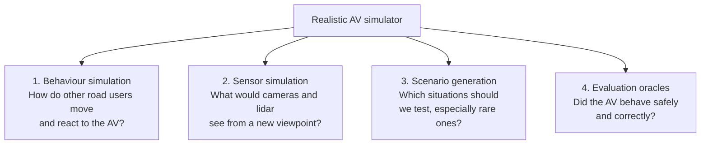
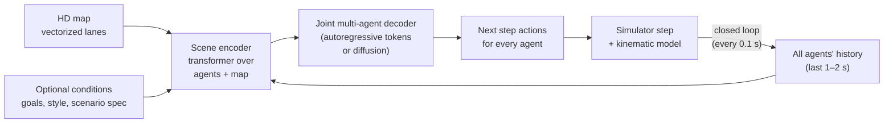
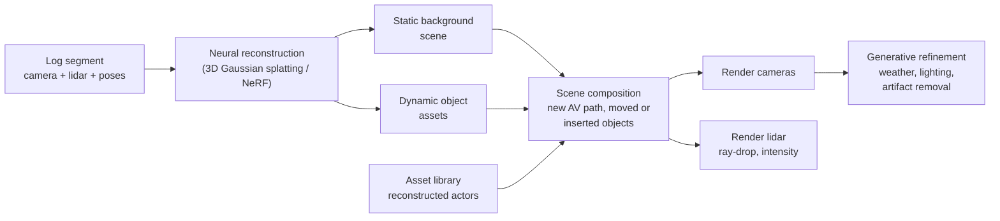
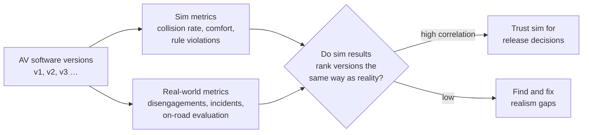
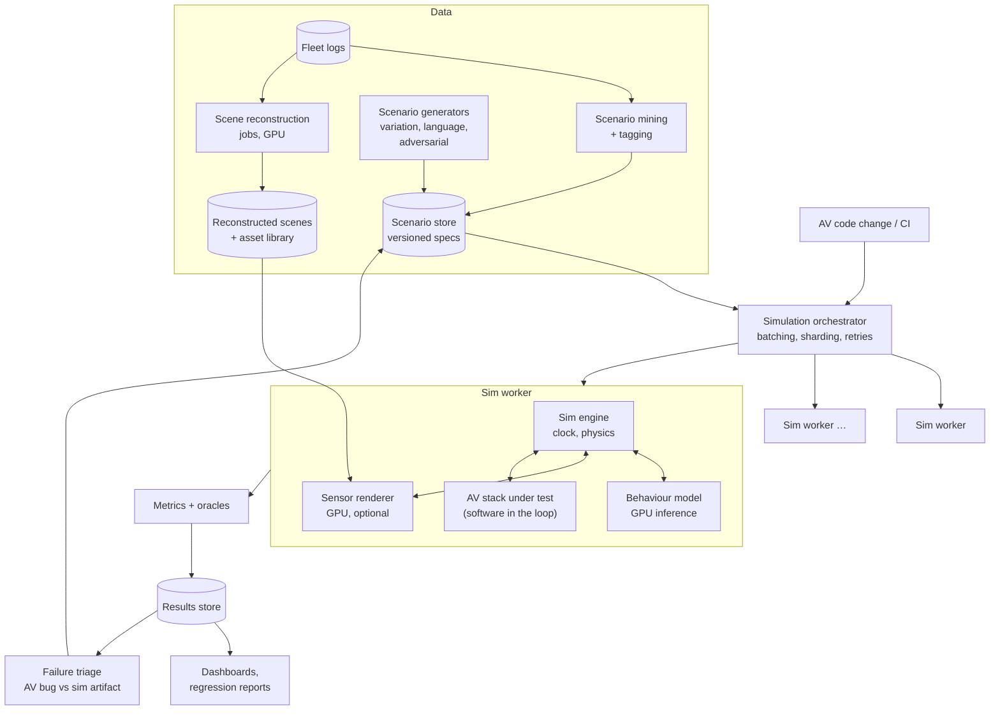

# Realistic Simulation for Autonomous Driving Training and Testing

> **Problem:** Design a simulation platform that lets an autonomous vehicle (AV) team **test** every software change against millions of realistic driving scenarios, and **train** driving and perception models on situations that are too rare or dangerous to collect on real roads.

The hard part isn't the physics engine. It's **realism**: other road users that behave like real people and react to the AV, and sensor data (camera, lidar, radar) that the AV's perception stack can't tell apart from real data. Both of those are ML problems.

---

## Table of Contents

1. [Clarifying Requirements](#1-clarifying-requirements)
2. [Framing as an ML Problem](#2-framing-as-an-ml-problem)
3. [Data Preparation](#3-data-preparation)
4. [Model Development](#4-model-development)
5. [Evaluation](#5-evaluation)
6. [Serving and System Architecture](#6-serving-and-system-architecture)
7. [Monitoring and Iteration](#7-monitoring-and-iteration)
8. [Interview Talking Points](#8-interview-talking-points)

---

## 1. Clarifying Requirements

| Question | Assumed answer |
|----------|----------------|
| Primary use? | **Testing / validation** first (regression testing every AV software change, building the safety case), **training** second (reinforcement learning (RL) for the planner, synthetic data for perception) |
| Which parts of the AV stack are tested? | Both modes: **planning-only** (feed perception outputs, test prediction + planning) and **full stack** (feed raw sensor data, test perception too) |
| Data available? | Millions of miles of fleet logs: camera, lidar, radar, vehicle state, HD maps, auto-labeled objects |
| Scale? | Millions of simulated scenarios per day; every code change runs a regression suite of ~100K scenarios |
| Closed-loop? | **Yes.** When the AV behaves differently from the log, other agents must react realistically. |
| Determinism? | The same inputs and seeds must produce the same result, so failures can be reproduced and debugged |
| Rare events? | Must cover long-tail scenarios: jaywalkers, red-light runners, emergency vehicles, debris, unusual weather |

### Why simulation?

```
Real-world miles to observe a serious failure  → hundreds of millions
Cost and risk of testing rare events on roads  → unacceptable
Time to validate one software release on roads → months
Simulation                                      → millions of scenarios overnight
```

---

## 2. Framing as an ML Problem

### Levels of simulation

| Level | Input to the AV | Realism challenge | Cost |
|-------|-----------------|-------------------|------|
| **Log replay (open-loop)** | Exact recorded log | None (it's real data), but agents **can't react**: if the AV brakes earlier than the logged vehicle did, the car behind "drives through" it | Cheap |
| **Object-level closed-loop** | Simulated perception outputs (objects, tracks) | **Behaviour realism** of other agents | Medium |
| **Sensor-level closed-loop** | Rendered camera, lidar and radar | Behaviour realism **plus sensor realism** | Expensive (GPU rendering) |

Most testing volume is object-level. Sensor-level sim is used where perception matters.

### The four ML problems inside the simulator



| Problem | ML formulation |
|---------|----------------|
| **Behaviour simulation** ("sim agents") | **Multi-agent generative model**: given the map and the history of all agents, sample realistic **joint** future trajectories. Run autoregressively in closed loop. |
| **Sensor simulation** | **Neural scene reconstruction and rendering**: reconstruct a 3D scene from logs, then render novel viewpoints, with the AV in a different position and objects moved, added or removed |
| **Scenario generation** | **Conditional generative modeling + search**: generate plausible scenarios matching a description, or adversarially search for scenarios that make the AV fail |
| **Evaluation oracles** | Rule-based metrics plus **learned models** of human judgment ("would a human driver rate this as uncomfortable or unsafe?") |

---

## 3. Data Preparation

### Data sources

| Source | Use |
|--------|-----|
| **Fleet driving logs** (sensor + vehicle state) | Scene reconstruction, behaviour model training, scenario seeds |
| **Perception outputs / auto-labels** | Agent tracks (position, heading, velocity, type) for behaviour models |
| **HD maps** | Lanes, traffic lights, crosswalks, speed limits |
| **Disengagements and incident reports** | Highest-value scenarios: where the AV or safety driver struggled |
| **Human-authored scenarios** | Regulatory test cases, known hard cases |

### Scenario mining

Most driving is boring. Find the interesting parts:
- **Rule-based triggers:** hard braking, small time-to-collision, disengagements, traffic rule violations by others.
- **Embedding-based search:** embed scenario segments (agents + map) and search for similar ones ("find more unprotected left turns with an oncoming motorcycle").
- **Novelty detection:** segments the behaviour or perception models find surprising (high prediction loss) are probably rare and valuable.
- **Natural-language search:** a multimodal model tags segments ("ambulance", "construction zone", "child near the road") for querying.

### Scenario representation

A scenario is a **structured, versioned spec**:

```
scenario:
  map: <map tile + version>
  initial_state: AV pose/speed + each agent's type, pose, velocity
  agent_behaviour: log-replay | learned-model | scripted (e.g. "cut in at 2s gap")
  conditions: weather, time of day, sensor degradations
  success_criteria: no collision, reach goal, comfort limits, traffic rules
  seed: <random seed for reproducibility>
```

**Parameterized scenarios** let one spec become thousands of variations (e.g. cut-in gap from 0.5 s to 3 s, speed from 20 to 60 km/h).

---

## 4. Model Development

### 4.1 Behaviour simulation (sim agents) ⭐

The goal: other agents behave like real humans **and** react plausibly to what the AV does.



**Design choices:**

| Choice | Options | Notes |
|--------|---------|-------|
| Marginal vs joint prediction | Predict each agent independently, or **all agents jointly** | **Joint** is needed in sim. Independent samples produce inconsistent futures, like two cars choosing the same gap and colliding. |
| Output type | Deterministic trajectory vs **distribution** | Must sample a distribution: realism means diverse behaviour, not the average driver |
| Decoder | Autoregressive over discretized motion tokens (transformer), or diffusion over trajectories | Autoregressive fits closed-loop stepping naturally. Diffusion gives strong joint samples and easy conditioning. |
| Physical plausibility | Output accelerations and steering, then integrate through a **kinematic bicycle model** | Prevents impossible motion (sideways sliding, teleporting) |

**Training:** imitation learning (behaviour cloning) on fleet logs: maximize the likelihood of the observed next actions.

**The big problem: compounding errors in closed loop.** A model trained only on logged data sees its own small mistakes at rollout time and drifts into states never seen in training (covariate shift). Agents drift off-road or collide.

Fixes:
- **Closed-loop training:** roll the model out in the simulator during training and penalize divergence from the logs (DAgger-style or differentiable simulation).
- **RL fine-tuning for realism:** add rewards for no collisions, staying on the road and obeying traffic lights, while staying close to human behaviour (a KL penalty to the imitation policy).
- **Noise injection:** perturb training histories so the model learns to recover.

**Controllability:** testers need agents that do specific things ("this car cuts in"). Condition the model on goals or text descriptions, or use **guided sampling** (steer diffusion samples toward the constraint) while keeping the rest of the behaviour realistic.

**Agent types:** vehicles, pedestrians, cyclists and motorcyclists behave very differently. Use one model with type embeddings and type-specific evaluation.

### 4.2 Sensor simulation

Needed to test perception and the full stack in closed loop. When the AV drives a different path than in the log, the cameras see a **viewpoint that was never recorded**.



| Approach | Strengths | Weaknesses |
|----------|-----------|------------|
| **Game-engine rendering** (hand-built 3D assets) | Full control, any scenario | Expensive assets, visible domain gap ("looks like a video game") |
| **Neural reconstruction** (NeRF, 3D Gaussian splatting) from logs ⭐ | Photorealistic for real places, scalable from fleet data | Quality degrades far from the original viewpoint; dynamic objects need separate handling |
| **Generative world models** (video diffusion conditioned on layout and actions) | Can create new scenes, weather and rare objects | Hard to keep geometry consistent across cameras and over time; hard to control precisely |

**Recommended:** neural reconstruction for the backbone (real places, accurate geometry), plus generative models for **edits** (weather, time of day, inserting rare objects), plus physics-based lidar and radar models with learned noise.

**Per-sensor details:** lidar needs ray-drop and intensity models; radar is the hardest (multipath, sparse returns); cameras need exposure, motion blur, rolling shutter and lens effects.

### 4.3 Scenario generation

| Method | How | Use |
|--------|-----|-----|
| **Log-based variation** | Take a real scenario, perturb agent behaviours or timing using the behaviour model | Large regression suites grounded in reality |
| **Language-conditioned generation** | "Pedestrian crosses mid-block at night in the rain" → generator produces the scenario spec and agent goals | Coverage of described edge cases |
| **Adversarial search** ⭐ | Optimize agent behaviours to **make the AV fail**, while a realism term keeps them plausible | Find failure modes before the real world does |
| **Combinatorial / parameter sweeps** | Grid or Bayesian optimization over scenario parameters | Find the boundary where the AV starts failing |

**Adversarial generation needs a realism constraint.** Without one, the generator finds trivial "failures" like a car teleporting into the AV, which tell you nothing.

### 4.4 Using simulation for training

- **Planner RL:** train or fine-tune the driving policy in closed loop against reactive sim agents. Reward = progress + safety + comfort + rule compliance, with a penalty for deviating from human driving.
- **Perception data augmentation:** render rare objects and conditions (debris, animals, unusual vehicles, heavy fog) with automatic labels, to train detectors on the long tail.
- **Risk:** the policy learns to **exploit simulator flaws**, e.g. sim agents that always yield. Mitigate with diverse and adversarial agents, and with sim-to-real validation (Section 5).

---

## 5. Evaluation

Two separate questions: **is the simulator realistic?** and **is the AV good?**

### 5.1 Is the simulator realistic?

**Behaviour realism:**

| Metric | What it checks |
|--------|----------------|
| **Distributional match** | Compare distributions of speed, acceleration, jerk, distance to nearest object, time-to-collision, and lane-change frequency between sim rollouts and real logs (e.g. per-feature likelihood or divergence) |
| **Interaction realism** | Rates of collisions, off-road driving and traffic-light violations by sim agents should match real-world rates (near zero, but not unrealistically zero) |
| **Log-likelihood on held-out logs** | How likely the real future is under the model's sampled distribution |
| **minADE / minFDE** | Closest of K samples to the real trajectory. Useful but insufficient: it doesn't measure diversity or joint consistency. |
| **Reactivity tests** | When the AV brakes hard, does the following car brake? Targeted unit tests for behaviours. |

**Sensor realism:**

| Metric | What it checks |
|--------|----------------|
| PSNR / SSIM / LPIPS on held-out views | Image fidelity versus real camera frames |
| FID-style distribution metrics | Overall look of rendered vs real images |
| **Perception consistency** ⭐ | Run the AV's real perception model on rendered and real versions of the same scene. Detection and tracking metrics should match. This is the metric that matters, because the simulator only needs to be realistic **to the AV**. |

**Sim-to-real correlation ⭐ (the ultimate test):**



If version B beats version A in simulation, B should also be better on real roads. Track this correlation over many releases.

### 5.2 Is the AV good? (metrics computed inside the simulator)

| Category | Metrics |
|----------|---------|
| **Safety** | Collisions (with severity), time-to-collision minimums, near misses, safety-envelope violations |
| **Rules** | Red lights, stop signs, speed limits, right of way |
| **Comfort** | Peak acceleration, jerk, hard braking |
| **Progress** | Route completion, time to goal, unnecessary stops |
| **Human-likeness** | Learned "would a human rate this as good driving?" model |

**Rare-event statistics:** a serious failure may happen once in millions of scenarios. Use **importance sampling**: sample dangerous scenarios more often, then reweight to estimate the real-world failure rate with confidence intervals.

**Attribution:** when the AV "fails" in sim, check whether it's a real AV bug or a **simulator artifact** (an unrealistic agent, a rendering glitch). This triage is a major operational cost. Track the simulator false-alarm rate.

---

## 6. Serving and System Architecture



**Key system points:**
- **Determinism:** fixed seeds, a simulated clock (not wall-clock time), and deterministic model inference (fixed batch composition, deterministic kernels), so a failure can be replayed exactly.
- **Versioning:** every result records the AV version, simulator version, behaviour model version and scenario version. Updating the behaviour model can change results **without any AV change**, so pin simulator versions for release comparisons.
- **CI gating:** each AV change runs a fast suite (minutes) on every commit and a large suite (hours) before release. Block merges on regressions.
- **Cost control:** sensor-level sim is ~100× more expensive than object-level. Run object-level by default, and sensor-level only for perception-relevant suites. Cache reconstructed scenes.
- **Faster than real time:** object-level scenarios run much faster than real time. Sensor-level is bounded by rendering throughput.
- **Hardware-in-the-loop:** a smaller suite runs on the real vehicle compute hardware to catch timing and latency issues.

---

## 7. Monitoring and Iteration

| Signal | Why |
|--------|-----|
| Sim-to-real correlation per release | Is the simulator still a trustworthy predictor? |
| Sim agent collision and off-road rates | Behaviour model regressions |
| Flaky scenario rate (different results on rerun) | Determinism bugs |
| Triage outcomes: % failures that are sim artifacts | Simulator quality from the user's point of view |
| Coverage of the scenario taxonomy (intersection types, weather, agent types) | Gaps in testing |
| Cost per simulated mile, queue time | Platform efficiency |

**Co-evolution problem:** as the AV improves, it drives differently from the logged human drivers. Scenes drift further from the original logs: sensor reconstructions get worse, and agents face situations not in their training data. Keep retraining the behaviour models with fresh logs from the **current** AV fleet, and track realism metrics as a function of how far the AV's path deviates from the log.

**Feedback loop to the real world:** every real-world disengagement or incident becomes a sim scenario (with variations), and the AV must pass it in every future release.

---

## 8. Interview Talking Points

### Key trade-offs

| Trade-off | Discussion |
|-----------|------------|
| Log replay vs closed-loop | Replay is 100% real but non-reactive. Closed-loop is reactive but only as real as the models. Use both. |
| Realism vs controllability | Learned agents are realistic but hard to direct. Scripted agents are controllable but robotic. Use conditioning and guided sampling. |
| Neural reconstruction vs generative world models | Reconstruction is geometrically accurate but limited to recorded places. Generative models are flexible but harder to keep consistent. |
| Adversarial vs natural scenarios | Adversarial finds failures fast but can be unrealistic. Always pair it with a realism score. |
| Fidelity vs cost | Sensor sim is expensive. Choose the cheapest level that exercises the component under test. |

### Likely follow-up questions

1. **How do you know the simulator is good enough to make release decisions?** Sim-to-real correlation across releases, perception consistency on rendered vs real data, and behaviour realism metrics.
2. **What happens when the AV deviates far from the log?** Agents must react (closed-loop behaviour model). Sensor reconstruction quality drops with distance from the original path. Measure and bound it, and fall back to object-level sim.
3. **How do you test a scenario that has never happened?** Language- or spec-conditioned generation, adversarial search with realism constraints, and inserting reconstructed or generated assets.
4. **How do you prevent the planner from exploiting the simulator during RL?** Diverse and adversarial agents, realism regularization, held-out sim agent models, and real-world validation.
5. **How do you estimate a failure rate of 1 in 10 million?** Importance sampling over scenario parameters, with reweighting and confidence intervals.

### Common pitfalls to avoid

- ❌ Testing only with log replay (non-reactive agents give false collisions and false passes)
- ❌ Judging sensor sim by image metrics alone instead of perception consistency
- ❌ Adversarial scenarios with no realism constraint
- ❌ Not versioning the simulator itself (results change with no AV change)
- ❌ Treating every sim failure as an AV bug without triage

---

## References

- [NeRF: Representing Scenes as Neural Radiance Fields for View Synthesis, Mildenhall et al. 2020](https://arxiv.org/abs/2003.08934)
- [3D Gaussian Splatting for Real-Time Radiance Field Rendering, Kerbl et al. 2023](https://arxiv.org/abs/2308.04079)
- [Domain Randomization for Transferring Deep Neural Networks from Simulation to the Real World, Tobin et al. 2017](https://arxiv.org/abs/1703.06907)
- [A Reduction of Imitation Learning and Structured Prediction to No-Regret Online Learning (DAgger), Ross et al. 2011](https://arxiv.org/abs/1011.0686)
- [Generative Adversarial Imitation Learning, Ho & Ermon 2016](https://arxiv.org/abs/1606.03476)
