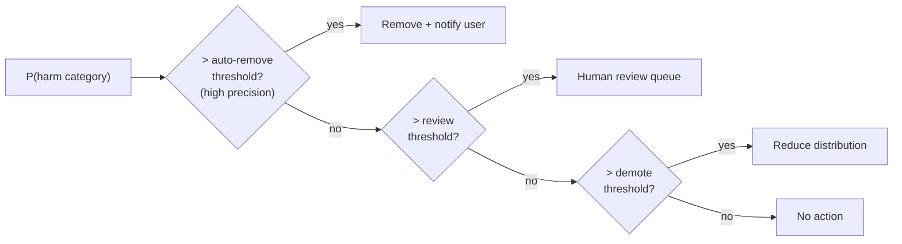
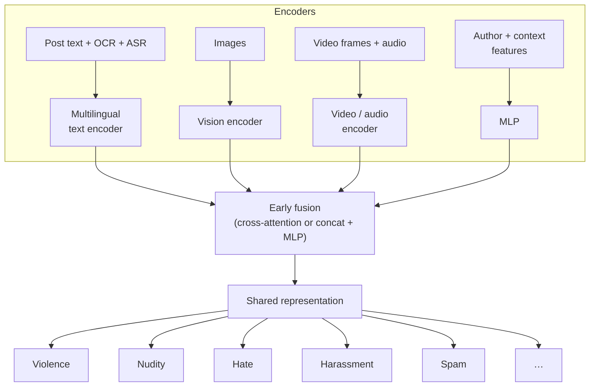
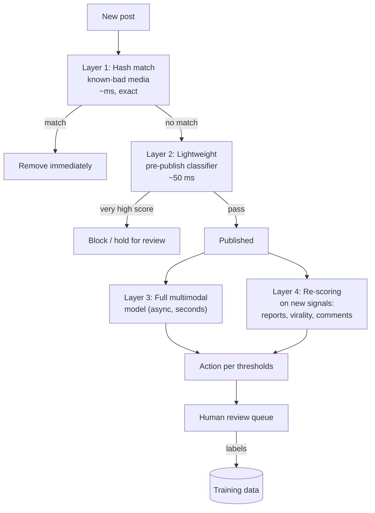
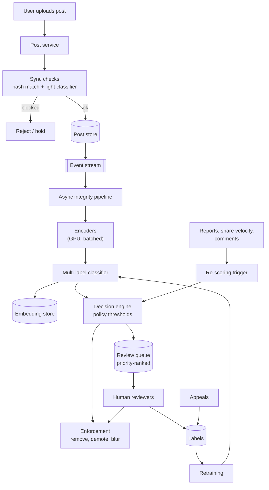

# Harmful Content Detection System

> **Problem:** Design a system that detects harmful content (hate speech, violence, nudity, harassment, spam, misinformation) in posts on a large social platform, and takes the right action before or soon after the content is seen.

---

## Table of Contents

1. [Clarifying Requirements](#1-clarifying-requirements)
2. [Framing as an ML Problem](#2-framing-as-an-ml-problem)
3. [Data Preparation](#3-data-preparation)
4. [Model Development](#4-model-development)
5. [Evaluation](#5-evaluation)
6. [Serving and System Architecture](#6-serving-and-system-architecture)
7. [Monitoring and Iteration](#7-monitoring-and-iteration)
8. [Interview Talking Points](#8-interview-talking-points)

---

## 1. Clarifying Requirements

| Question | Assumed answer |
|----------|----------------|
| Which harm categories? | Violence, nudity, hate speech, harassment, spam, self-harm, misinformation. Each has its own policy. |
| Content types? | Text, images, video, and combinations (image + caption, video + audio + comments) |
| Languages? | 100+ languages |
| What actions? | **Remove**, **demote** (reduce distribution), **blur / warning screen**, **send to human review**, **no action** |
| Before or after publishing? | Lightweight checks before publishing; full analysis just after publishing; re-check as signals accumulate (reports, virality) |
| Scale? | ~1B posts/day, plus comments and messages |
| Human reviewers? | Yes, a limited team of thousands. Their time is the scarcest resource. |
| Appeals? | Users can appeal removals. Successful appeals become labels. |

### Key requirements

- **High recall on severe harms** (e.g. violent extremism, child safety): missing them is very costly.
- **High precision for automatic removal:** wrongly removing legitimate speech harms users and trust.
- **Explainability:** an action must map to a specific policy so users can be told why and can appeal.
- **Adaptability:** bad actors constantly change tactics, and new harm types emerge.

---

## 2. Framing as an ML Problem

### Formulation

**Multi-label classification:** for each post, predict a probability per harm category.

```
input:  post = (text, images, video, audio, author, context)
output: P(violence), P(nudity), P(hate), P(harassment), P(spam), …
```

Multi-label, not multi-class, because a post can violate several policies at once.

### From probabilities to actions

Each category has **its own thresholds**, chosen to meet precision and recall targets:



Thresholds differ by **severity**:
- **Severe harms** (child safety, terrorism): low review thresholds that favour recall, with aggressive auto-removal.
- **Ambiguous harms** (harassment, misinformation): high auto-remove thresholds; most cases go to human review or demotion.

### Model design choices

| Choice | Options | Recommendation |
|--------|---------|----------------|
| One model per harm vs one shared | Per-harm models are easy to own but duplicate compute. A shared multi-task model shares representations. | **Shared multimodal backbone + per-harm heads.** Add a dedicated model only for categories that need special handling. |
| Fusion of modalities | **Late fusion** (classify each modality, combine scores) vs **early fusion** (combine embeddings, then classify) | **Early fusion.** Harm often comes from the **combination**, e.g. a harmless image plus a hateful caption. |

---

## 3. Data Preparation

### Label sources

| Source | Volume | Quality | Notes |
|--------|--------|---------|-------|
| **Expert human review** | Low | High | Gold-standard labels. Expensive. |
| **User reports** | High | Low and noisy | Biased: people report content they disagree with. Use as a weak signal and to prioritize review. |
| **Appeals outcomes** | Low | High | Directly reveal false positives |
| **Known-bad hash matches** | Medium | Very high | Exact or near-duplicates of previously removed content |
| **LLM-assisted labeling** | High | Medium | A large model applies the written policy; humans audit a sample. Good for bootstrapping new policies. |

**Labeling challenges:**
- **Policy ambiguity:** reviewers disagree. Measure inter-rater agreement and use multiple raters for hard cases.
- **Cultural and language context:** a slur in one language is a common word in another. Use reviewers who are native to the market.
- **Reviewer well-being:** exposure to severe content harms reviewers. Blur by default and limit exposure time.

### Handling imbalance

Harmful content is rare (often < 1% of posts), and severe categories are far rarer.

- **Oversample** positives and confirmed violations from review queues.
- **Active learning:** send uncertain and borderline predictions to human review. They're the most informative examples to label.
- **Focal loss** or class-weighted loss for rare categories.

### Features

| Modality | Representation |
|----------|----------------|
| **Text** | Multilingual transformer encoder (XLM-R style) on the post text, OCR text from images, and the speech transcript |
| **Image** | Vision encoder (ViT or CLIP-style) |
| **Video** | Sampled frames → image encoder → temporal pooling or a video transformer, plus audio |
| **Author** | Account age, previous violations, follower patterns, verification |
| **Context** | Reports so far, share velocity, comments (often reveal harm), group or page context |
| **Hash** | Perceptual hash (robust to small edits) to match against databases of known-bad media |

---

## 4. Model Development

### Architecture



- **Pretrained encoders, fine-tuned:** start from large pretrained text and vision models and fine-tune on policy data. Much better than training from scratch on scarce labels.
- **Multi-task loss:** `L = Σ_k λ_k · BCE_k`, with higher λ on severe categories.
- **Distillation:** the full multimodal model is expensive. Distill it into a smaller model for the pre-publish check.

### Layered detection (defence in depth)

No single model catches everything. Use several layers, from cheapest to most expensive:



### Prioritizing the human review queue

Reviewers can't see everything, so rank the queue by **expected harm prevented**:

```
priority = P(violation) × severity × predicted_future_views
```

A borderline post going viral outranks a confident violation with 3 views.

### Adapting to new harms quickly

- **Few-shot / prompt-based classification:** use a large multimodal model with the new written policy to label and detect early, before enough training data exists.
- **Similarity search:** embed known violations and find near-duplicates and variants with ANN search.
- **Frequent retraining** on fresh review labels. Weekly or faster for adversarial categories like spam.

---

## 5. Evaluation

### Offline

| Metric | Why |
|--------|-----|
| **PR-AUC** per category | Better than ROC-AUC for rare positives |
| **Recall at fixed precision** | e.g. recall at 95% precision, which is the auto-removal operating point |
| **Precision at fixed recall** | For the review threshold |
| **Per-language, per-region slices** | Catch blind spots in less common languages |
| **Fairness slices** | False positive rate across dialects and groups. Over-flagging some communities is a known failure. |

Use a **separate, carefully labeled evaluation set**, multi-rater and sampled from real traffic, not the training distribution. Training labels come from review queues that are biased toward high-scoring content.

### Online

| Metric | Definition |
|--------|------------|
| **Prevalence** ⭐ | % of **views** (not posts) that contained violating content. Estimated by labeling a random sample of views. The best measure of user exposure. |
| **Proactive rate** | % of actioned content found by the system before any user reported it |
| **Time to action** | How long violating content was live, and how many views it got |
| **Appeal overturn rate** | Measures false positives |
| **Reviewer precision** | % of the review queue that was actually violating. Measures queue efficiency. |

> **Prevalence measures views, not posts:** one viral violating post can matter more than 10,000 unseen ones.

---

## 6. Serving and System Architecture



**Key serving points:**
- **Sync path budget is tight (~50–100 ms):** only hash matching and a small distilled model before publishing.
- **Async path:** full multimodal models run on GPU in batches, seconds to minutes after publishing.
- **Re-scoring triggers:** posts are rescored when they get reports or go viral, because new context (comments, spread) changes the assessment.
- **Decision engine separate from models:** thresholds and policy rules live in config, so policy teams can change them without retraining.
- **Audit log:** every action records the model version, scores, threshold, and policy, which is needed for appeals and regulation.

---

## 7. Monitoring and Iteration

| Signal | Why |
|--------|-----|
| Prevalence trend per category | The north-star metric |
| Score distribution shift | Sudden shifts may mean an attack or a model bug |
| Appeal overturn rate | Rising rate = too many false positives |
| Review queue size and age | Capacity planning |
| Per-language precision and recall | Catch regressions in specific markets |

**Adversarial behaviour to plan for:**
- **Text obfuscation:** "h4te", Unicode homoglyphs, zero-width characters. Fix with normalization and character-level models.
- **Media manipulation:** cropping, mirroring, overlays to evade hashes. Fix with perceptual hashing and embedding similarity.
- **Coded language:** new slang and dog whistles. Fix with fast relabeling and similarity search from reviewer-flagged examples.
- **Coordinated campaigns:** many accounts posting variants. Fix with account- and network-level detection, in addition to per-post classification.

---

## 8. Interview Talking Points

### Key trade-offs

| Trade-off | Discussion |
|-----------|------------|
| Precision vs recall | Different per severity: auto-remove only at high precision, review queue for the uncertain middle |
| Pre- vs post-publish | Pre-publish adds latency for every user; post-publish allows some exposure. Layer both. |
| One model vs many | Shared backbone saves compute; per-harm heads and thresholds keep policy ownership clear |
| Automation vs human review | Humans are accurate but scarce. Prioritize their time by expected harm prevented. |
| Free expression vs safety | False positives silence legitimate speech. Use demotion and warnings for ambiguous cases instead of removal. |

### Likely follow-up questions

1. **How do you handle a new type of harm with no labeled data?** Write the policy, bootstrap with LLM-assisted labeling plus human audit, use similarity search from seed examples, then train a head once labels accumulate.
2. **How do you avoid bias against certain dialects?** Fairness slices in evaluation, diverse reviewers, and calibrating thresholds per language.
3. **Why early fusion instead of separate text and image models?** Many violations exist only in the combination (meme-style content).
4. **How do you measure success if most harmful content is never reported?** Prevalence from random-sample labeling of views, not report counts.
5. **How do you handle live video?** Score sampled segments continuously during the stream. Escalate to a human when risk is high. Be able to cut the stream.

### Common pitfalls to avoid

- ❌ One global threshold for all categories
- ❌ Measuring by posts removed instead of prevalence (views)
- ❌ Training only on user reports
- ❌ Ignoring adversarial adaptation
- ❌ Evaluating on the biased review-queue distribution

---

## References

- [Focal Loss for Dense Object Detection, Lin et al. 2017](https://arxiv.org/abs/1708.02002)
- [Unsupervised Cross-lingual Representation Learning at Scale (XLM-R), Conneau et al. 2019](https://arxiv.org/abs/1911.02116)
- [Learning Transferable Visual Models From Natural Language Supervision (CLIP), Radford et al. 2021](https://arxiv.org/abs/2103.00020)
- [The Hateful Memes Challenge, Kiela et al. 2020](https://arxiv.org/abs/2005.04790)
