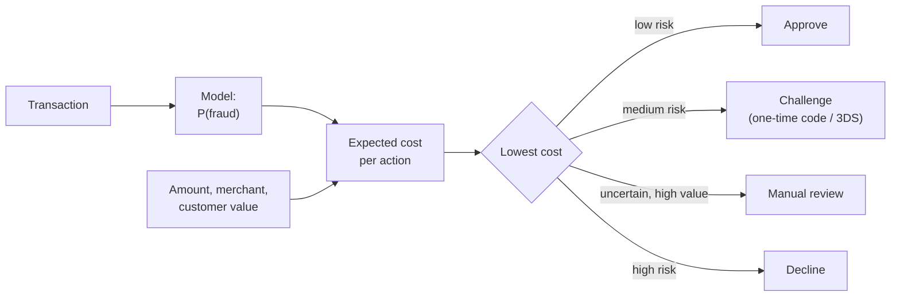
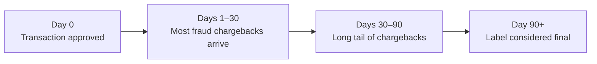
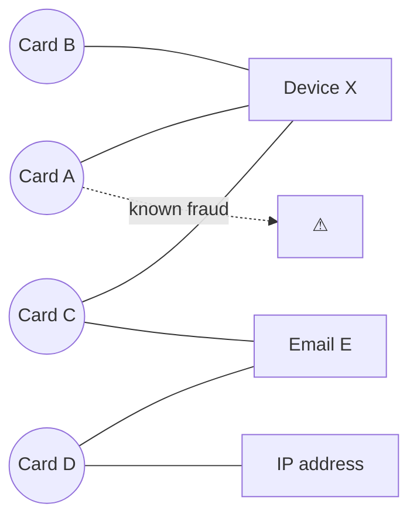
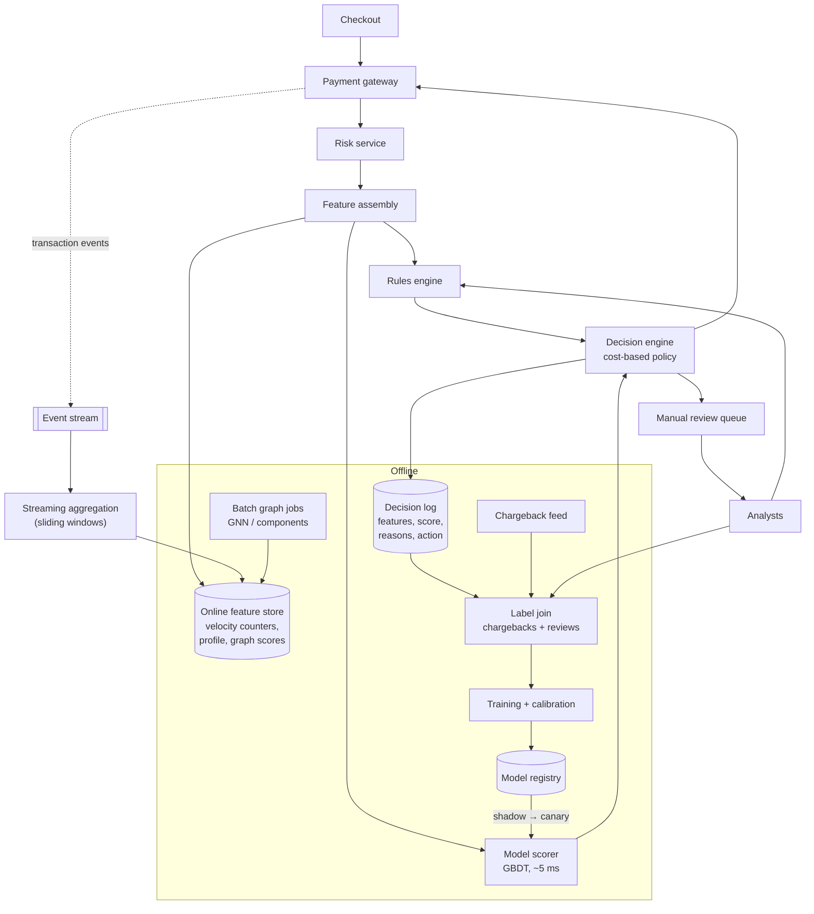

# Payment Fraud Detection System

> **Problem:** Design a real-time system that decides whether to approve, challenge, or decline each payment transaction on a large online payments platform, minimizing fraud losses without blocking legitimate customers.

Related: [Harmful Content Detection](harmful-content-detection.md) shares the adversarial, imbalanced-classification theme. Fraud adds **hard real-time latency, money-weighted costs, very delayed labels, and selection bias from its own decisions**.

---

## Table of Contents

1. [Clarifying Requirements](#1-clarifying-requirements)
2. [Framing as an ML Problem](#2-framing-as-an-ml-problem)
3. [Data Preparation](#3-data-preparation)
4. [Model Development](#4-model-development)
5. [Evaluation](#5-evaluation)
6. [Serving and System Architecture](#6-serving-and-system-architecture)
7. [Monitoring and Iteration](#7-monitoring-and-iteration)
8. [Interview Talking Points](#8-interview-talking-points)

---

## 1. Clarifying Requirements

| Question | Assumed answer |
|----------|----------------|
| What kind of fraud? | **Card-not-present** payment fraud: stolen cards used online. (Account takeover and merchant fraud are related but out of scope.) |
| Who's the customer? | A payments platform processing transactions for many merchants |
| Decisions? | **Approve**, **challenge** (step-up authentication: one-time code, 3-D Secure), **send to manual review**, **decline** |
| Scale? | ~100M transactions/day → ~1,200 TPS average, ~10K TPS at peak |
| Latency? | Decision in **< 100 ms** (p99), inside the payment authorization flow |
| Fraud rate? | ~0.1% of transactions |
| Labels? | **Chargebacks** (customer disputes), arriving **30–90 days later**, plus manual review outcomes |
| Constraints? | Explainable decisions (regulation, merchant disputes), fairness, PCI data handling |

### What makes fraud different

- **Extreme imbalance:** about 1 in 1,000 transactions is fraud.
- **Asymmetric, money-weighted costs:** missing a $2,000 fraud is far worse than missing a $5 one. A false decline loses a sale and annoys a real customer.
- **Delayed labels:** the truth arrives months later.
- **Adversarial:** fraudsters probe the system and adapt within days.
- **Selection bias:** declined transactions never get a label, so we never learn whether they were fraud.

---

## 2. Framing as an ML Problem

### Formulation

**Binary classification:** `P(fraud | transaction, history, context)`.

### From probability to decision: cost-sensitive thresholds

Don't pick one threshold on probability. Compare **expected costs**:

```
expected_fraud_loss  = P(fraud) × amount
cost_of_decline      = (1 − P(fraud)) × (margin lost + customer friction cost)
cost_of_challenge    = friction cost + P(fraud passes challenge) × amount

choose the action with the lowest expected cost
```



The same probability leads to different actions for a $5 and a $5,000 transaction. That's intended.

### Rules + ML

Real systems combine both:
- **Rules:** hard constraints and fast reactions (blocked countries, known-bad cards, "> 5 attempts in 1 minute"). Analysts can deploy a rule in minutes during an attack.
- **ML model:** captures complex patterns rules can't express.
- Rules can **override** the model (e.g. sanctions lists) or act as **features** for it.

---

## 3. Data Preparation

### Data sources

| Source | Examples |
|--------|----------|
| **Transaction** | Amount, currency, merchant, merchant category, timestamp, payment method |
| **Card / account** | Card age, issuing country, account age, past transactions, past chargebacks |
| **Device and network** | Device fingerprint, IP, IP geolocation, proxy/VPN detection, browser and OS |
| **Behavioural** | Typing speed, time on checkout page, copy-pasted card number |
| **Merchant** | Merchant fraud rate, category, age, typical ticket size |
| **Labels** | Chargebacks flagged as fraud, manual review outcomes, confirmed account-takeover reports |

### Labels: delayed and biased



| Problem | Mitigation |
|---------|------------|
| **Label delay** | Train on transactions older than ~90 days for clean labels, **plus** recent data with "early" labels (chargebacks so far, manual reviews). Weight recent data to adapt faster. |
| **Selection bias** (declined = no label) | Let a **tiny random sample** of medium-risk transactions through (control group), with loss limits, to get labels. Or use reject inference. |
| **Noisy labels** | Some chargebacks are "friendly fraud" (a real customer disputing a real purchase). Separate the dispute reason codes. |

### Feature engineering: velocity and aggregates ⭐

The most predictive features are **aggregates over entities and time windows**:

| Entity | Windows | Aggregates |
|--------|---------|------------|
| Card | 1 min, 1 h, 24 h, 30 d | # transactions, total amount, # distinct merchants, # declines |
| Device | 1 h, 24 h | # distinct cards used, # distinct accounts |
| IP | 1 h, 24 h | # transactions, # distinct cards, fraud rate |
| Email / shipping address | 7 d, 30 d | # distinct cards, # accounts |
| Merchant | 1 h, 7 d | Fraud rate, decline rate, volume spike |

Examples of strong signals:
- **Card testing:** many small transactions on a card within minutes.
- **One device, many cards:** a device that has used 15 different cards today.
- **Geo mismatch:** IP country ≠ card country ≠ shipping country.
- **Deviation from habit:** amount 10× the card's usual spend, or a first purchase in a new merchant category.

### Graph features

Fraudsters reuse infrastructure: devices, addresses, emails, IPs. Build an **entity graph**:



Graph-derived features: connected-component size, number of known-fraud nodes within 2 hops, shared-device count. A **graph neural network** can learn these automatically, but GNNs are usually computed in batch or near real time because of latency.

---

## 4. Model Development

### Model choice

| Model | Pros | Cons | Role |
|-------|------|------|------|
| Rules | Instant deployment, interpretable | Brittle, high false positives | Guardrails and fast response |
| Logistic regression | Simple, calibrated, explainable | Misses interactions | Baseline |
| **Gradient-boosted trees** (XGBoost / LightGBM) ⭐ | Best on tabular data, handles missing values and mixed types, fast inference, feature importance | Needs engineered aggregates | **Primary model** |
| Sequence model (RNN / transformer over recent transactions) | Learns behavioural patterns automatically | More complex serving | Adds an embedding feature to the GBDT |
| GNN | Captures fraud rings | Latency, complexity | Batch features (risk scores for nodes) |
| Autoencoder / isolation forest | Detects **new** patterns without labels | Many false alarms | Anomaly score as a feature; alerts for analysts |

**Recommended design:** a GBDT as the main scorer. Feed it engineered velocity features, graph risk scores (computed in batch), a sequence embedding, and an anomaly score.

### Training details

- **Class imbalance:** downsample negatives (e.g. 1:20), or use class weights. Recalibrate after downsampling, because the cost-based decision needs real probabilities.
- **Sample weights by amount:** optionally weight fraud examples by amount, so the model focuses on expensive fraud.
- **Time-based validation:** train on months 1–6 and validate on month 7. Never use random splits: they leak future fraud patterns, and fraud rings span many transactions.
- **Retraining cadence:** weekly or more often. Fraud patterns change fast.
- **Calibration:** isotonic regression on recent labeled data, because the decision layer multiplies probabilities by dollar amounts.

### Explainability

Every decline needs a **reason**, for merchants, customers, regulators, and analysts:
- SHAP values per prediction, turned into reason codes ("unusual amount for this card", "device linked to known fraud").
- Store the top reasons in the decision log.

---

## 5. Evaluation

### Offline

| Metric | Why |
|--------|-----|
| **PR-AUC** | Better than ROC-AUC under extreme imbalance |
| **Recall at a fixed false positive rate** | e.g. "catch X% of fraud while declining ≤ 0.5% of good transactions" |
| **Dollar-weighted recall** ⭐ | % of fraud **dollars** caught. Catching many small frauds while missing big ones is a bad trade. |
| **Expected cost / savings** | Simulate the decision policy: fraud losses avoided − good revenue lost − friction costs |
| **Calibration** | Required for the cost-based decision |
| **Slices** | By merchant category, country, amount bucket, new vs returning customers |

### Online

| Metric | Definition |
|--------|------------|
| **Fraud loss rate** | Fraud chargeback $ / total $ processed (basis points). Lagging by weeks. |
| **Approval rate** | % of transactions approved. Higher = less friction. |
| **False decline rate** | Good transactions declined. Estimated from the random control group and customer complaints. |
| **Challenge rate and pass rate** | Friction added; how many real customers complete the step-up |
| **Manual review rate and precision** | Analyst workload and efficiency |

**Experimentation challenges:**
- Labels take months, so online A/B results lag. Use **leading indicators** (early chargebacks, manual review results, challenge failures) for faster reads.
- **Shadow mode first:** run a new model alongside the current one, log decisions without acting, and compare offline before routing real traffic.
- Fraudsters adapt to the treatment group, so results can degrade after launch.

---

## 6. Serving and System Architecture



**Latency budget (< 100 ms):** feature fetch ~20 ms (parallel, key-value lookups), rules ~5 ms, model ~5–10 ms, decision ~2 ms, with margin for network and retries.

**Key serving points:**
- **Real-time velocity counters:** streaming jobs keep sliding-window counts per card, device and IP, updated within seconds. The current transaction must be counted too, so update counters synchronously or include it in the request.
- **Training-serving consistency:** log the exact feature values at decision time and train on those. Recomputing velocity features offline with hindsight leaks information.
- **Fail-safe defaults:** if the risk service times out, fall back to rules plus a conservative default per merchant (approve low-value transactions, challenge high-value ones). Never block the payment flow completely.
- **Feedback loop for analysts:** analysts can deploy rules immediately during an attack, and their review outcomes become training labels.

---

## 7. Monitoring and Iteration

| Signal | Why |
|--------|-----|
| Score distribution and decline-rate shifts | An attack or a broken feature shows up here first |
| Feature null and staleness rates | Velocity counter lag directly hurts detection |
| Early-label precision (reviews, challenge fails) | Leading indicator, since chargebacks lag |
| Approval rate by merchant | Catch merchants being hurt by false declines |
| Rule hit rates | Stale rules accumulate and cause false positives |

**Adversarial dynamics:**
- **Card testing attacks:** bursts of small transactions. Use velocity rules and rate limits.
- **Slow and low:** fraudsters spread attempts to stay under velocity thresholds. Use longer windows and graph features.
- **Probing the model:** fraudsters learn which amounts and merchants pass. Add randomization and don't reveal reasons to the transacting party.
- **Concept drift:** new fraud tactics. Use anomaly detection plus fast analyst rules, then retrain.

---

## 8. Interview Talking Points

### Key trade-offs

| Trade-off | Discussion |
|-----------|------------|
| Fraud loss vs false declines | Cost-based decisions with amount and customer value. False declines often cost more than fraud. |
| Challenge vs decline | Step-up authentication catches fraud with less friction than declining, but some real customers abandon |
| Rules vs ML | Rules for speed and hard constraints, ML for patterns. Retire rules regularly. |
| Fresh vs clean labels | Old data has final labels but is stale; recent data is fresh but incomplete |
| Explainability vs accuracy | GBDT + SHAP is usually enough. Deep models need more work to explain. |

### Likely follow-up questions

1. **How do you get labels for transactions you declined?** A small random control group that's approved despite risk (with loss limits), and reject inference.
2. **Why GBDT and not deep learning?** Tabular data with engineered aggregates is where GBDTs excel. They're fast, robust, and explainable. Deep models add value as feature generators (sequence embeddings).
3. **How do you react to an attack happening right now?** Analyst rules deployed in minutes, velocity limits, then a model retrain with the new labels.
4. **How do you set thresholds?** Expected-cost optimization per transaction, validated by simulation on held-out data.
5. **What if a new merchant has no history?** Category-level priors, merchant onboarding risk scoring, conservative limits at first.

### Common pitfalls to avoid

- ❌ Random train/test split (leaks future fraud patterns and fraud rings)
- ❌ Accuracy or ROC-AUC as the main metric under a 0.1% positive rate
- ❌ One probability threshold regardless of amount
- ❌ Ignoring selection bias from declined transactions
- ❌ Computing training features with information unavailable at decision time

---

## References

- [XGBoost: A Scalable Tree Boosting System, Chen & Guestrin 2016](https://arxiv.org/abs/1603.02754)
- [Inductive Representation Learning on Large Graphs (GraphSAGE), Hamilton et al. 2017](https://arxiv.org/abs/1706.02216)
- [A Unified Approach to Interpreting Model Predictions (SHAP), Lundberg & Lee 2017](https://arxiv.org/abs/1705.07874)
- [Isolation Forest, Liu et al. 2008](https://doi.org/10.1109/ICDM.2008.17)
