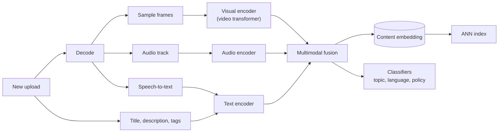
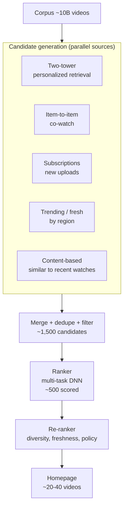
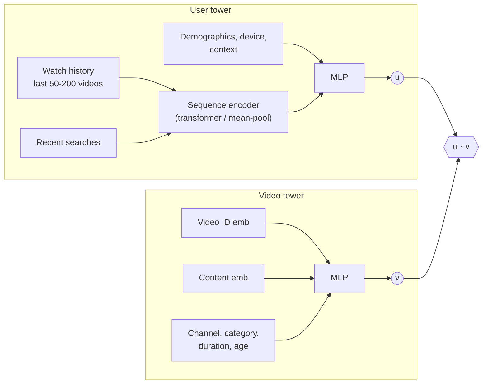
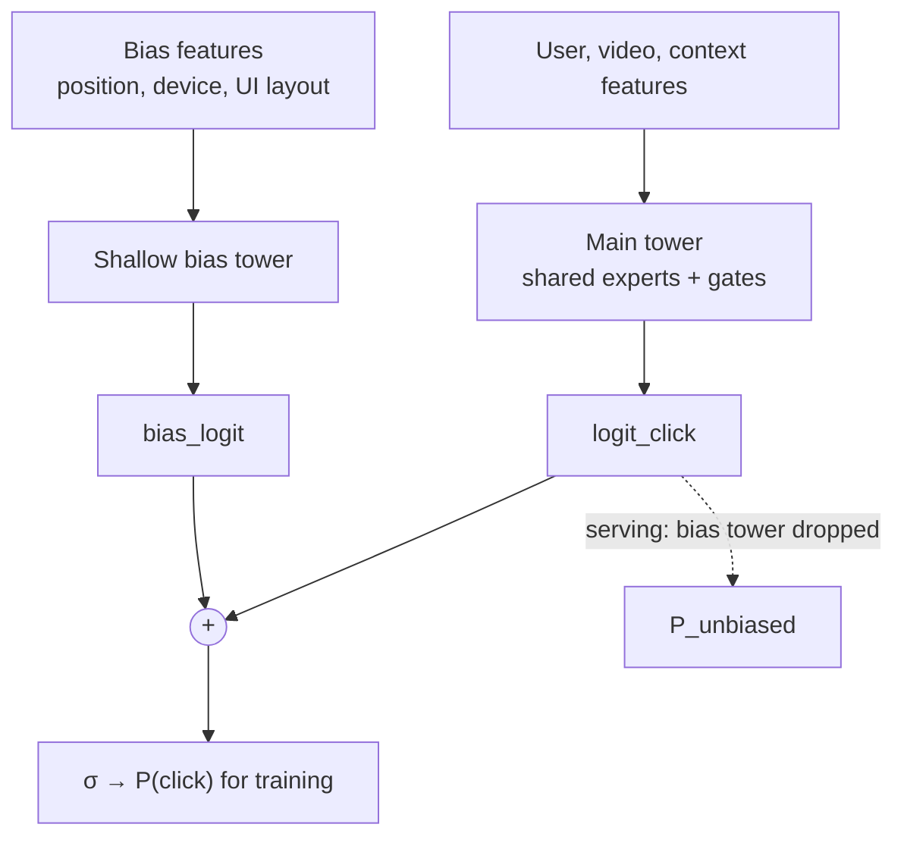
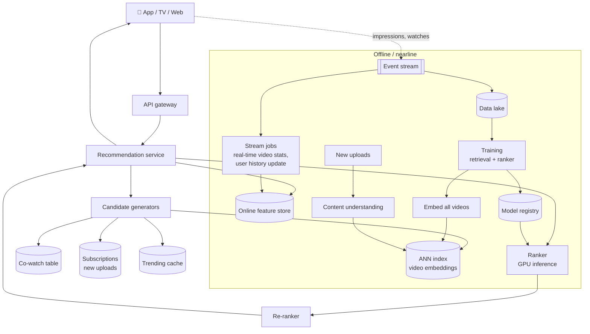

# Video Recommendation System

> **Problem:** Design the homepage recommendation system for a large video platform with billions of videos and hundreds of millions of daily users. When a user opens the app, show a personalized list of videos they're likely to watch and enjoy.

Related: [Feed Ranking System](feed-ranking.md) covers the multi-stage funnel and multi-task ranking in depth. [Improving Feed Ranking for Time Spent](feed-time-spent.md) covers watch-time labels and duration bias. This doc focuses on what's **different for video**: no social graph, a huge corpus, watch-time objectives, and content understanding.

---

## Table of Contents

1. [Clarifying Requirements](#1-clarifying-requirements)
2. [Framing as an ML Problem](#2-framing-as-an-ml-problem)
3. [Data Preparation](#3-data-preparation)
4. [Model Development](#4-model-development)
5. [Evaluation](#5-evaluation)
6. [Serving and System Architecture](#6-serving-and-system-architecture)
7. [Monitoring and Iteration](#7-monitoring-and-iteration)
8. [Interview Talking Points](#8-interview-talking-points)

---

## 1. Clarifying Requirements

| Question | Assumed answer |
|----------|----------------|
| Which surface? | **Homepage** recommendations. "Up next" and search are separate systems that share components. |
| Video types? | Long-form (minutes to hours) and short-form (< 60 s) |
| Is there a social graph? | No. Users subscribe to channels, but most consumption comes from recommendations. |
| Business objective? | Increase **satisfied watch time** and long-term retention |
| Scale? | ~10B videos in the corpus, ~500K uploads/day, ~500M DAU |
| Latency? | < 200 ms for recommendations |
| Freshness? | New uploads should be recommendable within minutes to hours |
| Constraints? | Don't recommend policy-violating or borderline content. Respect regional restrictions and age limits. |

### Back-of-the-envelope numbers

```
DAU                         = 500M
Homepage loads / user / day ≈ 4  → 2B requests/day → ~23K QPS avg, ~70K at peak
Corpus                      ≈ 10B videos  → retrieval must be sublinear (ANN)
Candidates per request      ≈ 1,000-2,000 after retrieval
Ranked per request          ≈ 500
```

---

## 2. Framing as an ML Problem

### Objective

Raw clicks reward clickbait thumbnails, and raw watch time rewards long videos. Optimize a mix:

```
score = w_click · P(click)
      + w_watch · E[watch_time | click]       ← duration-debiased
      + w_like  · P(like)
      + w_sat   · P(satisfied)                ← from post-watch surveys
      − w_neg   · P(dislike or "not interested")
```

### ML formulation

| Stage | Formulation |
|-------|-------------|
| **Candidate generation** | **Extreme multi-class classification**: "which of 10B videos will the user watch next?" Approximated with a two-tower model, sampled softmax, and ANN search. |
| **Ranking** | **Multi-task pointwise prediction** of click, watch time, like, satisfaction, dislike |
| **Re-ranking** | Rule-based and slate optimization for diversity, freshness, and policy |

### Why watch time and not clicks?

| Signal | Pros | Cons |
|--------|------|------|
| Click | Dense, immediate | Clickbait thumbnails and titles |
| Watch time | Reflects real consumption | Biased toward long videos. Noisy (autoplay, background play). |
| Completion rate | Fair across lengths | Short videos complete trivially |
| Likes / surveys | Explicit satisfaction | Sparse |

Using all of them in a multi-task model gives the best balance.

---

## 3. Data Preparation

### Data sources

| Source | Examples |
|--------|----------|
| **Watch history** | video_id, watch seconds, % completed, source surface, device, timestamp |
| **Explicit feedback** | Likes, dislikes, "not interested", subscriptions, shares, comments |
| **Search history** | Queries, which results were clicked. A strong signal of intent. |
| **Video metadata** | Title, description, tags, language, duration, upload time, channel |
| **Video content** | Frames, audio, transcripts (ASR) |
| **Impressions** | What was shown but **not** clicked. Critical for negatives. |

### Labels

| Task | Positive | Negative |
|------|----------|----------|
| Click | Clicked an impressed video | Impressed, not clicked |
| Watch time | Regression on duration-normalized watch time (see [duration bias](feed-time-spent.md#41-predict-time-per-post-properly)) | — |
| Satisfied | Watch ≥ X% **and** no dislike, or a positive survey answer | Quick abandon (< 10 s), dislike |
| Dislike / not interested | Explicit action | No action |

**Watch-time noise:** cap autoplay watch time. Down-weight background play. Treat videos abandoned within 10 seconds as negatives even though they were clicked.

### Features

| Group | Features |
|-------|----------|
| **User** | Watch history (sequence of video IDs + watch %), search queries, subscriptions, demographics, language, device, account age |
| **Video** | ID embedding, **content embeddings** (visual, audio, text), duration, age, channel, category, language |
| **Video stats** | Views, CTR, average watch %, likes/dislikes ratio over 1 h / 1 d / 7 d windows |
| **User × video** | Has the user watched this channel before? Similarity between user and video embeddings. Already watched? |
| **Context** | Time of day, device (TV → long-form; phone → short-form), network |

### Content understanding pipeline (key for cold start)



A new video has **no engagement data**, so its content embedding is the only signal available for retrieval and ranking until views accumulate.

---

## 4. Model Development

### Overall funnel



### Candidate generation

**1. Two-tower personalized retrieval** (the main source)



- **Training:** predict the next watched video from history. Use a sampled softmax with in-batch negatives and a **log-Q correction**, so popular videos aren't over-penalized for appearing as negatives more often.
- **Video ID + content embedding** in the video tower means new videos with no ID history still get sensible embeddings from content.
- **Serving:** video embeddings are indexed in ANN (HNSW or ScaNN-style quantized search). The user embedding is computed per request.
- **Label choice matters:** train on "watched ≥ 50%" positives, not clicks, to avoid learning clickbait.

**2. Item-to-item (co-watch)**

- "Users who watched A also watched B". Use a co-occurrence matrix or item2vec-style embeddings over watch sessions.
- Seed with the user's last few watched videos. Cheap, very effective, and easy to explain.

**3. Other sources:** new uploads from subscribed channels, regional trending, and content-similar videos to recent watches.

> Use **multiple sources**: each covers a blind spot of the others (personalization, freshness, subscriptions, exploration). Each source gets a quota so no single source dominates.

### Ranking model

Same structure as the [feed ranking heavy ranker](feed-ranking.md#stage-3-heavy-ranker-multi-task-dnn): embeddings, then a feature-interaction layer, then shared experts with per-task gates, then task heads. Video-specific additions:

- **Target attention over watch history:** weigh each past watch by relevance to the candidate video.
- **Duration-debiased watch-time head:** predict the watch-time quantile within a duration bucket.
- **Position and selection bias:** add a shallow **bias tower** that takes position, device and UI features. It's used in training and dropped at serving time, so the main model learns relevance, not "it was at the top".



### Re-ranking

- **Diversity:** not too many videos from the same channel or topic. Mix long-form and short-form.
- **Freshness:** boost recent uploads from subscriptions.
- **Already watched:** remove completed videos. Keep partially watched ones in a "continue watching" row.
- **Policy:** demote borderline content using classifier scores. Enforce region and age rules.
- **Exploration:** a small share of slots for new or uncertain videos (bandit-style), so new creators get a chance.

### Cold start

| Case | Approach |
|------|----------|
| **New video** | Content embedding drives retrieval. Give it a small exploration exposure. Update stats quickly with streaming counters. |
| **New user** | Popular and trending videos by region and language, onboarding topic selection, and fast adaptation from the first few watches within the session |
| **New creator** | Exploration quota and content-based retrieval. Show to their subscribers first. |

---

## 5. Evaluation

### Offline

| Stage | Metrics |
|-------|---------|
| Retrieval | **Recall@K** (K = 100–1,000) of next watched video, on time-based splits |
| Ranking | Per-task AUC and normalized entropy, watch-time error (RMSE on log), **nDCG@K** with watch-time-weighted gains |
| Calibration | Predicted vs observed rates, sliced by duration bucket and video age |
| Coverage | % of corpus recommended at least once, Gini of impressions across creators |

### Online

| Category | Metrics |
|----------|---------|
| **Primary** | Satisfied watch time per user, daily active users |
| **Engagement** | CTR, watch time, completion rate, likes per user |
| **Satisfaction** | Survey scores, dislikes, "not interested" rate |
| **Ecosystem** | New creator exposure, upload rate, catalog coverage |
| **Guardrails** | Latency, borderline-content views, regional policy compliance |

**A/B testing notes:**
- Recommendation tests need **≥ 2 weeks** because of novelty effects and weekly seasonality.
- Watch time is **highly skewed** and its variance is high. Use variance reduction (CUPED: adjusting each user's metric using their pre-experiment behaviour) to reach significance faster.
- Creator-side effects: a change can reallocate views between creators. Track creator-side metrics.

---

## 6. Serving and System Architecture



**Key serving points:**
- **ANN index updates:** new uploads are embedded and added to the index within minutes, using incremental index updates. Rebuild the full index periodically after retraining.
- **Embedding version consistency:** user and video towers must come from the **same model version**. Deploy the new index and the new user tower together, or keep both versions live during the switch.
- **User history freshness:** watch history in the feature store is updated by streaming jobs, so the next homepage load reflects what was just watched.
- **Precompute for heavy users:** generate the homepage asynchronously while the app is opening and cache it for a few minutes.
- **Fallback:** popular and regional trending videos if personalized retrieval fails.

---

## 7. Monitoring and Iteration

| Area | What to watch |
|------|---------------|
| Retrieval health | Number of candidates per source, empty-retrieval rate, ANN recall vs brute force |
| Model | Calibration by duration bucket, prediction drift, NE on live traffic |
| Content | Share of borderline content in impressions, new-video exposure, catalog concentration |
| Freshness | Delay from upload → index → first impression |
| System | Latency per stage, GPU utilization, cache hit rate |

**Failure modes:**
- **Popularity collapse:** the model keeps recommending the same viral videos. Fix with log-Q correction, exploration, and diversity constraints.
- **Rabbit holes / filter bubbles:** recommendations narrow onto one topic. Fix with topic-diversity re-ranking and satisfaction signals.
- **Clickbait drift:** creators adapt thumbnails to the model. Fix with satisfaction labels and quick-abandon negatives.
- **Stale embeddings:** an index built from an older model doesn't match the user tower. Fix with versioned deploys.

---

## 8. Interview Talking Points

### Video vs feed: what's different?

| Aspect | Social feed | Video platform |
|--------|-------------|----------------|
| Candidate source | Social graph (friends, follows) | **Whole corpus**: retrieval is the hard part |
| Main signal | Likes, comments, shares | **Watch time**, completion |
| Content understanding | Helpful | **Critical** for cold start and the huge corpus |
| Biases | Position bias | Position bias + **duration bias** + clickbait |
| Context | Phone mostly | Phone (short) vs TV (long) changes intent |

### Likely follow-up questions

1. **How do you handle a video that goes viral in an hour?** Streaming counters as features, the trending source, and frequent ranker updates or online learning.
2. **How do you stop recommending clickbait?** Train retrieval and ranking on satisfied watches. Use quick-abandon negatives and survey-based labels.
3. **How would you support short-form video in the same system?** Separate retrieval sources and duration-aware labels. Often a dedicated vertical feed with its own ranker, since swipe behaviour differs.
4. **How does the system update for a user who just watched three cooking videos?** Real-time user history in the feature store, and a sequence encoder in the user tower.
5. **Why multiple candidate sources instead of one great retrieval model?** Coverage, robustness, and freshness. Each source is cheap and catches what others miss.

### Common pitfalls to avoid

- ❌ Optimizing CTR or raw watch time only
- ❌ Forgetting cold start for the 500K daily uploads
- ❌ Ignoring duration bias
- ❌ Evaluating retrieval on in-batch negatives instead of the full corpus
- ❌ Deploying a new video embedding index without the matching user tower

---

## References

- [Sampling-Bias-Corrected Neural Modeling for Large Corpus Item Recommendations, Yi et al. 2019](https://doi.org/10.1145/3298689.3346996)
- [Deep Interest Network, Zhou et al. 2018](https://arxiv.org/abs/1706.06978)
- [Wide & Deep Learning for Recommender Systems, Cheng et al. 2016](https://arxiv.org/abs/1606.07792)
- [Item2Vec: Neural Item Embedding for Collaborative Filtering, Barkan & Koenigstein 2016](https://arxiv.org/abs/1603.04259)
- [MMoE: Modeling Task Relationships in Multi-task Learning, Ma et al. 2018](https://dl.acm.org/doi/10.1145/3219819.3220007)
