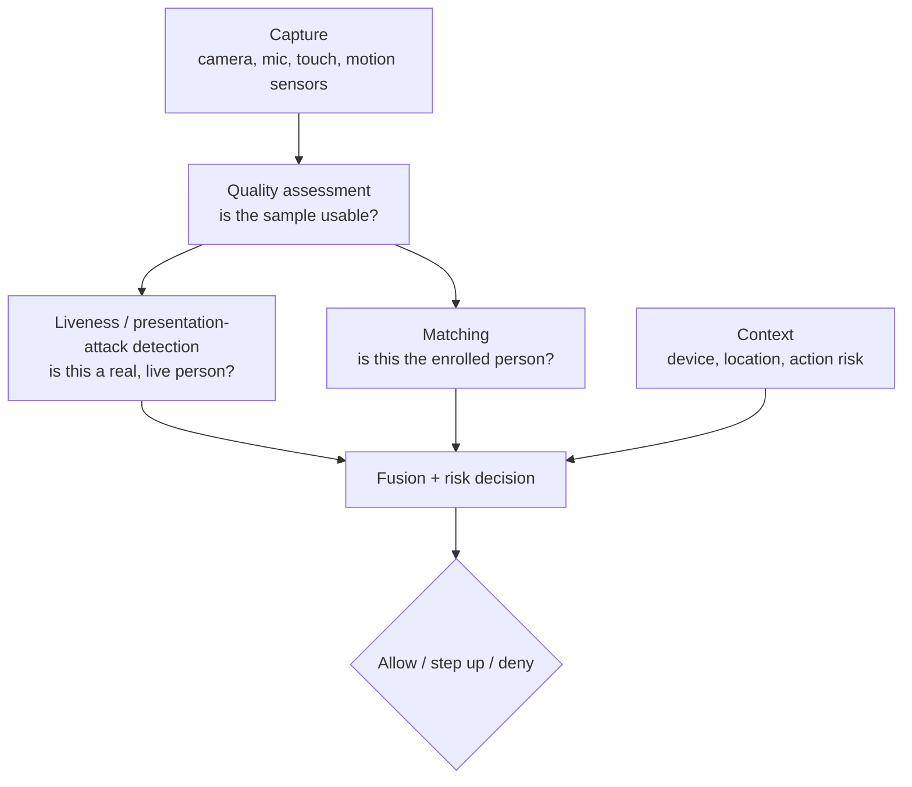
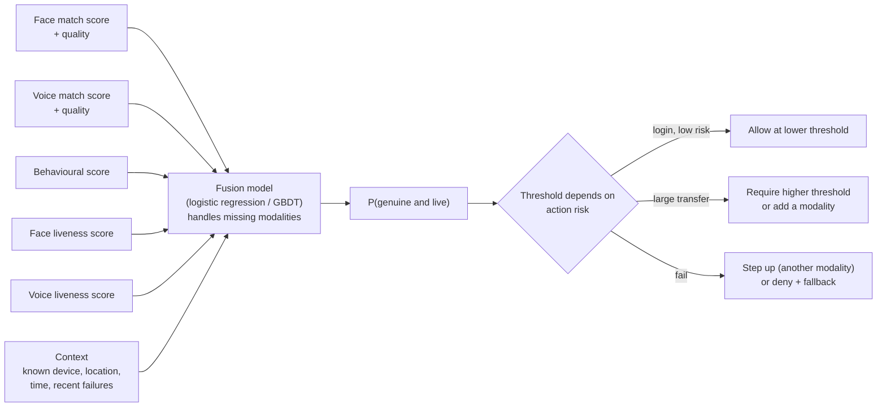
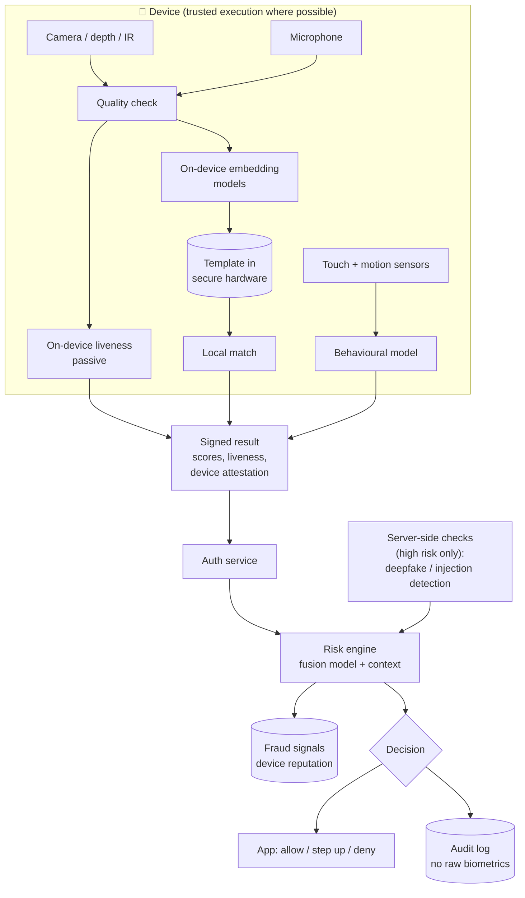
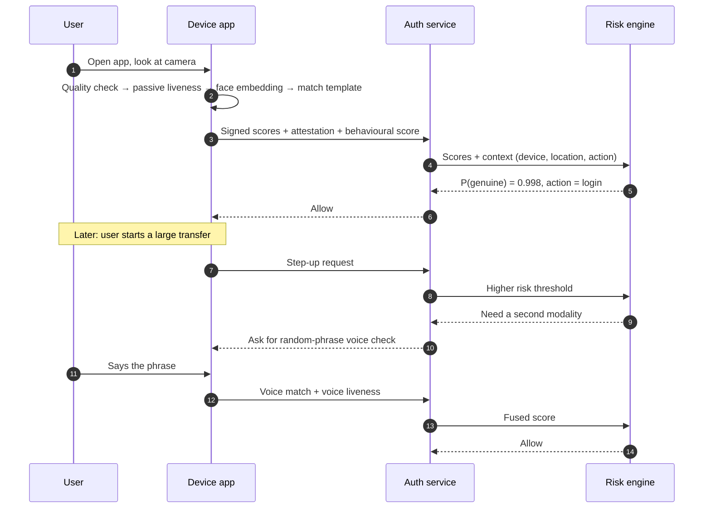

# Multimodal Perception and Authentication

> **Problem:** Design a system that authenticates users of a high-security mobile app (for example, banking) by **perceiving** them through several modalities: face, voice, and behaviour (how they type, swipe and hold the phone). It should let real users in smoothly and stop impostors, including **spoofing attacks**: printed photos, replayed videos, masks, deepfakes and synthetic voices.

---

## Table of Contents

1. [Clarifying Requirements](#1-clarifying-requirements)
2. [Framing as an ML Problem](#2-framing-as-an-ml-problem)
3. [Data Preparation](#3-data-preparation)
4. [Model Development](#4-model-development)
5. [Evaluation](#5-evaluation)
6. [Serving and System Architecture](#6-serving-and-system-architecture)
7. [Monitoring and Iteration](#7-monitoring-and-iteration)
8. [Interview Talking Points](#8-interview-talking-points)

---

## 1. Clarifying Requirements

| Question | Assumed answer |
|----------|----------------|
| Use cases? | **Login**, **step-up** before risky actions (large transfers, adding a payee), and **continuous** background checks during a session |
| Modalities? | Face (front camera, with depth or IR if the device has it), voice (a short phrase), behavioural (typing rhythm, touch dynamics, motion sensors) |
| Verification or identification? | **Verification (1:1):** "is this the enrolled user?", not "who is this?" among millions |
| Scale? | ~50M users, ~200M authentication events/day |
| Latency? | < 1 s for an active check (face or voice); behavioural checks run silently in the background |
| Security target? | False accept rate ≤ 1 in 100,000 for high-risk actions, with false reject rate ≤ 2–3% |
| Privacy? | Biometric data is highly sensitive: explicit consent, encrypted templates, never stored as raw images, deletion on request, regional regulations |
| Fairness? | Error rates must be similar across age, gender, skin tone and accent |

### Error types

| Error | Meaning | Cost |
|-------|---------|------|
| **False accept (FA)** | Impostor gets in | Account takeover, money lost. Severe. |
| **False reject (FR)** | Real user blocked | Frustration, support calls, users leave |
| **Attack accepted** (presentation attack) | A spoof (photo, mask, deepfake, replayed voice) is accepted as live | Severe, and attackers scale successful methods |

---

## 2. Framing as an ML Problem

Authentication is several ML problems combined:

| Sub-problem | ML formulation |
|-------------|----------------|
| **Quality assessment** | Regression or classification: blur, lighting, face pose, noise level. Reject bad samples and ask for a retry instead of matching them. |
| **Matching (per modality)** | **Metric learning:** an embedding model maps a sample to a vector; compare with the enrolled template using cosine similarity → match score |
| **Liveness / presentation-attack detection (PAD)** | **Binary classification:** live vs spoof, per modality |
| **Fusion and decision** | Combine scores from all modalities and context into a calibrated probability that this is the genuine user, then apply **risk-based thresholds** |

### Why verification with embeddings, not classification?

A classifier over user IDs would need retraining for every new user. An embedding model is trained once on many identities, then **enrollment** just stores the new user's embedding (template). Matching is a similarity comparison.

### Fusion levels

| Level | How | Pros | Cons |
|-------|-----|------|------|
| Feature-level | Concatenate embeddings, then one model | Captures cross-modal patterns | Needs all modalities; hard to add new ones |
| **Score-level** ✅ | Each modality outputs calibrated scores; a fusion model combines them | Modular, handles missing modalities, easy to calibrate | Misses some cross-modal interactions |
| Decision-level | Each modality votes accept or reject; combine with rules (AND / OR) | Simple, explainable | Throws away score information |

**Recommendation:** score-level fusion with a small learned model (logistic regression or GBDT) that also takes **quality scores** and **context** as inputs, so a noisy voice sample counts less than a clean face match.

---

## 3. Data Preparation

### Data needs

| Data | Use | Notes |
|------|-----|-------|
| **Face images with identity labels** (many per person) | Train face embedding model | Must be diverse in age, skin tone, lighting, pose, accessories (glasses, masks) |
| **Speech with speaker labels** | Train speaker embedding | Many languages, accents, microphones, background noise |
| **Behavioural sequences** (touch, typing, motion) with user IDs | Train behavioural embedding | Collected in-app with consent; very personal, keep on device where possible |
| **Spoof data** | Train PAD models | Printed photos, screen replays, paper and silicone masks, deepfake videos, replayed and synthesized speech |
| **Genuine vs impostor pairs** | Train and calibrate the fusion model | Impostor attempts are rare in logs; create them by pairing different users |

**Consent and governance:** collect biometric training data only with explicit consent, store it encrypted with access controls, and keep production templates separate from training data. Use licensed or purpose-collected datasets.

### Spoof data collection

Attack types evolve, so spoof data needs constant updating:
- **In-house red team** produces attacks with many devices, printers, screens and masks.
- **Generative attacks:** generate deepfake faces and synthetic voices with current open models, so detectors keep up with attackers.
- **Production signals:** confirmed fraud cases (account takeovers) are reviewed, and any spoof samples are added to training.

### Fairness balancing

Measure dataset composition by demographic group, and collect more data where groups are under-represented. Error rates must later be evaluated per group (Section 5).

---

## 4. Model Development

### 4.1 Face matching

- **Backbone:** a CNN or vision transformer trained with an **angular-margin loss** (ArcFace-style): a classification loss over training identities that forces embeddings of the same person to cluster tightly, with margins between people.
- **Output:** a 512-d normalized embedding. Match score = cosine similarity with the enrolled template.
- **Robustness:** augment with lighting, blur, pose, occlusion (masks, glasses), and aging (enroll again periodically).

### 4.2 Speaker matching

- **Model:** a speaker-embedding network (e.g. ECAPA-TDNN) over log-mel spectrograms, trained with an angular-margin loss over speakers.
- **Text-dependent vs text-independent:** a **random phrase** shown on screen ("say: blue seven river") makes replay attacks harder than a fixed passphrase.
- **Noise robustness:** augment with real noise, reverberation and different microphones.

### 4.3 Behavioural biometrics

- **Signals:** time between key presses, swipe speed and pressure, how the phone is held (gyroscope, accelerometer).
- **Model:** a sequence encoder (small transformer or GRU) producing a user embedding; or a **per-user anomaly model** comparing the session to the user's history.
- **Role:** a weak signal on its own, but **continuous and invisible**: it raises the risk score mid-session if someone else takes over the phone.

### 4.4 Liveness / presentation-attack detection ⭐

| Modality | Techniques |
|----------|------------|
| **Face (passive)** | CNN on RGB frames looking for print texture, screen moiré patterns and edges; **depth or IR** input when available (a photo is flat); auxiliary supervision with estimated depth maps |
| **Face (active)** | Challenge-response: random head turn, blink, or a **flash of random colors** on the screen whose reflection on the face is checked |
| **Deepfake / injection** | Detect generation artifacts; verify the camera feed comes from the real device camera (attackers inject video directly into the app, bypassing the camera) |
| **Voice** | Anti-spoofing classifier on spectral features (detects replay and speech synthesis); random phrases |

**Passive first, active when risky:** passive liveness has no friction. Active challenges add a few seconds and run only when risk is high or passive results are uncertain.

### 4.5 Fusion and risk decision

- **Calibration:** each modality's similarity score is mapped to a calibrated likelihood (genuine vs impostor) before fusion, so scores are comparable.
- **Liveness as a gate:** if liveness is clearly failed, deny regardless of how well the face matches. A perfect match on a spoof is still a spoof.
- **Missing modalities:** train the fusion model with modalities randomly dropped, so it works for users without voice enrollment or on devices without depth sensors.
- **Fallback:** always provide a non-biometric path (PIN + one-time code, or customer support) for users the system rejects.

### 4.6 Enrollment and template management

- **Enrollment:** capture several high-quality samples, check liveness, store the **averaged embedding** (not raw images).
- **Template protection:** encrypt templates; prefer on-device storage in secure hardware; use **cancelable templates** (a user-specific transform of the embedding) so a leaked template can be revoked and re-issued.
- **Template updates:** after confident successful authentications, slowly update the template to follow aging and appearance changes. Never update from low-confidence matches (an impostor could slowly poison the template).

---

## 5. Evaluation

### Offline

| Metric | Definition |
|--------|------------|
| **FAR / FRR** | False accept rate and false reject rate at a threshold |
| **DET curve** | FRR vs FAR across all thresholds |
| **TAR @ FAR = 10⁻⁵** ⭐ | True accept rate at the security target. The main matching metric. |
| **EER** | Rate where FAR = FRR. A quick single-number comparison. |
| **APCER / BPCER** | For liveness: attack presentations wrongly accepted as live / genuine presentations wrongly rejected. Report APCER **per attack type**. |
| **Fairness** | FAR and FRR per demographic group. Gaps above an agreed tolerance block launch. |
| **Robustness slices** | Low light, noise, older devices, glasses, masks |

**Test protocols:**
- Hold out **identities**, not just samples. The model must work on people it never saw.
- Hold out **attack types** for liveness. Testing only on known attacks overestimates protection against new ones.
- Measuring FAR = 10⁻⁵ precisely needs millions of impostor comparisons. Generate them by pairing different identities.

### Online

| Metric | Definition |
|--------|------------|
| Authentication success rate | First-attempt success for genuine users |
| Step-up and fallback rate | Friction added |
| **Account takeover rate** | Confirmed fraud through biometric authentication (lagging indicator) |
| Retry rate and time to authenticate | User experience |
| Red-team success rate | Scheduled attack campaigns against production |

---

## 6. Serving and System Architecture

**Key design choices:**
- **On-device matching:** templates and raw biometrics never leave the device in the common case, which reduces privacy risk and latency. The server receives **signed scores** plus **device attestation** (proof the result came from a genuine, untampered app on a real device).
- **Server-side checks for high risk:** for very large transfers or a new device, send an encrypted capture to the server for stronger liveness and deepfake models, then delete it.
- **Remote identity proofing at onboarding:** match a live selfie against the photo on a government ID document (with document authenticity checks), then enroll.
- **Latency:** quality check ~50 ms, liveness ~150 ms, embedding + match ~100 ms on device, plus the risk engine call ~100 ms.

### Login sequence

---

## 7. Monitoring and Iteration

| Signal | Why |
|--------|-----|
| FRR by device model, OS, region, demographic proxy | New devices or camera changes can raise rejections; fairness drift |
| Liveness failure rate and attack-type mix | New attack campaigns show up as spikes |
| Account takeover cases linked to biometric success | The real security outcome |
| Score distribution drift | Model or capture pipeline changes |
| Template update rate and poisoning checks | Templates drifting away from the original enrollment |

**Adversarial loop:** red-team new attack tools (each new generation of deepfake and voice-cloning models), add them to the test set before they appear in the wild, retrain PAD models, and ship updates.

---

## 8. Interview Talking Points

### Key trade-offs

| Trade-off | Discussion |
|-----------|------------|
| Security vs convenience | Risk-based thresholds: easy login, stricter checks for risky actions |
| Passive vs active liveness | Passive has no friction; active is stronger but slower. Escalate when needed. |
| On-device vs server | On-device is private and fast; the server can run bigger models. Use the server only for high risk. |
| More modalities vs friction | Each modality adds security and effort. Behavioural signals add security with zero friction. |
| Template updates vs poisoning | Adapting to aging vs an impostor slowly shifting the template |

### Likely follow-up questions

1. **How do you defend against deepfakes?** Liveness with depth/IR and challenges, generation-artifact detectors, camera-injection detection with device attestation, and continuous red-teaming with the newest generators.
2. **How do you make sure the system is fair across demographics?** Balanced training data, per-group FAR and FRR evaluation with launch gates, per-group calibration if needed, and monitoring after launch.
3. **What if a user's face changes (beard, aging, injury)?** Template updates from confident matches, re-enrollment, and other modalities as a fallback.
4. **Why fuse at the score level?** Modular, handles missing modalities, easy to calibrate, and each modality can be updated independently.
5. **How do you protect templates if the database leaks?** On-device storage in secure hardware, encryption, and cancelable templates that can be revoked.

### Common pitfalls to avoid

- ❌ Treating authentication as classification over user IDs
- ❌ Reporting accuracy instead of TAR at a low FAR
- ❌ Evaluating liveness only on attack types seen in training
- ❌ Letting a strong match override a failed liveness check
- ❌ Storing raw biometric images on servers
- ❌ No non-biometric fallback

---

## References

- [ArcFace: Additive Angular Margin Loss for Deep Face Recognition, Deng et al. 2018](https://arxiv.org/abs/1801.07698)
- [ECAPA-TDNN: Emphasized Channel Attention, Propagation and Aggregation in TDNN Based Speaker Verification, Desplanques et al. 2020](https://arxiv.org/abs/2005.07143)
- [ASVspoof 2019: Future Horizons in Spoofed and Fake Audio Detection, Todisco et al. 2019](https://arxiv.org/abs/1904.05441)
- [Learning Deep Models for Face Anti-Spoofing: Binary or Auxiliary Supervision, Liu et al. 2018](https://arxiv.org/abs/1803.11097)
- [FaceNet: A Unified Embedding for Face Recognition and Clustering, Schroff et al. 2015](https://arxiv.org/abs/1503.03832)
